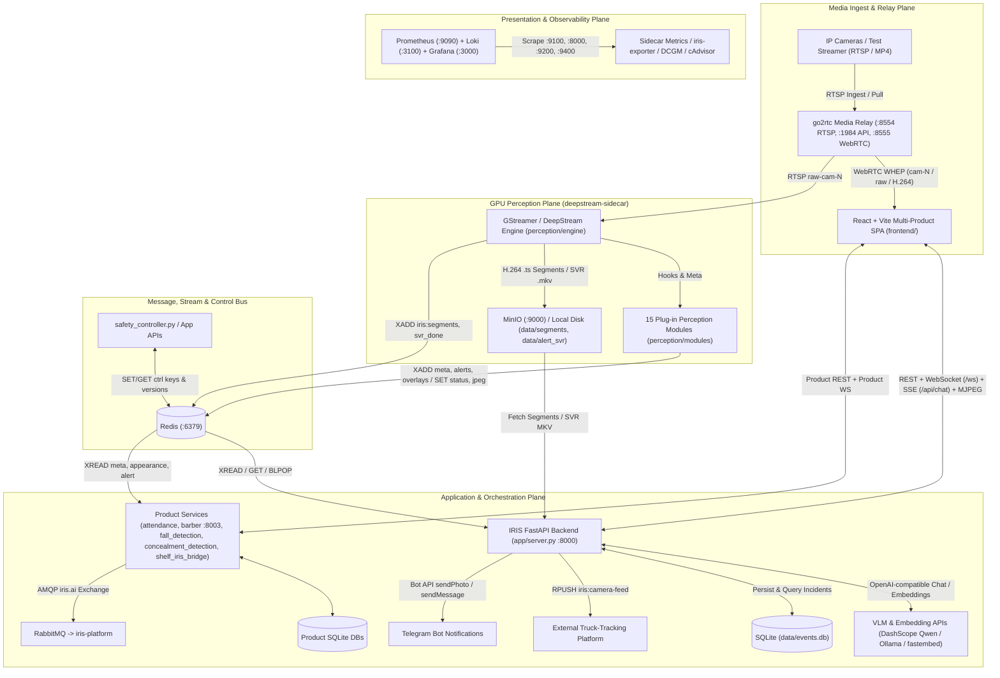
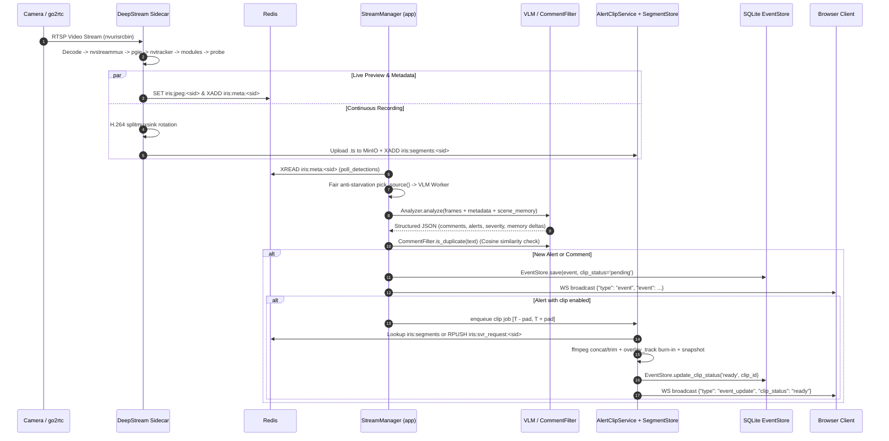
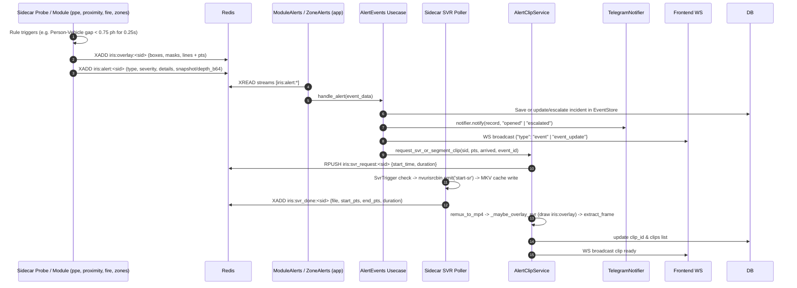
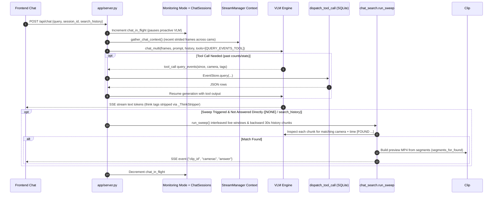
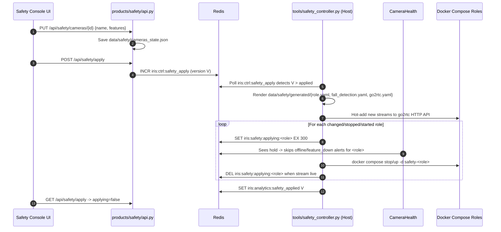
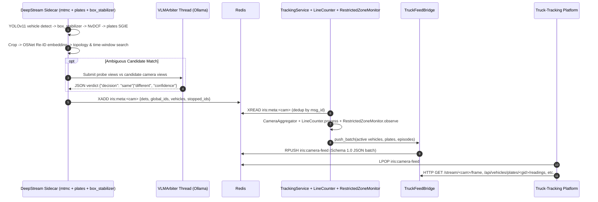

# IRIS Surveillance System — High-Level Design (HLD)

> **Scope**: System-wide architecture, core components, deployment topologies, inter-service communication contracts (Redis, HTTP/REST, WebSocket, SSE, RTSP/WebRTC, MinIO, AMQP), end-to-end sequence diagrams, and complete API design across the IRIS core platform and its product suite.

---

## 1. System Purpose & Product Portfolio

**IRIS (Intelligent Real-time Inspection & Surveillance)** is a modular, GPU-accelerated multi-camera video analytics and incident management platform. It ingests live RTSP IP camera feeds or looped video recordings, executes NVIDIA DeepStream hardware-accelerated decode, object detection, tracking, and specialized computer-vision modules, and routes real-time detections, deterministic alerts, VLM (Vision-Language Model) scene descriptions, conversational video search, and evidence clips to web consoles and external enterprise platforms.

The monorepo hosts the **core IRIS engine + web backend** alongside **purpose-built products** layered over a shared DeepStream/Redis infrastructure:

| Product / Stack | Purpose | Compute Location | State / DB | Frontend Module |
|---|---|---|---|---|
| **IRIS Core** (`app/`, `perception/`) | General surveillance, VLM proactive analysis, multi-camera conversational video search (`chat`), fire/smoke, intrusion/overcrowding, face gallery, vehicle tracking, PPE, proximity | DeepStream sidecar (`perception/engine`) + FastAPI (`app/`) | SQLite `data/events.db`, MinIO / disk segments, Redis | `frontend/src/products/iris` |
| **Site Safety** (`products/safety/`, `tools/safety_controller.py`) | Unified HSE console: per-camera toggleable Proximity, Zones, PPE, Fall, Fire, plus Camera Health monitoring and Telegram paging | Role-isolated sidecars (`safety-proximity`, `safety-zones`, `safety-ppe`, `safety-fall`, `safety-fire`) + Host `fall_detection` + IRIS `app/` | `data/events.db` + `data/safety/{cameras_state,settings,applied}.json` | `frontend/src/products/safety` |
| **Attendance & Productivity** (`products/attendance/`) | Employee clock-in/out via ArcFace face recognition, session/break calculation, desk presence, and restricted zone compliance | Sidecar (`face_detect` + `face_recognition` + `person_boxes`) + Host FastAPI service | SQLite `products/attendance/data/attendance.db` | `frontend/src/products/attendance` |
| **Barber Shop Operations** (`products/barber/`) | Multi-camera anonymous customer journey (door -> waiting area -> chair -> wash -> exit), haircut/wait SLA timing, barber roster credit, kids car occupancy | Sidecar (`appearance` uniform Re-ID + `person_masks`) + Host FastAPI service (`:8003`) | SQLite `barber.db` | `frontend/src/products/barber` |
| **Fall Detection** (`products/fall_detection/`) | Pose-based fall, lying, and immobility monitoring using YOLO-Pose 17 keypoints + MMAction2 ST-GCN (`TSSTGClassifier`) + soft noisy-OR scoring + human review queue | Sidecar (`pose` module) + Host GPU/CPU FastAPI service | SQLite review queue & events DB | `frontend/src/products/fall_detection` |
| **Concealment Detection** (`products/concealment_detection/`) | Suspected retail item concealment detection via torso-normalized kinematics, hand/bag/cart context, and per-track FSM with human verification tiers | Sidecar (`pose` + person/bag/cart PGIE) + Host FastAPI service | SQLite `candidates` & `assessments` tables | `frontend/src/products/concealment_detection` |
| **Multicam Vehicle Tracking** (`products/multicam/`, `products/el-mohandes/`, `mtmc/`) | Cross-camera vehicle Re-ID (`OSNet`/`SOLIDER`), camera-topology priors, VLM arbiter (`VLMArbiter`), Arabic license plate detection/OCR, restricted zones, gate line counting, hazard VLM analysis | Sidecar (`mtmc`, `plates`, `box_stabilizer`) + IRIS `app/` (`TrackingService`, `TruckFeedBridge`) + external `truck-tracking` UI | `data/tracking_stays.json`, `data/restricted_zones.json`, `data/line_count.json`, Redis | External `truck-tracking` platform (`iris:camera-feed`) |
| **Shelf Void Bridge** (`products/shelf_iris_bridge/`) | Empty-shelf gap detection in retail aisles forwarded to the external `iris-platform` RabbitMQ event bus | Sidecar (`shelf_void` module) + Bridge container/process | AMQP broker + IRIS alert correlation | External `iris-platform` |

---

## 2. High-Level System Architecture & Planes

IRIS cleanly separates real-time **GPU video processing** (the DeepStream sidecar containers), **control & state transport** (Redis), **video object storage** (MinIO / local disk), **application & VLM orchestration** (FastAPI `app/` and autonomous product backends), **live browser media delivery** (`go2rtc` WebRTC or annotated MJPEG), and **observability** (Prometheus, Grafana, Loki).

---

## 3. Core Components Overview

### 3.1 Media Plane (`go2rtc` & `test_streamer`)
- **`go2rtc`** (`go2rtc.yaml`): Acts as the central RTSP/WebRTC broker on ports `:8554` (RTSP), `:1984` (HTTP/WHEP API), and `:8555` (WebRTC ICE TCP/UDP).
  - Real cameras or `test_streamer/stream_recordings.py` (`ffmpeg -re -stream_loop -1 -c copy`) publish or pull to `raw-<cam>`.
  - DeepStream **always** pulls `raw-<cam>` so inference and SVR smart-recording operate on untouched camera bitstreams.
  - Browsers request derived `<cam>` streams via WebRTC WHEP (`/api/webrtc?src=<cam>`). `go2rtc` prefers zero-copy passthrough and lazily spawns CPU `libx264 -tune zerolatency` FFmpeg transcodes only if the client browser cannot decode the native codec (e.g., HEVC) and tears them down when idle.

### 3.2 Perception Plane (`perception/engine` & `perception/modules`)
- **`perception/engine/`**: Product-agnostic GStreamer + DeepStream runtime (`python3 -m perception.engine.main <config.yaml>`).
  - Decodes multiple streams (`nvurisrcbin`), optionally caps analysis branch framerate (`videorate`), batches frames (`nvstreammux`), executes primary GPU inference (`nvinfer` PGIE), tracks objects (`nvtracker` NvDCF), runs module-declared secondary GIEs (`nvinfer` SGIEs) and `nvdsanalytics`, executes module Python hooks inside `probe()`, encodes preview JPEGs (`GpuJpegEncoder` via `nvjpegenc` or CPU `cv2.imencode`), and records video via either continuous H.264 encode branches (`splitmuxsink`) or RTSP-only NVIDIA Smart Video Record (`SVR` MKV buffer).
- **`perception/modules/`**: 15 pluggable vision modules implementing domain detection, tracking, and deterministic alerting without touching `perception/engine/`:
  - `box_stabilizer`, `person_boxes`, `person_masks`
  - `zones`, `fire_alerts`
  - `face_detect`, `face_recognition`, `customer_faces`, `appearance`
  - `ppe`, `proximity`, `shelf_void`
  - `pose`, `plates`, `mtmc`

### 3.3 Application & Orchestration Plane (`app/`)
- **`app/server.py`**: FastAPI + Uvicorn entrypoint serving REST APIs, MJPEG streams, WebSocket `/ws`, SSE `/api/chat`, and static frontend bundles. Supports two mutually exclusive backends (`config.yaml` -> `camera.backend`):
  1. **`local` backend**: Threaded OpenCV `Camera` capture -> `CVEnricher` (Ultralytics YOLO) -> `Scheduler` -> `Analyzer` (VLM) -> `CommentFilter` (embedding dedup) -> `EventStore`.
  2. **`deepstream` backend**: `StreamManager` discovers streams dynamically via `iris:status:*` in Redis, polls frames/metadata via `PerceptionSource`, schedules fair VLM analysis rounds across N cameras (`pick_source`), consumes deterministic alerts (`ModuleAlerts`, `ZoneAlerts`, `CountAlerts`), coordinates incident lifecycles (`fire_incidents`, `zone_incidents`), builds evidence clips (`AlertClipService`, `SegmentStore`, `ClipBuilder`), executes multi-camera chat/sweep (`chat`, `chat_search`), tracks vehicles across cameras (`TrackingService`, `TruckFeedBridge`), and hosts optional product routers (`/api/faces`, `/api/vehicles`, `/api/hazards`, `/api/safety`, `/vlm`).

### 3.4 Storage Plane (Redis, MinIO, SQLite)
- **Redis (`:6379`)**: Real-time ephemeral bus for frame JPEGs (`iris:jpeg:<id>`), frame metadata streams (`iris:meta:<id>`), camera status hashes (`iris:status:<id>`), deterministic alerts (`iris:alert:<id>`, `iris:zone_alert:<id>`, `iris:overcrowd_alert:<id>`), overlay draw commands (`iris:overlay:<id>`), video segment indexes (`iris:segments:<id>`), Smart Video Record handshakes (`iris:svr_request:<id>`, `iris:svr_done:<id>`), control/hot-reload keys (`iris:ctrl:*`), face/appearance/MTMC feeds, and `iris:camera-feed`.
- **MinIO (`:9000`) / Local Segments Directory**: Stores H.264 MPEG-TS segments (`segments/<cam>/<ts>.ts`) with configurable lifecycle retention, alongside SVR `.mkv` clips (`data/alert_svr/`) and cut MP4 preview/alert clips (`data/clips/`, `data/alert_clips/`), depth crops (`data/alert_depth/`), and face/vehicle crops (`data/plates/`, `data/face_captures/`).
- **SQLite (`data/events.db` & Product DBs)**: Durable relational storage via `aiosqlite` (core) or `sqlite3` WAL mode (products) holding events/incidents, acknowledgments, descriptions, clip statuses, attendance sightings, barber visits/haircuts, fall/concealment review candidates.

### 3.5 Autonomous Product Services (`products/*`) & Controllers
- Host/container microservices that subscribe directly to Redis streams (`iris:meta:*`, `iris:alert:*`, `iris:appearance:*`, `iris:face_rec:*`) and manage domain state machines (`ShopEngine`/`ChairEngine`, `FallMonitor`+`TSSTGClassifier`, `ConcealmentMonitor`, `SightingCoalescer`+`DeskStateEngine`) plus external integrations (`safety_controller.py`, `shelf_iris_bridge`).

### 3.6 Presentation & Observability Plane (`frontend/`, `monitoring/`)
- **`frontend/`**: Single React/TypeScript build using `shared/Shell.tsx` to dynamically query `/api/products`, set language/RTL direction, scope hash routes (`#/iris/...`, `#/safety/...`, `#/attendance/...`, `#/barber/...`, `#/fall_detection/...`, `#/concealment_detection/...`), and render live video, zone editors, timelines, review queues, and VLM chat.
- **`monitoring/`**: Prometheus + `iris-exporter` + DCGM GPU Exporter + `node-exporter` + Promtail/Loki + Grafana dashboards + `alerts.scale.yml` for backpressure and pipeline health monitoring.

---

## 4. Deployment Topologies

IRIS supports four main deployment patterns defined in `docker-compose.yml` and `products/safety/`:

1. **Single-Process Monolithic (`deepstream` default)**: One `deepstream-sidecar` container runs all enabled modules for all cameras, paired with `redis`, `go2rtc`, `minio`, and `iris`.
2. **Sharded Horizontal Scaling (`--profile shards`)**: Cameras are partitioned deterministically by `shard_index = hash_or_idx % total_shards` across `deepstream-sidecar` (shard 0), `deepstream-sidecar-1` (shard 1), `deepstream-sidecar-2` (shard 2) sharing one GPU.
3. **Role-Isolated Pipelines (`--profile roles` / `products/safety/`)**: One sidecar container per heavy model/feature (`safety-proximity`, `safety-zones`, `safety-ppe`, `safety-fall`, `safety-fire`).
   - Uses **`role_scoped_keys: true`**, scoping every per-camera Redis key as `<camera>@<role>` (e.g., `iris:meta:bay-a@ppe`, `iris:alert:bay-a@ppe`).
   - Allows multiple independent detectors (different resolution, tracker tuning, frame cadence) to run simultaneously on the same camera without overwriting `iris:status:*` or mixing frame streams.
   - Orchestrated at runtime from the UI via `tools/safety_controller.py` watching `iris:ctrl:safety_apply`.
4. **Local CPU/OpenCV Mode (`camera.backend: local`)**: Runs `app/` standalone with OpenCV `Camera`, optional `ultralytics` `CVEnricher`, and `Scheduler`, with zero DeepStream/Redis/MinIO dependency.

---

## 5. Inter-Service Communication Contracts

### 5.1 Redis Key & Stream Contract

| Key / Stream Pattern | Type | Producer -> Consumer | Payload / Semantics |
|---|---|---|---|
| `iris:status:<sid>` | String (JSON) | Sidecar `status.py` -> `StreamManager`, `CameraHealth`, `app/` | `{"running": bool, "is_file": bool, "source": str, "boot_id": str, "preview_uri"?: str, "preview_mode": "pipeline" \| "raw", "error"?: str}` |
| `iris:jpeg:<sid>` | String (bytes) | Sidecar `_FramePublisher` -> `PerceptionSource`, MJPEG `/stream/{id}`, Telegram | Latest annotated/clean JPEG frame for stream `<sid>` (if `pipeline_preview: true` and `ViewerGate` allows) |
| `iris:watched:<sid>` | String (TTL 5s) | `app/` (`/stream/{id}`, `/frame`) -> Sidecar `ViewerGate` | Refreshed on viewer pull when `viewer_gated_preview: true` to skip idle JPEG encoding |
| `iris:meta:<sid>` | Stream (maxlen ~64-500) | Sidecar `_FramePublisher` -> `PerceptionSource`, `TrackingService`, `fall_detection`, `concealment_detection`, `attendance`, `barber` | `{ts, frame, pts, arrived, jpeg?, dets: [[label, conf, oid, l, t, w, h, ...]], mask?, person_boxes?, person_masks?, pose?, global_ids?, vehicles?, stopped_ids?}` |
| `iris:alert:<sid>` | Stream (maxlen ~500) | Sidecar modules (`fire`, `ppe`, `proximity`, `shelf_void`), `fall_detection`, `concealment_detection` -> `ModuleAlerts`, `shelf_iris_bridge` | `{type, severity, category, message, label, count, pts, arrived, ts, details (JSON), snapshot_b64?, depth_b64?}` |
| `iris:zone_alert:<sid>` | Stream | `zones` module -> `ZoneAlerts` | Zone intrusion & `intrusion_cleared` payloads `{zone_id, zone_name, object_id, kind, pts, ts, label}` |
| `iris:overcrowd_alert:<sid>` | Stream | `zones` module -> `CountAlerts` | Overcrowding & `overcrowding_resolved` payloads `{zone_id, zone_name, count, threshold, pts, ts}` |
| `iris:overlay:<sid>` | Stream (`OVERLAY_MAXLEN`) | `proximity` & `overlay_boxes` (`ppe`, `pose`, `fire`, `zones`) -> `AlertClipService` (`overlay_track.py`) | `{module, pts, at, w, h, shapes (JSON boxes/masks/lines)}` |
| `iris:segments:<sid>` | Stream | Sidecar `recording.py` -> `SegmentStore` | `{object, bucket, start_wall, end_wall, start_pts, end_pts, duration, storage}` |
| `iris:svr_request:<sid>` | List / Pub/Queue | `AlertClipService`, `fall_detection`, `concealment_detection` -> Sidecar `svr.py` | JSON `{start_time, duration, reason}` triggering DeepStream `start-sr` action signal |
| `iris:svr_done:<sid>` | Stream | Sidecar `svr.py` -> `AlertClipService` | `{file, start_wall, end_wall, start_pts, end_pts, duration}` matching SVR completion |
| `iris:ctrl:pipeline` / `iris:ctrl:zones_version` / `iris:ctrl:proximity_version` / `iris:ctrl:ppe_version` / `iris:ctrl:proximity_preview` / `iris:ctrl:safety_apply` | String | `app/` -> Sidecar `ControlPoller` & `safety_controller.py` | Command/version bump keys polled every 1s |
| `iris:zones:applied` / `iris:proximity:applied` / `iris:ppe:applied` / `iris:analytics:safety_applied` | String | Sidecar `VersionedConfig` / `safety_controller` -> `app/` & UI | Applied config version acknowledgement (warns UI if `applied < version`) |
| `iris:face:gallery` | Hash | `app/face_recognition.py` -> `FaceRecognizer` | `face_id -> {name, embeddings: [[512 floats]], photo_path}` |
| `iris:face_rec:<sid>` | Stream | `face_recognition` module -> `attendance` (`RecognitionStreamReader`), `app/` | Recognized/locked face tracks per frame `{ts, pts, results: [{object_id, face_id, name, score, ...}]}` |
| `iris:appearance:<sid>` | Stream | `appearance` module -> `barber` (`AppearanceStreamReader`) | Staff uniform classifier `staff_p`, Re-ID crops & embeddings |
| `iris:customer_face:<sid>` | Stream | `customer_faces` module -> `barber` (`FaceCandidateReader`) | Quality-gated customer face crops & embeddings |
| `iris:mtmc:*` / `iris:vehicle:crops` / `iris:camera-feed` | Hashes / Lists / Streams | `mtmc` module, `TrackingService`, `TruckFeedBridge` -> `app/`, `vehicle_gallery.py`, `truck-tracking` platform | Cross-camera global vehicle IDs, cropped vehicle/plate paths, and Schema 1.0 live truck-tracking batches (`RPUSH iris:camera-feed`) |
| `iris:count:totals:<cam>` / `iris:count:recent:<cam>` | Hash / List (cap 50) | `LineCounter` -> `/api/count/{cam_id}` | Directional vehicle crossing counters (`enter`, `exit`) and recent crossings |
| `iris:safety:applying:<role>` | String (TTL hold) | `safety_controller.py` -> `CameraHealth` | Suppresses false `offline` / `feature_down` incidents while a role container restarts |

### 5.2 External System Integrations

| External System | Protocol | Direction | Purpose |
|---|---|---|---|
| **IP Cameras / RTSP Sources** | RTSP / RTP (optional RTCP Sender Reports) | Cameras -> `go2rtc` / Sidecar | Live H.264/H.265 video + wall clock (`rtcp_camera_clock`) |
| **VLM Providers** (DashScope Qwen / Ollama / llama-server) | HTTP OpenAI-compatible (`/chat/completions`, `/embeddings`) | `app/` & `mtmc/vlm_arbiter.py` -> VLM Server | Proactive scene captions/alerts, alert clip narration, multi-cam chat & sweep, hazard inspection, ambiguous MTMC truck verification |
| **MinIO / S3** | HTTP S3 API | Sidecar -> MinIO -> `app/` | Durable H.264 MPEG-TS recording segment storage and retrieval |
| **Truck-Tracking Platform** | Redis List `iris:camera-feed` + HTTP pull (`/stream/<cam>/frame`, `/api/vehicles/*`, `/api/hazards/*`, `/api/tracking/*`, `/api/streams/<cam>/*`) | Bidirectional (`app/` <-> Truck Platform) | Live fleet location/plate sightings, facility map overlays, restricted-area dwell alerts, VLM HSE hazard audits |
| **iris-platform** | AMQP 0-9-1 (`pika`, exchange `iris.ai`, persistent JSON, publisher confirms) | `products/shelf_iris_bridge` <-> RabbitMQ | Consumes `catalog.sync`, `pipeline.upsert`, `pipeline.remove`; publishes `catalog.snapshot`, `state.sync.request`, `pipeline.status`, `event.raised`, `event.cleared` |
| **Telegram Bot API** | HTTPS REST (`sendPhoto` multipart / `sendMessage` / `getUpdates`) | `products/safety/notifier.py` -> `api.telegram.org` | Incident open/escalation alerts with live camera JPEG snapshot |

---

## 6. End-to-End Sequence Diagrams

### 6.1 Live Frame Processing, Proactive VLM Analysis & Alert Clip Resolution

### 6.2 Deterministic Module Alert & Smart Video Record (SVR) Flow

### 6.3 Multi-Camera Conversational Video Chat & Temporal Backward Sweep (`POST /api/chat`)

### 6.4 Site Safety Dynamic Role Reconfiguration (`safety_controller.py`)

### 6.5 Multi-Camera Vehicle Tracking (`mtmc`) & External Truck-Tracking Sync

---

## 7. Complete API Design

### 7.1 Core IRIS Backend (`app/server.py`, `:8000`)

#### Live Streams & Legacy Camera Control
| Method & Path | Query / Body | Response / Purpose |
|---|---|---|
| `GET /stream` | — | MJPEG stream (`multipart/x-mixed-replace`) for `local` camera backend |
| `GET /stream/{source_id}` | — | MJPEG stream for DeepStream stream `<source_id>`; touches `iris:watched:{source_id}` |
| `GET /stream/{source_id}/frame` | — | Latest single JPEG frame (`image/jpeg`); touches `iris:watched:{source_id}` |
| `GET /api/cameras` | — | Multi-stream status (`cameras[]`, `pipeline`, `zones` sync versions) in DS mode; `{current, ...}` in local mode |
| `POST /api/camera/start`, `/stop`, `/pause`, `/resume` | — | Lifecycle control of the single OpenCV `Camera` (local backend) |
| `GET /api/camera/status`, `/api/camera/time` | — | Local camera state and playback offset (`seconds`) |
| `POST /api/camera/use-camera` | — | Switch local source back to live webcam/RTSP |
| `POST /api/camera/switch/{index}` | — | Switch local source index across `camera.sources` |
| `POST /api/streams/start`, `/stop` | — | Set `iris:ctrl:pipeline` to `playing` or `paused` for DeepStream sidecar |
| `POST /api/upload-video` | Multipart `file` | Upload MP4/video to `data/uploads/` and enqueue in local or DS pipeline |

#### Zones, Proximity & Analytics Configuration
| Method & Path | Query / Body | Response / Purpose |
|---|---|---|
| `GET /api/detection-classes` | — | Returns available detection classes from PGIE labels |
| `GET /api/proximity/preview` | — | Read `iris:ctrl:proximity_preview` JSON (`enabled`, `clip_style`, `depth_map`) |
| `POST /api/proximity/preview` | `{...}` | Update proximity live/clip visual settings in Redis |
| `GET /api/streams/{stream_id}/zones` | — | Get zones (normalized `0..1` & mux pixels) for camera/stream; resolves safety blocks (`ppe`, `fall`, `fire`, `proximity`, `intrusion`, `overcrowding`) |
| `POST /api/streams/{stream_id}/zones` | `{zones: [...]}` | Validate geometry, save `data/zones_config.txt`, regenerate `nvdsanalytics` INI, bump `iris:ctrl:zones_version` / `proximity_version` / `ppe_version` |
| `GET /api/streams/{stream_id}/filter-zones` | — | Get occlusion/ignore filter zones for `<stream_id>` |
| `POST /api/streams/{stream_id}/filter-zones` | `{zones: [...]}` | Persist filter zones and bump config reload version |
| `GET /api/streams/{stream_id}/restricted-zones` | — | Get vehicle dwell restricted polygons (`threshold_s`) |
| `POST /api/streams/{stream_id}/restricted-zones` | `{zones: [...]}` | Save `data/restricted_zones.json` for `RestrictedZoneMonitor` |
| `GET /api/streams/{stream_id}/memory` | — | Inspect live `SceneMemory` situations/areas for stream |

#### Events, Clips & Conversational Chat
| Method & Path | Query / Body | Response / Purpose |
|---|---|---|
| `GET /api/events` | `limit`, `camera`, `event_type`, `severity`, `category`, `since`, `tag` | Query SQLite `EventStore` history |
| `POST /api/events/{event_id}/acknowledge` | — | Stamp `acknowledged_at` in SQLite and broadcast `event_update` over `/ws` |
| `DELETE /api/events` | — | Clear stored events and broadcast `{"type": "cleared"}` |
| `DELETE /api/events/tag/{tag}` | — | Delete events matching tag (e.g., reset test incidents) |
| `POST /api/chat` | `{query, session_id?, search_history?, cameras?}` | SSE stream (`text/event-stream`): tokens, tool statuses, and optional sweep result clip |
| `DELETE /api/chat/session/{session_id}` | — | Evict conversation session memory |
| `GET /api/chat/clip/{clip_id}` | — | Clip metadata `{cameras, meta}` |
| `GET /api/chat/clip/{clip_id}/{camera}` | — | Download/stream generated MP4 clip (`video/mp4`) |
| `GET /api/alerts/clip/{clip_id}` | — | Alert clip metadata |
| `GET /api/alerts/clip/{clip_id}/{camera}` | — | Serve alert evidence MP4 clip (`video/mp4`) |
| `GET /api/alerts/snapshot/{clip_id}/{camera}/{event_id}` | — | Serve annotated still JPEG extracted at peak/fire moment |
| `GET /api/alerts/depth/{event_id}` | — | Serve proximity depth map crop JPEG (`data/alert_depth/`) |

#### Personas, Mode, Counting, Tracking & Platform Misc
| Method & Path | Body / Params | Purpose |
|---|---|---|
| `GET /api/products` | — | Enabled product IDs for `frontend/src/shared/Shell.tsx` |
| `GET /api/config`, `GET /api/debug/frame` | — | Active UI configuration & debug JPEG frame |
| `GET /api/prompt`, `POST /api/prompt` | `{prompt}` | Read/update active custom VLM system prompt |
| `GET /api/personas`, `POST /api/persona/{persona_id}` | — | Switch VLM analysis persona preset |
| `GET /api/language`, `POST /api/language` | `{language}` | Switch VLM output language (`en` / `ar`) |
| `GET /api/mode`, `POST /api/mode` | `{mode}` | Switch `proactive` vs `chat` monitoring mode |
| `GET /api/count/{cam_id}`, `PUT .../line`, `DELETE .../line`, `POST .../reset` | `{a, b, enter_positive}` | Read/configure/reset `LineCounter` gate crossing line |
| `GET /api/tracking/{tracks,transitions,stats,cameras,config}`, `GET /api/vehicles/{gid}/sightings` | `cam_id`, `state`, etc. | Query MTMC `TrackingService` state, global tracks, transitions, per-camera active feeds, and vehicle timelines |
| `GET /api/map`, `POST /api/map` | JSON facility layout | Read/save facility floorplan + camera placement metadata |
| `GET /metrics` | — | Prometheus text exposition metrics from `app` |
| `WS /ws` | Text `ping` -> `pong` | Bidirectional WebSocket pushing `history`, `event`, `event_update`, `status`, `mode`, `cleared`, `error` |

### 7.2 Mounted Core Sub-Routers (`app/`)

- **Face Recognition (`/api/faces/*`, `app/face_recognition.py`)**:
  - `GET /api/faces` (list gallery), `POST /api/faces/register` (multipart photo -> `buffalo_l` 512-d embedding -> Redis hash), `GET /api/faces/{face_id}/image`, `DELETE /api/faces/{face_id}`, `POST /api/faces/{face_id}/images` (append multi-angle embedding).
  - `GET /api/faces/recognition/{source_id}` & `/history`: Live recognized faces per stream.
  - `GET /api/faces/captures`, `GET .../captures/{id}/image`, `POST .../captures/{id}/assign`, `DELETE .../captures/{id}`: Unrecognized CCTV capture triage & enrollment.
- **Vehicle & Plate Gallery (`/api/vehicles/*`, `app/vehicle_gallery.py`)**:
  - `GET /api/vehicles/crops`, `GET /api/vehicles/crops/{cam_id}/{global_id}/image`, `GET /api/vehicles/plates/{global_id}/readings`, `GET /api/vehicles/plates/{global_id}/image`, `GET /api/vehicles/plates/{global_id}/{cam_id}/image`.
- **HSE Hazards VLM Audit (`/api/hazards/*`, `app/hazards_api.py`)**:
  - `GET /api/hazards/status`, `POST /api/hazards/analyze` (multipart image or `{cam_id}` frame grab -> Qwen VLM bbox + optional Arabic translation), `GET /api/hazards/history`, `GET /api/hazards/history/{item_id}`.
- **MTMC VLM Arbitration Live Inspector (`/vlm`, `app/vlm_live.py`)**:
  - `GET /vlm`, `GET /api/vlm/log`, `GET /api/vlm/image/{name}`.

### 7.3 Product APIs (`products/*`)

- **Site Safety Router (`products/safety/api.py`, mounted on `app/` at `/api/safety/*`)**:
  - `GET/PUT /api/safety/settings` (per-feature `ack_required`, `notify`, `min_severity`; Telegram settings; language)
  - `GET /api/safety/cameras`, `PUT /api/safety/cameras/{camera_id}` (rename + toggle features), `GET .../snapshot` (go2rtc raw still cached 1.5s)
  - `POST/GET /api/safety/apply` (trigger & poll `safety_controller.py` apply version)
  - `GET /api/safety/unacknowledged`
  - `GET /api/safety/fall/candidates`, `POST /api/safety/fall/review/{row_id}` (same-origin proxy to `SAFETY_FALL_URL`)
  - `POST /api/safety/telegram/test`, `GET /api/safety/telegram/chats`
- **Attendance Service (`products/attendance/server.py`)**:
  - `GET /api/employees`, `GET/POST /api/admin/employees`, `PATCH/DELETE /api/admin/employees/{id}`, `POST .../photos`, `PATCH /api/employees/{id}/leave`, `GET .../history`, `GET .../photo`
  - `GET /api/monitoring`, `DELETE /api/monitoring/violations`, `GET/PUT /api/monitoring/policy`, `GET /api/monitoring/zones`, `PUT .../zones/{cam_id}`
  - `GET/PUT /api/attendance/policy`, `GET /api/attendance`, `GET /api/time`, `GET /api/recordings`, `GET /media/{cam_id}.mp4`, `WS /ws`
- **Barber Operations Service (`products/barber/server.py`, `:8003`)**:
  - `GET /api/time`, `GET /api/barber/cameras`, `GET /api/barber/logo`
  - `GET/POST /api/staff`, `PATCH/DELETE /api/staff/{id}`
  - `GET /api/barber/roster`, `GET/POST /api/barber/roster/confirmation`, `PUT /api/barber/roster/{chair_id}`
  - `GET /api/monitoring/zones`, `PUT .../zones/{cam_id}`, `GET .../zones/problems`
  - `GET/PUT /api/barber/policy`, `GET/PUT/DELETE /api/barber/kids-car`
  - `GET /api/barber/live`, `GET /api/barber/stats`, `GET /api/barber/handoffs`, `GET /api/barber/bindings`, `GET /api/barber/alerts`, `GET /api/barber/alerts/{id}/snapshot`, `GET /api/barber/customers`, `GET/DELETE .../customers/{id}`, `GET /api/barber/crops/{kind}/{row_id}`, `GET /api/barber/resume-checks`
  - `GET /api/barber/report`, `GET .../report/photos`, `GET .../report/photos/allowed`, `GET .../reports/saved`, `GET .../reports/saved/file`, `WS /ws`
- **Fall Detection Service (`products/fall_detection/server.py`)**:
  - `GET /status`, `GET /cameras`, `GET /candidates`, `GET /events`, `POST /review/{row_id}`
- **Concealment Detection Service (`products/concealment_detection/server.py`)**:
  - `GET /status`, `GET /healthz`, `GET /cameras`, `GET /candidates`, `GET /candidates/{id}`, `POST /review/{id}`, `GET /assessments`

### 7.4 WebSocket (`/ws`) & Chat SSE Contracts
- **Core `/ws` Server -> Client JSON messages**:
  - `{"type": "history", "events": [...], "mode": "proactive"|"chat"}`
  - `{"type": "event", "event": <EventRecord>}`
  - `{"type": "event_update", ...}` — incremental partial patches carrying either full `event`, `clip_status`/`clip_id`/`clips`, `clips`, `incident_status`, `acknowledged_at`, or `description_status`/`description` (consumers patch rather than replace wholesale).
  - `{"type": "status", "status": ...}`, `{"type": "mode", "mode": ...}`, `{"type": "cleared"}`, `{"type": "error", ...}`.
- **Chat `POST /api/chat` SSE frames**: Text delta events followed by final structured metadata (`session_id`, `clip_id`, `cameras`, `timing`) when sweep or context retrieval completes.

---

## 8. Cross-Cutting Architectural Invariants

1. **Engine / Module Strict Isolation**: `perception/engine/` never imports from `perception/modules/`, `app/`, or `products/`. Enforced by `tests/test_engine_boundary.py`.
2. **Product Autonomy**: Product services (`attendance`, `barber`, `fall_detection`, `concealment_detection`, `shelf_iris_bridge`) run independent processes/venvs and interact with IRIS solely through Redis streams or HTTP contracts.
3. **Configuration Single Source of Truth**: `app/sidecar_config.py` resolves the exact same `SIDECAR_CONFIG` (with `extends:` inheritance and `role_scoped_keys` merging) that the DeepStream sidecar container loads, eliminating resolution/camera-index drift for zones and `nvdsanalytics`.
4. **Severity & Review Safety**: Model-supplied alert severities are clamped downward (`normalise_severity` never invents `"critical"`). Low-confidence or ambiguous product detections (`fall_detection`, `concealment_detection`, `proximity` depth holds) route to human review queues rather than raising unverified critical alarms.
5. **Startup Verification**: Sidecars and model-bearing product services run `model_manifest.verify()` (`perception/engine/model_manifest.py`) at boot, refusing startup if any ONNX, label file, or Re-ID weight differs by SHA-256 from the committed `models.manifest.json`.
