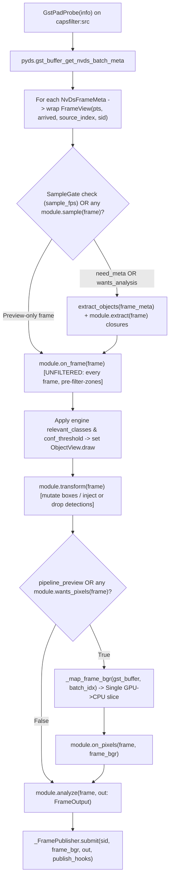

# IRIS Surveillance System — Low-Level Design (LLD)

> **Scope**: Detailed implementation mechanics, algorithms, mathematical formulations, exact data structures, function call chains, concurrency models, and fault-recovery guards inside `perception/engine/`, `perception/modules/`, `products/*`, and `app/`.

---

## 1. DeepStream Perception Engine (`perception/engine/`)

### 1.1 Main GStreamer Probe Call Chain (`perception/engine/probe.py`)
The central frame callback `probe(pad, info, ctx: ProbeCtx)` runs on the GStreamer streaming thread downstream of `nvvideoconvert ! capsfilter` (`RGBA`, `CUDA_UNIFIED` / host-accessible NVMM):

- **Lazy Extraction (`FrameView` & `extract_objects`)**: `perception/engine/objects.py` walks `frame_meta.obj_meta_list` once and constructs `ObjectView(id, label, conf, left, top, width, height, gie_name, detected, parent_id, raw=obj_meta)`. Module `extract(frame)` hooks return a per-object closure `read(obj_view)` that pulls custom `pyds` data (such as `nvds.analytics_roi` or `nvds.instance_mask`) into `obj_view.attrs`, keeping `pyds` pointers confined to that single pass.
- **`FrameOutput` Structure**: Holds `annotations: list[Annotation]` (sorted ascending by integer `layer` before drawing so lower layers never paint over labels/lines), `fields: dict` (merged into `iris:meta:<sid>` JSON), `draw: list[Callable]` (custom OpenCV painters on BGR), and `after_publish: list[Callable]`.

### 1.2 Asynchronous Frame Publisher & Shedding Queue (`perception/engine/publisher.py`)
To avoid blocking the GStreamer streaming thread on CPU/GPU drawing, JPEG encoding, and Redis I/O:
- `_FramePublisher` maintains per-stream bounded worker queues (`deque(maxlen=8)`) with one daemon worker thread per stream (`frame-publisher-<sid>`), plus a dedicated metadata-only fallback queue `_meta_q`.
- **Queue Saturation / Graceful Shedding**: When a camera's main encode queue reaches `max_pending=8`, the newest job does not discard detections. Instead, its metadata dictionary (`fields`, `pts`, `arrived`, `dets`) is diverted onto `_meta_q` while drawing/JPEG compression is skipped (tracked via `pub_shed_total_<sid>`). Only if `_meta_q` itself overflows is metadata dropped (`pub_drops_total_<sid>`, alerting `DetectionDataLost`).
- **Pooled GPU JPEG Encoding (`perception/engine/jpeg_encoder.py`)**:
  - `GpuJpegEncoder` builds a private GStreamer pipeline (`appsrc -> nvvideoconvert -> nvjpegenc -> appsink`) on a dedicated GLib `MainLoop` thread.
  - Because `nvjpegenc` holds a synchronous mutex for ~6 ms per frame (~150 fps ceiling per encoder), `SidecarConfig.jpeg_encoders` spins a pool of $K$ encoders sharded across cameras by index.
  - If `nvjpegenc` fails or stalls, the publisher transparently falls back to `cv2.imencode('.jpg', bgr, [IMWRITE_JPEG_QUALITY, q])`.
- **`ViewerGate` (`sources.py`)**: When `viewer_gated_preview: true`, before drawing/encoding JPEGs the worker checks Redis `EXISTS iris:watched:<sid>` (refreshed with 5s TTL by `app/` `/stream/{id}` endpoints), eliminating preview CPU/GPU cost for unwatched streams.

### 1.3 Selective GIE Execution (`perception/engine/gie_gate.py`)
DeepStream `nvinfer` secondary GIEs normally infer on *every* frame and *every* primary object. `GieGate` avoids redundant inference:
- **`HIDE_OFFSET = 1000`**:
  - Attached as Gst pad probe on an SGIE's **sink** pad (`_sink_probe`) and **src** pad (`_src_probe`).
  - Before the SGIE runs (`sink`), any `NvDsObjectMeta` whose parent class, object ID, or `SampleGate` frame cadence does not qualify has its `obj_meta.unique_component_id += 1000`. Because `nvinfer` filters inputs by `operate-on-gie-id`, it completely skips the hidden objects.
  - Immediately after the SGIE (`src`), the probe subtracts `1000` back so downstream `nvtracker` and modules see the original `gie_id` intact.
- **`SampleGate`**: Compares incoming buffer `pts` against `last_pts` per `source_id` (`pts - last_pts >= min_interval_s`), returning `False` on skipped frames so SGIEs run at sub-rate without `videorate` dropping frames for the primary detector.

### 1.4 TensorRT Engine Collision Guard (`perception/engine/engine_path.py`)
NVIDIA's `TrtModelBuilder::buildModel()` names serialized engines differently based on `nvinfer` config keys:
- **ONNX branch** (absent/empty `engine-create-func-name=`): writes `<onnx-path>_b<batch>_gpu<id>_<mode>.engine`.
- **Custom-engine branch** (non-empty `engine-create-func-name=`, used by custom YOLO parsers): writes `<cwd>/model_b<batch>_gpu<id>_<mode>.engine`. Two GIEs with identical `(batch_size, gpu_id, network-mode)` collide on the exact same filename.
- **Guards**:
  1. `assert_distinct_engine_paths()` refuses startup if two GIEs in the same process resolve to the same engine file.
  2. `claim_engine()` writes a `<engine>.src` sidecar marker recording `{real_path, size, sha256}` of the ONNX file. If another product/config starts from the same working directory with a different ONNX, `claim_engine()` deletes the mismatched `.engine` so TensorRT rebuilds from the true network.
  3. `invalidate_stale_engine()` deletes cached engines older than their ONNX/config mtime or zero-byte truncated files.

### 1.5 Recording Engines: Continuous Segments vs Smart Video Record

#### A. Continuous Encode Branch (`recording.py`, `segment_index.py`, `nvenc_probe.py`)
For `file://` sources or `recorder: encode`:
1. **`_RecordBranchScheduler` + `nvenc_probe.py`**: Probes driver NVENC capacity cleanly and staggers dynamically linking `queue -> nvv4l2h264enc -> h264parse -> splitmuxsink` (`pad-added`) so concurrent `nvv4l2h264enc` opens cannot deadlock on consumer GPUs (note RTX 5090 caps at 8 concurrent NVENC sessions).
2. **Monotonic PTS Rewrite**: Downstream of `h264parse`, a pad probe tracks cumulative PTS offset across looped file restarts so `splitmuxsink` never rejects a non-monotonic PTS reset to `0`.
3. **`SegmentBoundaryTracker`**: On each `splitmuxsink` `format-location-full` signal, records sample `pts`:
   - Finalizes previous fragment `[start_pts, end_pts]`. If `end - start > max_span_factor * fallback_seconds` (`2.0x`), clamps `start = end - fallback_seconds` so stalls produce an honest temporal gap rather than an inflated span.
4. **SPS Validation (`has_parameter_sets`)**: Scans first 1 MB of the closed `.ts` chunk for Annex-B start code `\x00\x00\x01` followed by `nal_unit_type == 7` (`data[i+3] & 0x1F == 7`). Chunks lacking SPS (mid-GOP warmup fragments) are discarded rather than indexed, preventing `ffmpeg -f concat` header failures on the first alert.
5. **`_SegmentUploader`**: Background worker pushes valid `.ts` files to MinIO S3 (or local dir) and executes `XADD iris:segments:<sid>`.

#### B. Smart Video Record (`svr.py`, `svr_trigger.py`, `svr_session.py`)
For `rtsp://` sources (`recorder_kind` -> `"svr"`, zero NVENC cost):
1. `nvurisrcbin` is configured with `smart-record=2` (MKV container, rolling cache `smart-rec-cache` seconds).
2. **Emitting `start-sr`**: In Python GI bindings, DeepStream's `start-sr` action signal expects an out-pointer `NvDsSRSessionId *` (`gpointer`). `_emit_start_sr()` allocates a 4-byte `ctypes.c_uint32` buffer wrapped via `ctypes.pythonapi.PyCapsule_New` and emits under `_SVR_EMIT_LOCK` while checking `smart-rec-status` (preventing un-tracked concurrent start calls inside NVIDIA's `libnvdsgst_smartrecord.so`).
3. **`SvrTrigger` State Machine** per source:
   - Given `(now, recording_active = smart-rec-status)`:
   - If `recording_active`: returns `"coalesce"` if `now - _session_start <= coalesce_seconds`, else `"skip"`.
   - If inactive: returns `"cooldown"` if `now - _closed_at < min_gap_seconds` (reduces `enc_que1:src` use-after-free teardown races inside NVIDIA's binary), else sets `_session_start = now` and returns `"start"`.
4. **`SvrFileTracker` FIFO**: Records directory diff `after_names - before_names` on start into a `collections.deque`; pops oldest filename in `sr-done` signal callback (`popleft()`), eliminating mtime race bugs between overlapping consecutive SVR sessions (~1s truncated clip bug).
5. **`svr_window_for_age(age, pad, duration, cache)`**: For proactive VLM alerts arriving delayed by inference time (`age > 0`), shifts lookback `start_time = min(pad + age, cache)` and shrinks forward `duration`, returning `None` if `age > cache`.

### 1.6 Watchdogs & Flight Recorder (`source_recovery.py`, `flight.py`)
- **`SourceStallWatch`**: Tracks per-stream last buffer arrival time; if a source emits nothing for `source_stall_seconds`, transitions only that `nvurisrcbin` through `NULL -> PLAYING` up to `source_stall_max_failed_restarts` before forcing container exit.
- **`MainLoopWatchdog` & `FlightRecorder`**: Runs on a dedicated OS thread completely independent of GLib's `MainLoop` and Python GStreamer probes:
  - Calls `beat()` from GLib timer every 1s; if lag exceeds `stall_s=10s`, dumps Python thread stacks (`sys._current_frames()`) to `<dir>/stall-<time>.txt`.
  - Reads Linux `/proc/self/task/<tid>/{comm,wchan,stat}`: `census_from()` detects `dec_que*` decoder threads trapped in `nanosleep`/`hrtimer` kernel wait states (exposed as Prometheus `decoder_threads_sleeping` gauge) and measures wake-up scheduling delay (`flight_sched_delay_ms`) to diagnose CPU/GIL starvation.

---

## 2. Perception Modules (`perception/modules/`)

### 2.1 `box_stabilizer` (`stabilizer.py`, `postprocess.py`)
1. **Vectorized Containment Suppression (`containment_suppression`)**:
   - Computes $N \times N$ pairwise intersection, union, IoU (`inter / union`), and area containment matrix `frac[i, j] = inter[i, j] / area[i]`.
   - Box $i$ is dropped if a strictly larger box $j$ (`area[j] > area[i]`) satisfies either:
     - `frac[i, j] >= 0.85` (area containment), OR
     - center of $i$ lies inside $j$ AND `iou[i, j] >= 0.30` (tractor cab nested in trailer+cab).
   - Mutual near-duplicates (`iou >= 0.70` or bidirectional containment) keep the higher-confidence box instead of defaulting to larger area.
2. **Canonical Smoothing & Hold (`BoxStabilizer`)**: Smooths surviving vehicle track boxes via exponential moving average across frames, compensates for cab-only translations, and retains short virtual holds when occluded, marking stationary vehicles in `stopped_ids`.

### 2.2 `zones` (`zones/dedup.py`, `lib/overcrowding_dedup.py`, `nvdsanalytics_config.py`)
- **`ZoneReentryGrace` (Intrusion Dedup)**:
  - Stores `_alerted: set` (IDs that have ever triggered) and `_last_seen: dict[oid -> (t, cx, cy, diag)]`.
  - When a new tracker ID `oid` appears inside a zone (not in `_alerted`), `_match_vanished()` scans vanished IDs (`not in present` and `now - t <= grace_seconds=5.0`).
  - If Euclidean center distance $\le \text{match\_radius} \times \max(\text{diag}_{\text{new}}, \text{diag}_{\text{old}})$ (`match_radius = 1.5`), transfers the donor's alerted status to `oid` without firing a duplicate intrusion alert.
- **`OvercrowdingLatch` (State Threshold Debounce)**:
  - Used by both `zones` (overcrowding) and `fire_alerts` (fire/smoke).
  - Three independent timers per `(stream, zone)`:
    1. **Sustain (`sustain_seconds`)**: Count must remain $\ge \text{threshold}$ continuously until `now - _at_since >= sustain_seconds` before transitioning `_armed = False` and returning `True`.
    2. **Dropout Grace (`dropout_grace_seconds`)**: Brief dips below threshold lasting $< \text{dropout\_grace\_seconds}$ preserve `_at_since` rather than aborting sustain accumulation.
    3. **Release (`release_seconds`)**: Once latched (`_armed = False`), count must stay below threshold for `now - _below_since >= release_seconds` to re-arm. Stray frames above threshold during release only cancel the release countdown once they themselves clear `sustain_seconds`.
- **Analytics Hot Reload**: `nvdsanalytics_config.py` renders INI sections `[roi-filtering-stream-N]` (`operate-on-class=0`, `inverse-roi=0`); when `VersionedConfig` detects a bump on `iris:ctrl:zones_version`, `zones` updates the live `nvdsanalytics` element and acknowledges to `iris:zones:applied`.

### 2.3 `face_detect` & `face_recognition` (`owner.py`, `recognizer.py`)
- **5-Landmark Letterbox Unprojection (`face_detect`)**: Parser packs 5 facial keypoints into `obj_meta.mask_params`. The module unprojects from `sgie_face` network coordinates back through `(left, top, w, h)` to mux pixels.
- **`FaceOwnership` (`face_detect/owner.py`)**: Resolves faces inside multiple overlapping person boxes (after `_one_per_face` deduplication with IoU/smaller-overlap $\ge 0.5$):
  1. Track continuity: Check if face center is within `follow_radius * face_diag` (`1.0`) of an active track's recent face position within `memory_s = 2.0s`.
  2. Top alignment: Choose candidate person boxes whose `top` is above or at most `stick_out * face_h` (`0.25`) below `face_top`; pick nearest `abs(person_top - face_top)`.
  3. Fallback: `"highest-top"` (prevents leaning barber faces from attaching to smaller seated customer boxes) or `"smallest"` (`legacy` mode for attendance calibration parity).
- **`SgieGalleryMonitor`**: Polls `HLEN iris:face:gallery`. When `idle_when_unused=true` and count is 0, instructs `GieGate` to hide all persons from `sgie_face`, reducing GPU work to zero.
- **`FaceRecognizer` (`recognizer.py`)**:
  - Background worker consumes aligned crops, extracts 512-d L2-normalized ArcFace (`buffalo_l`) embeddings (`verify_gpu_inference` asserts CUDA execution), multiplies `(1, 512) @ (N, 512).T` against flattened gallery matrix.
  - **Temporal Voting & Lock (`_stabilize_names`)**: Requires `min_votes` matching frames over recent window to lock `name` onto `track_id` for `lock_seconds`; `_collision_guard` prevents two overlapping tracks from falsely inheriting the same identity when faces cross paths.
  - Unrecognized quality faces are enhanced and stored in `FaceCaptureStore` (`iris:face:captures` + `iris:face:capture_img:<id>`).

### 2.4 `ppe` (`ppe/compliance/*`, `ppe/adapter.py`)
- **Geometry & Strict 3-Valued Evaluation (`compliance.py`)**:
  - Drops nested duplicate `person` boxes (`ioa >= duplicate_min_inside` and `x_inter/x_union >= duplicate_min_x_overlap`).
  - Attaches at most 1 positive (`Hardhat`/`Safety Vest`) and 1 negative (`NO-*`) box per person via greedy 1-to-1 matching (`association.py`) sorted descending by tuple: `(round(IoU(box, region), 2), conf, -center_dist, -region_area)`.
  - **`evaluate_item()` 9-step priority**:
    1. `person_height < min_person_height_px` $\to$ `UNKNOWN (person_too_small)`
    2. Both strong pos & neg within `conflict_margin` $\to$ `UNKNOWN (conflicting_evidence)`
    3. `p >= present_conf` and `p > n` $\to$ `PRESENT`
    4. Sensitive frame edge truncation (`region_truncated_edges`) $\to$ `UNKNOWN (person_truncated)`
    5. `n >= absent_conf`, `n > p`, but `absent_requires_no_positive` & `p > 0` $\to$ `UNKNOWN (conflicting_evidence)`
    6. `n >= absent_conf` and `n > p` $\to$ `ABSENT (negative_detection)`
    7. Optional missing-positive inference $\to$ `ABSENT`
    8. Sub-threshold evidence $\to$ `UNKNOWN (low_confidence)`
    9. Else $\to$ `UNKNOWN (no_evidence)`
- **`TemporalFilter` (`temporal.py`)**: Maintains per-`(track, item)` `deque(maxlen=window)` of statuses. Emits violation when smoothed majority clears `min_absent_frames` and opens an episode; keeps episode open (blocking repeats) until `close_after_present_s` of continuous smoothed `PRESENT` plus `cooldown_s`.

### 2.5 `proximity` (`proximity/{scale,shapes,tracks,episodes,camera,depth}.py`)
1. **Online Perspective Height Scale (`PersonScale` in `scale.py`)**:
   - Fits linear floor-plane perspective model $h(v) = a \cdot v + b$ mapping person foot row $v$ to expected standing height $h$ in mux pixels.
   - Collects up to 1 sample/sec per clear standing person (`conf >= 0.6`, `h > 2.2 * w`, `5px` inside all borders), minimum `min_samples = 50` from $\ge 5$ distinct people.
   - **`_robust_fit`**: Executes 4 iterations of `np.polyfit(..., deg=1)`, each iteration discarding the lowest 20% residuals ($hs - (av + b)$) so crouched/partially occluded people do not bias expected standing height downward. Checks `drift` between the last 200 samples and fitted line to detect camera movement/zoom.
   - Hidden head-height inverse: given head row $v_{\text{head}}$, $h = \frac{a \cdot v_{\text{head}} + b}{1 - a}$.
2. **Mask Thinning & Shape Extraction (`shapes.py`)**:
   - `blob_of()` strides the float instance mask (`[::sy, ::sx]`) to ~1 cell per mux pixel, thresholds, runs `cv2.connectedComponentsWithStats(connectivity=8)`, keeps only largest connected component, and fills internal contours (`filled`) so seated drivers do not punch holes inside vehicle masks.
   - Extracts person `foot` (bottom 5% x-mean) & `head` (top 5%); vehicle lower outline (max 64 points), ground reference point (median of lowest third of outline), and `vehicle_band` (lowest 25% of vehicle mask).
3. **Robust Track Kinematics (`VehicleMotion`, `FootAnchors`, `tracks.py`)**:
   - **Track Continuity**: Links disappearing vehicle tracks to newly spawned IDs within `link_px` and `LINK_S = 2.0s`.
   - **Motion Measurement**: Discards samples whose mask area jumps $> 30\%$ (`AREA_JUMP = 0.3`). Computes median position of last third minus median of first third over `window_s` (immune to single-frame mask jitter), plus `box_motion` gate measuring the 2nd-largest edge displacement (ignoring edges touching within `BORDER_PX = 8px` of frame borders). Hysteresis holds moving state until parked cleanly for `parked_hold_s`.
   - **Hidden Feet Recovery (`FootAnchors`)**: If visible height $< 0.8 \times h_{\text{standing}}$, extrapolates estimated foot using the median observed height ratio of the person's last 5 un-occluded sightings (within `30s`) if $\ge 50\%$ visible, else uses `PersonScale.standing_height_from_head()`.
4. **Occupant Exclusion & Gap Scoring (`camera.py`)**:
   - Excludes passengers/riders (`is_rider` overlap + `co_motion` ratio $\ge 0.5$ or cab travel $\ge 0.8$, tracked via `RIDER_HOLD_S = 5.0s` / `BOARDING_S = 1.5s`).
   - Measures Euclidean gap from person foot to nearest point of `vehicle_band` normalized by `person_height` ($\text{gap\_ph} \le \text{max\_gap}$, default `0.75 ph`).
5. **Latch, Episodes & Async Depth Confirmation (`episodes.py`, `depth.py`)**:
   - `PairLatch` persists gaps up to `grace_s` flicker tolerance and links ID switches within `(PERSON_RADIUS = 1.5 ph, VEHICLE_RADIUS = 2.0 ph)` to hit `persist_s` (`0.25s`).
   - `EpisodeBook` deduplicates latched pairs spatially so re-ID breaks join existing open episodes (only re-alerting if severity escalates).
   - **`DepthWorker`**: Runs ONNX `YOLO26m-depth` (`736x1280` RGB letterboxed on pad `114`, CUDA verified via `ensure_on_gpu`) off the GStreamer thread. Computes relative depth difference $\frac{|d_p - d_v|}{d_p}$ between median depth in person's lowest `15%` foot band and neighbor vehicle band; if $> \text{depth\_max\_gap}$ (`0.25`), downgrades/holds alert as false 2D overlap (`held_by_depth`), attaching diagnostic crop (`<= 256 KB`).

### 2.6 `shelf_void` (`detector.py`, `stability.py`, `core/*`)
- **Heatmap Mode (`ShelfVoidDetector`)**: Updates per-pixel float32 map $H_t = d \cdot H_{t-1} + (1 - d) \cdot M_t$ ($d = 0.85$), thresholds $H_t > 0.5$, applies morphological closing with horizontal kernel `(40, 9)` to merge shelf aisle gaps, and extracts contours $\ge 400\text{ px}^2$.
- **Tracker Mode (`RegionTrackers`)**:
  - `PersonGate`: Padds detected person boxes by `15%` (`pad = 0.15`), checks pixel overlap against filled polygon masks (`region_masks`), and freezes regions until `resume_s = 0.4s` person-free.
  - `StableTracker`: Matches void boxes via IoU $\ge 0.3$; confirms once age $\ge \text{confirm\_s}$ (`2.0s`) and hit ratio $\ge 0.5$; drops unconfirmed tracks during person freezes while holding confirmed gaps alive.
  - `Situation`: Opens on confirmed spots `0 -> >=1` (`reason="new"`), updates on spot count increase (`"more"`), refreshes every `300s` (`"periodic"`), and clears after `30s` (`clear_s`) of continuous **person-free** zero-spot time (`"gone"`).

### 2.7 `plates` & `mtmc` (`plates/hold.py`, `mtmc/core/*`, `mtmc/vlm_arbiter.py`)
- **`one_plate_per_vehicle()` (`plates/hold.py`)**: Filters detections by minimum size `(w, h)`, aspect bounds, `edge_margin = 2.0px`, `area <= 0.25 * vehicle_area`, and centroid inside parent box; selects minimum normalized distance to vehicle bottom-center `(cx_v, y2_v)` with `stick = 0.12` hysteresis toward previously locked relative center. `PlateHold` maintains `[rx, ry, rw, rh]` relative coordinates smoothed via EMA across skipped frames for `hold_s = 1.5s`.
- **`MTMCTracker` & `GlobalVehicleAssociation` (`_associate.py`, `_tracklets.py`, `_reid.py`)**:
  - `ReIDEngine` embeds cropped vehicle images on a background worker thread; `TrackletRecord` accumulates temporal L2-normalized crop embeddings.
  - Matching searches active and inactive `GlobalVehicleTrack`s allowed by camera-graph topology (`_topology` valid transitions & `(min_s, max_s)` / `overlap_tolerance` travel windows) above Re-ID cosine similarity thresholds.
  - **VLM Arbiter (`vlm_arbiter.py`)**: Ambiguous matches submit multi-camera probe views (`_pick_views`) vs candidate gallery camera views (`_candidate_views`: entrance + most recent cameras) to local Ollama/VLM queued worker. Rejects stale results if waiting $> \text{max\_wait\_s}$ or tracklet expired; maintains strict invariant that one `(cam_id, local_id)` alias never belongs to two `GlobalVehicleTrack`s simultaneously (`mtmc_alias_conflicts_total`).

---

## 3. Product Services Algorithms (`products/*`)

### 3.1 Fall Detection (`products/fall_detection/scoring.py`, `fall_monitor.py`, `tsstg_model.py`)
1. **Monitor Paths (`FallMonitor`)**: Maintains per-track rolling time windows resampled to 25 Hz (`keypoint_adapter.py`). Computes kinematics: vertical hip/torso `drop`, downward velocity `vdown`, normalized hip height over box bottom `hip_rel`, torso `angle`, bbox `aspect`, and `compute_knee_angle(hip 11/12, knee 13/14, ankle 15/16)`. Tracks latch via `path_b` (kinematic collapse + knee veto), `path_c` (cold entry fall), `lying`, or `immobility` (windowed excursion displacement). Action window feeds `TSSTGClassifier` (MMAction2 ST-GCN projecting 60 NTU classes or 8 action classes).
2. **Soft Margin Scoring (`scoring.py`)**:
   - **Classifier Margin**: $\text{score}_{\text{action}} = \text{clip}\left(\frac{\max_{c \in E} p_c - \max_{c \notin E} p_c}{\text{margin\_span}}\right)$.
   - **Collapse Margin**: Geometric mean across the 4 gate excesses so zero on any single gate zeroes the path score:
     $$S_{\text{collapse}} = \left( s_{\text{drop}} \cdot s_{\text{vdown}} \cdot s_{\text{hip}} \cdot \max(s_{\text{angle}}, s_{\text{aspect}}) \right)^{1/4}$$
   - **Noisy-OR Fusion**: Combines independent non-null path scores with calibrated trust weights:
     $$P_{\text{combined}} = 1 - \prod_{k \in \{\text{action}, \text{kinematic}, \text{cold}\}} \left(1 - \text{trust}_k \cdot S_k\right)$$
   - If $P_{\text{combined}} < \text{confirm\_threshold}$, routes to SQLite `ReviewQueue` (`review=True`, hedged message); otherwise confirms `"falling"` / `"immobile"` (`critical`), `"lying"` / `"unstable"` (`warning`), or suppresses `"upright"`.

### 3.2 Concealment Detection (`products/concealment_detection/concealment/*`)
1. **Torso Normalization (`features.py`)**: Cached via `@lru_cache(maxsize=65536)` on `TrackObservation`. Computes `(torso_center, torso_len, shoulder_width)` from `{L_SHOULDER, R_SHOULDER, L_HIP, R_HIP}` (falling back to `0.35 * box_h` if confidence $< 0.30$ or foreshortened `< 0.18 * box_h`). Maps wrist distance into dimensionless **torso lengths** and checks elbow angle flexion (`joint_angle_deg`) against pocket/waistband/chest/bag zones.
2. **Per-Track FSM (`TrackStateMachine`, `state_machine.py`)**:
   - Transitions: `IDLE -> DWELL` (after `dwell_min_s` in shelf zone) `-> REACH -> AT_BODY -> {RETURNED, HIDDEN, RETURNED_FAST, HIDDEN_SPATIAL, EXIT, PARTIAL} -> COOLDOWN`.
   - Freeze/grace mechanisms: If `quality.state` is `INSUFFICIENT`/`GONE` during `REACH`/`AT_BODY`, freezes accumulators and shifts entered timestamps forward by `paused_s` upon recovery (up to `insufficient_grace_s`). Similarly bridges brief shelf boundary exits via `zone_exit_grace_s` and optional `hand_transfer`.
   - **Tier Capping**: Defaults to `high` with full dwell, `medium` with `short_track_grace_used`, capped downward (`_TERMINAL_TIER_CAPS`: `PARTIAL -> low`, `RETURNED_FAST -> low`, `HIDDEN_SPATIAL -> medium`, `EXIT -> medium`; or non-flexed elbow without flex requirement `-> medium`). Suppresses `low` unless `emit_low_tier=True`.

### 3.3 Barber Shop (`products/barber/chair_engine.py`, `consumer.py`)
- **`ChairEngine`**:
  - Tracks live `staff_p` histories per `(cam, obj)` over `STAFF_HIST_N=400` samples (`TRACK_TTL_S=600s` eviction). A track outside every seat scoring staff continuously for `staff_outside_confirm_s` cannot start a haircut; seated customers score near staff due to capes, so `STAFF_BEFORE_S=60s` and `STAFF_AFTER_S=120s` validate barbers vs customers.
  - **`DoorCounter`**: Signed foot crossing of shop `DoorLine` (`inside` reference point) starts visits and pending exits.
  - **`ChairStates` / `HaircutBook` / Seat Claim**: A still non-staff body inside a chair owner's `seat` polygon for `seat_dwell_s` starts/resumes a haircut backdated to stillness onset. New track IDs on a seated customer only claim the active haircut via `identity.may_claim_seat()` if the customer has no competing live track outside that chair on the camera and Re-ID does not veto. Haircuts shorter than `min_service_s` are dropped cleanly; visits through `washing` suspend and resume within `wash_return_s`.
- **Looped Recording Clock Sync (`consumer.py`, `footage_clock.py`)**: Detects synchronized video clip wraps (`last_position` drop), triggers `on_lap_end` report callback, clears lap tables if `clear_on_loop=true`, and waits `BASELINE_SETTLE_S=180s` before snapshotting initial in-shop baseline occupancy.

### 3.4 Safety Camera Health (`products/safety/camera_health.py`)
- Samples `iris:status:<sid>` existence and `iris:meta:<sid>` Redis `XINFO STREAM` counters (`last-generated-id` timestamp and `entries-added` delta) every `interval_s = 5.0s` (never decoding JPEG bytes):
  - No `status` key $\to$ `"down"`.
  - Last stream entry older than `silent_s = 30.0s` $\to$ `"silent"`.
  - $(\Delta \text{entries}) / \Delta t < \text{min\_fps}\ (1.0)$ $\to$ `"slow"`.
- Aggregates per camera: all non-held streams down/silent $\to$ one `offline` incident; otherwise individual `feature_down` or `slow` incidents. Holds during `APPLYING_PREFIX + role` (`300s` max safety lock during container restarts). Opens event after `confirm_s = 15.0s` persistence and auto-resolves upon recovery.

---

## 4. App Backend Algorithms & Concurrency (`app/`)

### 4.1 Fair Anti-Starvation Scheduling (`app/stream_manager.py`)
- Each camera has a bounded 1-2 slot `VLMQueue`. The single async `_worker()` selects the next camera via `pick_source()`: ignores paused/empty queues and chooses the camera with the **oldest last-served timestamp**, guaranteeing no busy camera starves quiet cameras even under VLM saturation.
- `Local` mode uses `Scheduler._cycle()` with a bounded `_max_pending` queue, dynamic backoff/drop if VLM falls behind frame capture, and overlap tail prepending (`overlap` frames from previous cycle appended before new frames for temporal continuity).

### 4.2 Embedding Semantic Deduplication (`app/similarity.py`)
- **`CommentFilter`**: Maintains sliding `deque(maxlen=20)` of `(timestamp, text, L2-normalized embedding)` entries.
- Computes 384-d or text embeddings via DashScope `text-embedding-v3` or local ONNX `fastembed` (`BAAI/bge-small-en-v1.5`).
- Prunes entries outside `window_seconds`; computes dot product (`cosine`) against retained texts. Uses a **two-phase pending commit (`_pending`)**: `commit()` persists the comment to recent memory *only* after `EventStore.save()` succeeds, preventing DB errors from muting valid alerts.

### 4.3 VLM Streaming Parser, Context Packing & Scene Memory (`app/analyzer.py`, `app/scene_memory.py`)
- **`_ThinkStripper`**: Incremental streaming character FSM that buffers `<think>` tokens cleanly even when split across SSE chunk boundaries, emitting only post-`</think>` assistant output.
- **`select_history_by_severity`**: Formats prior event logs into prompt context, prioritizing critical/warning incidents over info chatter within prompt token budgets.
- **`_build_visual_content`**: Supports DashScope OpenAI-compatible `image_url` frames or encodes multi-frame sequences directly into temporary `.mp4` `video_url` payloads (via `ffmpeg`) when configured for video-native VLM endpoints.
- **`SceneMemory` (`scene_memory.py`)**: Maintains per-camera tracked `Situation`s and `Area`s fed back into prompts. Each analysis cycle parses structured JSON memory deltas (add/update/resolve) and runs cycle-based decay (`_age`, `_cap`) so resolved situations expire naturally from VLM working memory.

### 4.4 Chat Search & Backward Sweep (`app/chat_search.py`, `app/chat_select.py`)
1. `select_chat_frames` & `recent_strided`: Picks up to `max_chat_images` evenly strided across active cameras while interleaving timestamps.
2. **`run_sweep()`**: When live context returns `[NONE]`, splits each camera's `ChatFrameBuffer` into 30s chronological backward chunks (`history_chunks`) interleaved with checks on newly arriving live frames (`sweep_live_window`).
3. **`SweepMarkerGate`**: Buffers streaming output tokens until confident whether the chunk reply begins with `[FOUND ...]` or `[NONE]`, suppressing `[NONE]` chatter cleanly from the user stream.
4. **`clamp_answer_timestamps()`**: Parses VLM-reported timestamps and clamps them strictly within `[min_offset, max_offset]` of the inspected frames before calling `segments_for_found()` to extract an MP4 clip via `ClipBuilder`.

### 4.5 SQLite EventStore & Clip Composition (`app/events.py`, `app/alert_clips.py`, `app/segment_store.py`, `app/clip_builder.py`, `app/overlay_track.py`)
- **`EventStore`**: Async SQLite (`aiosqlite`) with serialized mutations (`BEGIN IMMEDIATE` inside `_modify()`), atomic JSON tag/clip array updates (`append_clip`), analytics aggregation (`analytics_summary`), startup crash cleanup (`resolve_stale_pending`), and periodic age-based row pruning (`_purge_old`).
- **`SegmentStore`**: Uses `Redis.XADD iris:segments:<sid>` as index and MinIO/disk for payloads. `list_range()` switches dynamically (`mode="auto"`) between `pts` matching (preferred, immune to wall-clock drift) and `wall` bounds.
- **`AlertClipService`**:
  - `segments_cover()` and `contiguous_run_containing()` check continuity (`gap <= max_gap`) around the peak alert timestamp before invoking `ClipBuilder`.
  - **`ClipBuilder.build_clip()`**: Concatenates `.ts` files, validates stream dimensions via `_has_decodable_video()` (`ffprobe`), trims with `-ss`/`-t` (stream-copying or falling back to `-c:v libx264` re-encode when keyframe cut accuracy requires it).
  - **`overlay_track.draw` + `write_sequence()`**: Computes exact frame-time offset `pts - clip_start_pts`, renders sparse BGRA PNGs with alpha-blended mask polygons, dashed occluded foot rings (`_dashed`), depth gap readouts, and alert boxes (`ALERT_BGR` `#ff5e62`), generates a `lines.ffconcat` timeline, and composites over the clip (`apply_overlays`) under `_SVR_ENCODES = BoundedSemaphore(2)`.

### 4.6 Multi-Camera Vehicle Downstream Algorithms (`app/tracking.py`, `app/line_counter.py`, `app/restricted_zones.py`, `app/truck_feed.py`)
- **`TrackingService` (`tracking.py`)**: Deduplicates `iris:meta:<cam>` reads by tracking last seen `(cam, msg_id)` (protecting counts/feeds against Redis restarts/replays). `CameraAggregator` segments vehicle visits using `EPISODE_GAP_S = 90.0s` and `STALE_THRESHOLD_S = 5.0s`.
- **`LineCounter` (`line_counter.py`)**:
  - Evaluates vehicle box bottom-center `p = (left + bw/2, top + bh)` against line $a \to b$ via 2D cross product `side_of(a, b, p) / length` with `SIDE_MARGIN_PX = 3.0px` deadband.
  - Checks intersection parameter `crossing_param` $u \in [-0.08, 1.08]$ (`SEGMENT_SLACK`). Handles tracks spawning already near the line (`abs(d) <= NEAR_FIRST_PX = 45px`) by verifying directional retreat $\ge \text{MOVE\_AWAY\_PX}\ (5\text{px})$. Debounces `(cam, g{gid}|l{oid}, dir)` for `DEBOUNCE_S = 20s` and updates Redis `HINCRBY iris:count:totals:<cam>`.
- **`RestrictedZoneMonitor` (`restricted_zones.py`)**:
  - Uses even-odd ray casting (`point_in_polygon`) per frame.
  - Key design: promotes temporary camera-local stays `("o", cam, obj_id)` directly into global stays `("g", gid)` via `_stay()` (retaining earliest `since` and max `alerted_at`), enriching an already-fired alert once MTMC assigns a `gid` without resetting dwell timers.
- **`TruckFeedBridge` (`truck_feed.py`)**:
  - Fallback `gid_to_plate()` encodes integer `global_id` deterministically in **base-18 over a fixed Arabic plate alphabet + numeric digits** whenever live `read_plate()` OCR has no high-confidence reading yet.
  - Applies configured camera-group priority (`camera_groups`) so overlapping cameras watching the same gate never double-report the same truck simultaneously.

---

## 5. System Concurrency & Threading Summary

| Process | Execution Context / Threads / Loops | Synchronization & Backpressure Mechanism |
|---|---|---|
| **`app/` FastAPI (`uvicorn`)** | Single `asyncio` event loop; blocking work (Redis `XREAD`, FFmpeg, SQLite sync helpers, HTTP calls) offloaded via `asyncio.to_thread` / `run_in_executor` | Fair `pick_source()` VLM worker; bounded `VLMQueue(maxlen=2)` & `ChatFrameBuffer`; `_SVR_ENCODES = BoundedSemaphore(2)`; hazards `BoundedSemaphore(2)`; `EventStore` `BEGIN IMMEDIATE` |
| **DeepStream Sidecar (`perception/engine`)** | GLib `MainLoop` thread; GStreamer `streaming` thread (`probe()`); $N$ `_FramePublisher` daemon worker threads; $K$ `GpuJpegEncoder` pipeline threads; `ControlPoller` thread; `SourceStallWatch` thread; `FlightRecorder` OS monitor thread; Module worker threads (`FaceRecognizer`, `DepthWorker`, `ReIDEngine`, `VLMArbiter`) | Bounded per-stream `deque(maxlen=8)` + `_meta_q` metadata shedding; `_SVR_EMIT_LOCK` protecting NVENC/SVR `PyCapsule` signals; thread-local telemetry accumulators (`telemetry.py`) with zero locks on hot path |
| **`fall_detection` Service** | 1 Redis `XREAD` consumer thread + $N$ per-camera `CameraWorker` threads running `FallMonitor` + `TSSTGClassifier` | Bounded per-camera `FrameQueue(maxsize=64)` dropping oldest stale frames |
| **`concealment_detection` Service** | 1 Redis `XREAD` consumer thread + $N$ per-camera `CameraWorker` threads + `threading.RLock` on worker health | Bounded `FrameQueue(maxsize=128)` drop-oldest |
| **`barber` Service (`:8003`)** | FastAPI asyncio loop + `ConnectionManager` per-client `asyncio.Queue(16)` sender tasks + 1 `ConsumerThread` driving single `ShopEngine`/`ChairEngine` | `threading.Lock` synchronizing `ConsumerThread` engine mutations with `/api/barber/live` snapshots; SQLite WAL mode |
| **`shelf_iris_bridge`** | `AlertReader` Redis `XREADGROUP` thread + `Broker` single-thread `pika.BlockingConnection` loop | `threading.Lock` over `Bridge` pipeline state & `Broker._outbox`; AMQP manual ack & publisher confirms |
