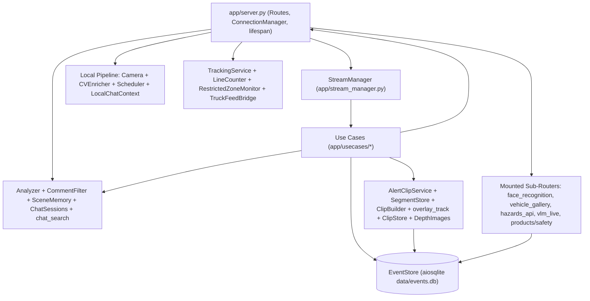
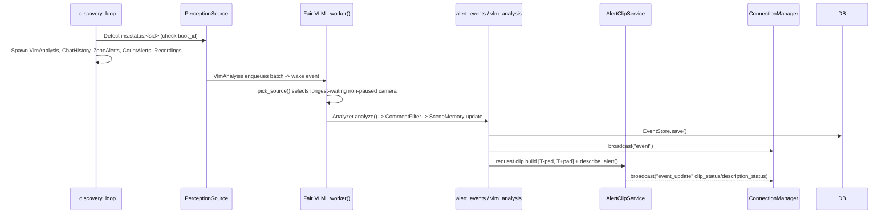
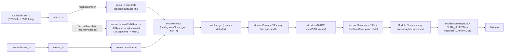
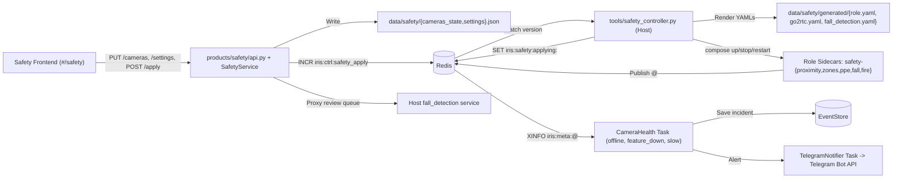
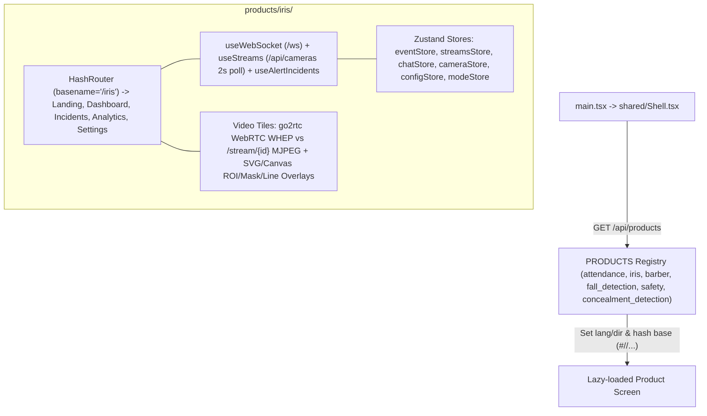

# IRIS Surveillance System — Mid-Level Design (MLD)

> **Scope**: Internal component architecture, submodule decomposition, data & request routing inside each component, and component-level sequence diagrams across `app/`, `perception/engine/`, `perception/modules/`, `products/`, `frontend/`, and `monitoring/`.

---

## 1. Component 1: Core FastAPI Application (`app/`)

### 1.1 Internal Module Decomposition

### 1.2 Backend Boot & Task Graph (`app/server.py`)
In `create_app(config)`, `lifespan` initializes shared stores (`EventStore`, `SegmentStore`, `ClipStore`, `AlertClipService`, `DepthImages`, `ChatSessionStore`, `CommentFilter`, `Analyzer`, `ConnectionManager`) and branches on `camera.backend`:
- **`local` backend**:
  - Starts `Camera` (dedicated OpenCV daemon thread capturing into `_frame_queue` and optional `_annotated_queue`), `LocalChatContext` (periodic slow-sampler filling `ChatFrameBuffer`), and `Scheduler` (async loop grabbing overlapping frame batches, running `CVEnricher.process_batch`, calling `Analyzer.analyze`, deduplicating via `CommentFilter`, saving via `EventStore`, broadcasting over `ConnectionManager`).
- **`deepstream` backend**:
  - Starts `StreamManager` (`_discovery_loop` polling `iris:status:*` every second, spawning/cancelling per-stream asyncio tasks + one fair-scheduled `_worker()` coroutine).
  - Starts `ModuleAlerts`, `AlertClipService`, optional `TrackingService` (`mtmc.enabled`), optional `SafetyService` + `CameraHealth` + `TelegramNotifier` (`IRIS_PRODUCT=safety`), and periodic background pruning (`ClipStore`, `SegmentStore`, `EventStore`).

### 1.3 Request & Stream Processing Inside `app/`

#### A. Per-Stream Discovery & Task Orchestration (`app/stream_manager.py`)
For every active stream ID `<sid>` discovered via `iris:status:*`:
1. **`PerceptionSource`** reads `iris:meta:<sid>` and `iris:jpeg:<sid>`.
2. **`StreamManager`** registers per-stream tasks keyed by `(kind, sid)`:
   - **`("analysis", sid)`** (`VlmAnalysis` -> `VLMQueue` depth `maxlen=2`): samples annotated/detected frames on interval, pushes batch to bounded per-stream slot, wakes `_worker()`.
   - **`("chat", sid)`** (`ChatHistory`): slow-samples `ChatFrameBuffer` (default 2 fps over 300s window) for `/api/chat` and `run_sweep()`.
   - **`("zone", sid)`** (`ZoneAlerts`) & **`("count", sid)`** (`CountAlerts`): tail-reads `iris:zone_alert:<sid>` and `iris:overcrowd_alert:<sid>` via `redis_streams.read_stream()` and dispatches deterministic alerts + zone incident state transitions (`zone_incidents.py`).
   - **`("record", sid)`** (`Recordings`): monitors `iris:segments:<sid>` and triggers pruning/lifecycle bookkeeping.
3. **Global Task `ModuleAlerts`**: Uses `redis_streams.read_streams()` over `iris:alert:<sid>` across all known streams with a single blocking `XREAD`, routing each entry to `AlertEvents` (`app/usecases/alert_events.py`).
4. **Boot-ID Crash Recovery**: `StreamManager._discovery_loop()` compares `boot_id` in `iris:status:<sid>`. If a sidecar restarts (new `boot_id`), it calls `EventStore.resolve_stale_incidents_for_camera()` and resets active latches (`fire_incidents`, `zone_incidents`) so crashed incidents do not remain orphaned as `"ongoing"`.

#### B. Incident Lifecycle & Clip Resolution (`app/usecases/*`, `app/alert_clips.py`)
- **`alert_events.py` & `fire_incidents.py` & `zone_incidents.py`**:
  - Supports **incident-mode alerts** (e.g., `fire_smoke`, `proximity`, `intrusion`, `overcrowding`) where the first alert opens an `"ongoing"` event row, subsequent escalations or zone re-entries **update the same event in place** (`incident_key`, appending follow-up clip IDs via `EventStore.append_clip`), and resolution events (`fire_smoke_resolved`, `intrusion_cleared`, `overcrowding_resolved`, `proximity_resolved`) flip `incident_status` to `"resolved"`.
- **`AlertClipService` (`app/alert_clips.py`)**:
  - **Coalescing**: Checks `find_coalescible()` — if an alert on the same stream arrives within `coalesce_seconds` of an active build job, attaches the new `event_id` to that job so one clip serves the burst.
  - **Path 1 — Encode Segment Path (`SegmentStore` + `ClipBuilder`)**: Waits up to deadline for `iris:segments:<sid>` entries covering `[lo, hi]`, verifies a contiguous gap-free run containing the peak moment via `contiguous_run_containing()`, fetches `.ts` objects from MinIO/disk, concatenates and trims with `ffmpeg` (`ClipBuilder.build_clip`), burns overlays (`overlay_track` PNG sequence via `ffmpeg` `ffconcat`), extracts the alert snapshot (`extract_frame`), and saves into `ClipStore`.
  - **Path 2 — Smart Video Record Path (`SVR`)**: Sends `RPUSH iris:svr_request:<sid>`, awaits matching `iris:svr_done:<sid>` `.mkv`, remuxes MKV -> MP4 (`remux_to_mp4`), runs `_maybe_overlay_svr` (guarded by `_SVR_ENCODES = BoundedSemaphore(2)`), extracts still snapshot, and stores under `ClipStore`.
- **Alert Depth Images (`app/depth_images.py`)**: Decodes proximity `depth_b64` JPEG blobs (max 256 KB) and stores `<event_id>.jpg` under `data/alert_depth/` with matching clip TTL.

#### C. Multi-Camera Chat & Temporal Search (`app/usecases/chat.py`, `app/chat_search.py`, `app/analyzer.py`)
1. `POST /api/chat` increments `monitoring["chat_in_flight"]` (auto-pausing `Scheduler` / `StreamManager` proactive cycles).
2. `gather_chat_context()` pulls strided recent frames (`recent_strided`, capped by `max_chat_images`) across cameras and sends them with conversation history from `ChatSessionStore` + `QUERY_EVENTS_TOOL` to `Analyzer.chat_multi()`.
3. VLM responses stream through `_ThinkStripper` to remove `<think>...</think>` reasoning blocks in real time.
4. If the query requests historical visual search or returns `[NONE]` from immediate context, `chat_search.run_sweep()` runs interleaved rounds over newer live windows and backward `30s` chunks of `ChatFrameBuffer` until `[FOUND cam=... at=...]` or exhaustion, clamping timestamps (`clamp_answer_timestamps`) and cutting an MP4 evidence clip (`segments_for_found`).

---

## 2. Component 2: DeepStream Perception Engine (`perception/engine/`)

### 2.1 Engine Architecture & Strict Plugin Boundary
`perception/engine/` contains zero product-specific logic. Everything from detectors to alerting modules is attached through the `Module` interface in `perception/engine/modules.py`:
- `GieSpec`: Secondary or primary `nvinfer` TensorRT element specification (`name`, `config_path`, `role="primary"|"secondary"`, optional `process_mode`, `gie_id`, `gate`, `is_classifier`).
- `ElementSpec`: Inline GStreamer plugin elements (e.g., `nvdsanalytics`).
- `Module` lifecycle hooks:
  1. `settings_class` -> validated from YAML at load (`load_modules` enforces `requires` and `after` topological ordering).
  2. `setup(cfg)` / `model_files(settings)` -> declare ONNX/tracker files for startup SHA-256 `model_manifest` verification.
  3. `configure(pipeline, handle)` / `on_built(pipeline)` -> wire pad probes, start background workers (ArcFace, Re-ID, Depth), register `VersionedConfig` hot-reload handlers.
  4. Per-frame hot path hooks: `sample` -> `extract` -> `on_frame` -> `transform` -> `wants_pixels` -> `on_pixels` -> `analyze` -> `publish_hooks`.

### 2.2 GStreamer Pipeline Topology (`perception/engine/gst_build.py`)

### 2.3 Inside the Hot-Path Probe (`perception/engine/probe.py`)
Every batched `GstBuffer` passing `capsfilter`'s src pad executes `probe()` on the GStreamer streaming thread:
1. Extract `NvDsBatchMeta` -> iterate each `NvDsFrameMeta` wrapped in a lazy `FrameView` (`pts`, `arrived` NTP/RTCP or monotonic wall clock, `source_index`, `stream_id`).
2. **Sample gating**: `SampleGate` determines `need_meta` (`sample_fps`), while modules declare via `sample(frame)` whether they also require analysis on this frame. Unsampled frames still pass preview drawing if `pipeline_preview=true`.
3. **Single metadata extraction (`extract`)**: Calls `extract_objects()` (`pyds`) only if needed, then invokes each module's `extract(frame)` reader (`analytics_roi`, `instance_mask`, landmarks) so raw C pointers never leak downstream.
4. **Unfiltered frame hooks (`on_frame`)**: Runs on **every** frame regardless of `sample_fps` or filter-zone pruning (used by `zones` / `fire_alerts` / `ppe` for exact sustain timing).
5. **Engine class/conf filtering + `transform`**: Applies `relevant_classes`, `conf_threshold`, and runs module `transform(frame)` hooks in order (e.g., `box_stabilizer` suppresses nested cab boxes -> `person_boxes`/`person_masks` snapshot boxes -> `zones` filter-zones drop objects in ignore polygons).
6. **Optional GPU->CPU pixel mapping (`wants_pixels` -> `_map_frame_bgr`)**: Only if `pipeline_preview=true` OR any module returns `True` from `wants_pixels(frame)`, copies GPU NVMM RGBA surface once into pinned/numpy memory and slices BGR + runs `on_pixels(frame)` (e.g., vehicle crop extraction, face alignment crops, depth frames).
7. **Analyze & Submit (`analyze` -> `_FramePublisher`)**: Collects `FrameOutput` (`annotations` with priority `layer`, `fields` for `iris:meta`, `draw` custom painters, `after_publish` callbacks) and enqueues a lightweight job to `_FramePublisher` (returning control to GStreamer immediately).

### 2.4 Asynchronous Frame Publisher & Sub-Loops (`publisher.py`, `recording.py`, `svr.py`, `source_recovery.py`)
- **`_FramePublisher` (`publisher.py`)**: Spawns one worker thread per camera stream pulling from a bounded queue (`max_pending=8`).
  - Annotates the BGR frame using `annotations` sorted by `layer` (and `draw` callbacks), encodes JPEG via pooled `GpuJpegEncoder` (`nvjpegenc`) with automatic `cv2.imencode` CPU fallback, executes `SET iris:jpeg:<sid>` (respecting `ViewerGate`) and `XADD iris:meta:<sid>`, then invokes `publish_hooks` on the clean pre-draw BGR frame.
  - Under queue overflow, **sheds drawing/JPEG** onto `_meta_q` so detection metadata (`iris:meta:<sid>`) is preserved even under preview backpressure.
- **`recording.py` (`encode` mode)**: Uses `_RecordBranchScheduler` with `nvenc_probe.py` to stagger opening `nvv4l2h264enc` sessions (avoids NVIDIA driver initialization lockups), rewrites PTS monotonically across looped files, validates SPS (`has_parameter_sets`), and asynchronously uploads `.ts` chunks via `_SegmentUploader` to MinIO + `XADD iris:segments:<sid>`.
- **`svr.py` (`svr` mode)**: Polls `iris:svr_request:<sid>`, coordinates `_SVR_EMIT_LOCK` + `SvrTrigger` FSM + `SvrFileTracker` FIFO, invokes `nvurisrcbin.emit("start-sr", ...)` via a `PyCapsule` `NvDsSRSessionId*` handle, and publishes completed MKVs on `sr-done` signal to `iris:svr_done:<sid>`.
- **Control & Watchdogs**: `ControlPoller` thread polls Redis control keys every `1.0s`; `SourceStallWatch` restarts individual stalled `nvurisrcbin` elements cleanly; `MainLoopWatchdog` & `FlightRecorder` monitor GLib main-loop heartbeats and thread CPU/decoder `nanosleep` stalls outside the GIL/GLib thread.

---

## 3. Component 3: Plug-in Perception Modules (`perception/modules/`)

All 15 modules register via `MODULE = <Class>` and communicate via `FrameView.objects` (`ObjectView`), `FrameOutput.fields`, `FrameOutput.annotations`, `EngineServices.alert()`, and `EngineServices.overlay()`:

| Module | GIE(s) / Elements | Core Hook Stages | Internal Design & Outputs |
|---|---|---|---|
| **`box_stabilizer`** | — | `transform` | Runs two passes on vehicles: (1) `containment_suppression` drops nested tractor/cab sub-boxes inside whole-vehicle boxes; (2) `BoxStabilizer` smooths bounding box jitter via EMA + cab translation tracking + virtual holds across short dropouts. Updates `obj.bbox` in place and populates `stopped_ids`. |
| **`person_boxes`** | — | `transform`, `analyze` | Snapshots tracked person `[l, t, w, h, oid]` boxes before filter-zones prune them; publishes `out.fields["person_boxes"]` for collision guards & overlap logic. |
| **`person_masks`** | — | `extract`, `transform`, `analyze` | Reads `nvds.instance_mask(o.raw)`, extracts simplified largest contour polygon (`<=40` points normalized `0..1`), publishes `out.fields["person_masks"]` for `barber` and segmentation consumers. |
| **`zones`** | Element: `nvdsanalytics` | `on_built`, `extract`, `on_frame`, `transform`, `analyze`, `control` | Hot-reloads `zones_config.txt` (intrusion, overcrowding, filter-zones) via `VersionedConfig` (`iris:ctrl:zones_version` -> `iris:zones:applied`). Maps analytics ROI labels to `ZoneReentryGrace` (per-ID spatial handover) and `OvercrowdingLatch` (count threshold + sustain/release debounce). Emits `iris:zone_alert:<sid>` and `iris:overcrowd_alert:<sid>` + optional `intrusion_cleared` / `overcrowding_resolved` end markers + `OverlayWriter` alert boxes. |
| **`fire_alerts`** | PGIE: `pgie_fire` | `on_frame`, `analyze`, `control` | Monitors `fire` and `smoke` detections clipped optionally to `FeatureZones("fire")`, drives two separate `OvercrowdingLatch` state machines (with sustain & dropout grace), tracks `FireIncidentEvent` ongoing/resolved lifecycles, and emits `iris:alert:<sid>` + base64 JPEG snapshots + `HAZARD_BGR` overlays. |
| **`face_detect`** | SGIE: `sgie_face` (+ optional `GieGate`) | `extract`, `transform`, `analyze`, `control` | Parses YOLO-Face bboxes + 5 facial landmarks packed into `mask_params`; runs `FaceOwnership` (`legacy` smallest-box vs `tracked` body-following rule) to bind faces to overlapping `person` tracks; annotates face boxes; pauses `sgie_face` inference via `SgieGalleryMonitor` when `idle_when_unused=true` and `iris:face:gallery` is empty. |
| **`face_recognition`** | — (ArcFace ONNX thread) | `wants_pixels`, `analyze`, `on_frame` | Enqueues clean face crops + landmarks onto a background `FaceRecognizer` thread (`insightface` `buffalo_l` on CUDA). Matches 512-d embeddings against in-memory `FaceGallery` matrix, runs multi-frame voting (`min_votes`) + lock window (`lock_seconds`) + collision guard (`_collision_guard`), publishes `iris:face_rec:<sid>`, annotates person box labels with employee name, and saves unrecognized enhanced captures to `FaceCaptureStore`. |
| **`customer_faces`** | — | `wants_pixels`, `publish_hooks` | Selects quality-gated customer faces (size, sharpness, frontal alignment) per track and publishes base64 crops/embeddings to `iris:customer_face:<sid>` for `barber`. |
| **`appearance`** | — | `wants_pixels`, `publish_hooks` | Samples person crops, scores uniform probability (`staff_p` via ONNX classifier or CLIP), extracts Re-ID embeddings, and publishes to `iris:appearance:<sid>` for `barber` staff classification & cross-camera matching. |
| **`ppe`** | PGIE: `pgie_ppe` | `extract`, `on_frame`, `transform`, `analyze`, `control` | Feeds tracked `person` and untracked `Hardhat`/`NO-Hardhat`/`Safety Vest`/`NO-Safety Vest` boxes into `compliance.evaluate_frame()` + per-person `TemporalFilter` sliding window, gated optionally by `FeatureZones("ppe")` (with per-zone item overrides like `["helmet"]`), emits `ppe_violation` alerts on `iris:alert:<sid>` + `OverlayWriter` boxes. |
| **`proximity`** | Requires `person_masks` / YOLO-seg | `extract`, `analyze`, `on_pixels`, `control` | For each analysed frame per zone (`ZoneRule` from `zones_config.txt`): builds `PersonScale` linear height map `h(v)=a*v+b`; extracts largest mask `Blob`, foot/head & vehicle `vehicle_band` outline; classifies `VehicleMotion` (moving/parked/unknown); recovers hidden feet via `FootAnchors`; filters vehicle riders/cab drivers (`is_rider`, `co_motion`); evaluates gap in person-heights; latches via `PairLatch` & deduplicates via `EpisodeBook`; dispatches close pairs asynchronously to `DepthWorker` (ONNX `YOLO26m-depth`); writes `iris:overlay:<sid>` polygons/lines & emits `iris:alert:<sid>` (and held-back depth diagnostics). |
| **`shelf_void`** | PGIE: `pgie_shelf` | `on_built`, `analyze` | Supports two modes: **`heatmap`** (`ShelfVoidDetector` spatial EMA decay + morphology close -> continuous score visualization) or **`tracker`** (`RegionTrackers`: `PersonGate` pauses regions overlapped by padded person boxes -> `StableTracker` confirms static void boxes over `confirm_s` -> `Situation` emits `shelf_empty` & `shelf_restocked` correlation events to `iris:alert:<sid>`). |
| **`pose`** | SGIE: `sgie_pose` | `extract`, `transform`, `analyze` | Extracts `17 x (x, y, conf)` COCO keypoints from `sgie_pose` `mask_params` (with letterbox inverse mapping back to frame coordinates), matches each pose to its parent `person` track ID, and publishes `out.fields["pose"] = {"shape": [w, h], "items": [{"id", "box", "kps"}]}` + optional `OverlayWriter` boxes. |
| **`plates`** | SGIE: `sgie_plate` | `extract`, `transform`, `analyze` | Filters candidate license plates attached to vehicle tracks via `one_plate_per_vehicle` (min size, aspect ratio, frame-edge cut filter, containment, normalized distance to vehicle bottom-center) and smooths/holds positions across skipped SGIE intervals via `PlateHold`. |
| **`mtmc`** | — (Re-ID + Plate OCR + VLM threads) | `on_frame`, `wants_pixels`, `on_pixels`, `analyze`, `publish_hooks` | Collects `TrackletRecord`s per camera, crops vehicles for `ReIDEngine` (Torch/ONNX Re-ID worker thread), executes `GlobalVehicleAssociation` across active & inactive `GlobalVehicleTrack`s using cosine similarity + camera topology transitions (`time_gap` windows), submits borderline matches to `VLMArbiter` (Ollama async queue with multi-view montages), reads Arabic license plates asynchronously, and publishes `global_ids`, `vehicles`, `stopped_ids` to `iris:meta:<cam>`. |

---

## 4. Component 4: Autonomous Product Services & Bridges (`products/*`)

### 4.1 Site Safety Orchestrator (`products/safety/` + `tools/safety_controller.py`)

- **`SafetyService`**: Merges `cameras.yaml` defaults + UI overrides (`cameras_state.json`) + `settings.json`, serves raw snapshots from `go2rtc` (`SNAPSHOT_TTL_S = 1.5s`), and proxies `/api/safety/fall/*` to `SAFETY_FALL_URL` so the browser uses a single origin.
- **`CameraHealth`**: Inspects Redis `EXISTS iris:status:<sid>` and `XINFO STREAM iris:meta:<sid>` (`entries-added` & `last-generated-id`) without decoding frame JPEGs. Classifies streams into `down`, `silent` (`>30s`), `slow` (`<1.0 fps`), waits `confirm_s=15s`, suppresses alerts during `iris:safety:applying:<role>`, and auto-resolves incidents on recovery.
- **`TelegramNotifier`**: Non-blocking bounded `deque(maxlen=100)` worker pulling latest JPEG from `iris:jpeg:<sid>` and sending `sendPhoto` (or `sendMessage` fallback) with 3 retries.

### 4.2 Fall Detection Service (`products/fall_detection/`)
- **Ingestion**: `ConsumerThread` executes `XREAD` on `iris:meta:<cam>` across configured cameras, parses `pose` keypoints via `acl.py`, and pushes frames into per-camera `FrameQueue(maxsize=64, drop_oldest=True)`.
- **Per-Camera Worker**: Each `CameraWorker` owns its isolated `CameraMonitor` wrapping vendored `FallMonitor` (`fall_detection/fall_monitor.py`) and `TSSTGClassifier` (MMAction2 8-class ST-GCN on CUDA).
  - Why per-camera worker: `FallMonitor` keys state by local `track_id` and runs GPU tensor inference; isolating workers avoids cross-camera ID collisions and keeps Redis `XREAD` non-blocking.
- **Candidate Scoring & Routing (`scoring.py`)**:
  1. Evaluates action recognition class probabilities (`evaluate` + margin `reading_score`), kinematic collapse gates (`path_b`), cold fall gates (`path_c`), lying posture (`lying_score`), and windowed immobility (`stillness_score`).
  2. Combines active paths via Noisy-OR probability: `combined = 1 - Π(1 - trust_i * score_i)`.
  3. Routes candidates: if `combined >= confirm_threshold` -> emit alert to `iris:alert:<key_id>` + `iris:svr_request:<key_id>` + history DB (`critical`/`warning`, or drop if confirmed `"upright"`); if `combined < confirm_threshold` -> save to SQLite `ReviewQueue` (`GET /candidates`, `POST /review/{row_id}`) and emit hedged `"needs review"` warning alert.

### 4.3 Concealment Detection Service (`products/concealment_detection/`)
- **Ingestion**: Reads `iris:meta:<cam>` (`pose` 17 keypoints + `dets` for shopping bags/backpacks and shopping carts/baskets), tracks replay footage clock wraps (`footage_clock.py`), and dispatches to per-camera `CameraWorker` (`FrameQueue(maxsize=128)`).
- **Pure-Python Library (`concealment/`)**:
  - `QualityGate`: Rejects tracks that are too small, occluded, low-confidence, or moving excessively (`INSUFFICIENT` / `GONE`), with short freeze grace timers (`insufficient_grace_s`).
  - `extract_track_features` (`features.py`): Computes torso-normalized wrist coordinates (`shoulder-hip` triangle frame), elbow flexion angles (`joint_angle_deg`), hand-to-body zones (pocket, waistband, chest/jacket, personal bag), wrist visibility/disappearance, reach velocity, directional shelf-facing alignment (`zones.py`), and negative context (proximity to cart/basket).
  - `TrackStateMachine` (`state_machine.py`): Orders transitions across `IDLE -> DWELL -> REACH -> AT_BODY -> (RETURNED | HIDDEN | EXIT | PARTIAL) -> COOLDOWN` with hand-transfer support, tier capping (`high`/`medium`/`low`), and zone-scoped cooldowns.
- **Evidence & Persistence**: `evidence.py` formats neutral non-accusatory behavioral timelines, triggers `iris:svr_request:<cam>` `[pts-5s, pts+5s]` + `iris:alert:<cam>`, and stores candidates/assessments in `ReviewStore`.

### 4.4 Barber Shop Operations Service (`products/barber/`)
- Consumes `iris:meta:<cam>` (person boxes + optional `person_masks`), `iris:appearance:<cam>` (`staff_p` + Re-ID crops), and `iris:customer_face:<cam>` across all synchronized cameras (`barber-c`, `barber-l`, `barber-r`) inside a single unified shop engine (`ShopEngine` or chair-first `ChairEngine`):
  - **Zones & Pairing (`zones.py`)**: Normalizes `entrance_line`, `waiting`, `chair`, `seat` (`seat_of`), `washing`, and `face_area`. Paired multi-camera zones share an area ID with one designated `owner: true` camera.
  - **Core Subsystems**:
    - `DoorCounter`: Signed foot-crossing across `entrance_line` -> creates visits / pending exits.
    - `Appearance / Staff Vote`: Aggregates per-track `staff_p` samples; staff tracks never create customers.
    - `Cross-Camera Handoff`: Matches unbound non-staff tracks via synchronized paired-zone entry windows (`sync_window_s`), Re-ID embedding similarity, and lost-customer `reattach_s`.
    - `ChairStates` / `HaircutBook`: Tracks still non-staff bodies in chair seats (`seat_dwell_s`), claims new IDs via `identity.may_claim_seat`, suspends haircuts temporarily during `washing` transitions (`wash_return_s`), attributes barber via temporal `roster_at(chair, started_at)`.
    - `WaitBook` / `WaitingCounter` / `KidsCar` (ONNX kids-car occupancy): Tracks customer dwell SLAs and triggers `EXCESSIVE_WAIT` / overrun alerts + snapshots.
    - `reports`: Exports daily/period DOCX, HTML, SVG, PDF reports with optional customer photo permissions.

### 4.5 Attendance & Productivity Service (`products/attendance/`)
- Reads `iris:face_rec:<cam>` and `iris:meta:<cam>` in `ConsumerThread`:
  - `SightingCoalescer` coalesces stabilized recognitions into per-(employee, camera, minute) `Sighting` rows flushed by real wall time (immune to looped video `pts` wrap via `acl.camera_clock`).
  - `DeskStateEngine` (`productivity.py`) monitors person occupancy inside defined `seat_zones` with debounced idle/at-desk/away transitions.
  - `ZoneViolationEngine` (`violations.py`) flags unauthorized roles or unidentified visitors in restricted zones.
  - `sessions.derive_day()` / `derive_month()` computes daily arrival, departure, work intervals, breaks, late/early flags, and overtime purely on read from raw `Sighting` rows.

### 4.6 Multicam Vehicle Tracking Downstream (`app/tracking.py`, `app/truck_feed.py`, `app/line_counter.py`, `app/restricted_zones.py`, `app/hazards.py`)
- **`TrackingService` (`app/tracking.py`)**: Polls `iris:meta:<cam>` (deduping via last seen `(cam, msg_id)`), aggregates per-camera stays in `CameraAggregator` (`EPISODE_GAP_S=90s`), drives `LineCounter` (bottom-center signed distance across normalized `CountLine`s -> `iris:count:totals:<cam>`), drives `RestrictedZoneMonitor` (ray-casting dwell with `grace_s`, promoting local `obj_id` stays to `gid` once matched), and updates `TruckFeedBridge` (generating base-18 Arabic synthetic plates as fallback until real OCR stabilizes, applying camera-group home priority, pushing Schema 1.0 JSON batches to `iris:camera-feed`).
- **`Hazards` (`app/hazards.py`, `hazards_api.py`)**: On-demand Qwen VLM industrial safety inspection returning 0-1000 bounding boxes + severity + optional Arabic translation, capped by `BoundedSemaphore(2)`.

### 4.7 Shelf Void AMQP Bridge (`products/shelf_iris_bridge/`)
- **`AlertReader`**: Reads `iris:alert:<cam>[@role]` using its **own Redis consumer group** (`XREADGROUP` + `XACK`), leaving the stream intact for IRIS `ModuleAlerts`' plain `XREAD`.
- **`Bridge` & `Broker`**: Maintains deterministic `uuid5` `eventId`s and correlation keys (`shelf-void:<cameraId>:<region>`). Maps `shelf_empty` -> `event.raised` and `shelf_restocked` -> `event.cleared` on RabbitMQ exchange `iris.ai` with publisher confirms and an in-memory unacked outbox across reconnects; honors `pipeline.upsert` (active/paused) and `pipeline.remove` from `iris-platform`.

---

## 5. Component 5: Frontend Workspace (`frontend/`)

- **`shared/Shell.tsx` & `shared/router.ts`**: Enables one unified static build to serve any combination of enabled products (`GET /api/products`). Isolates CSS/translations/routing (`setProductBase` prefixes `#/<product>/`), switching `<html lang dir>` seamlessly (e.g., `ar`/`rtl` for `attendance`, `en`/`ltr` for `iris`, `barber`, `safety`, `fall_detection`, `concealment_detection`).
- **`products/iris`**: Combines Zustand state (`eventStore` handling live tail + `outside` map patches for older historical rows) with WebSocket incremental `event_update` patching, `forLiveView()` filtering (hides proximity depth-held-back diagnostics unless inspecting), interactive polygon editors (converting between `0..1` UI canvas coordinates and sidecar mux pixels), and streaming SSE Markdown + video clip chat drawer.
- **`products/safety`**: Wraps IRIS components (`Header.module.css`, incident card media player) inside an HSE console featuring persistent unacknowledged alarm `Banner`, feature toggles + `ApplyBar` polling `GET /api/safety/apply`, `HealthPage`, and go2rtc raw snapshot camera tiles.

---

## 6. Component 6: Monitoring & Media Observability (`monitoring/`)

- **Sidecar Telemetry (`perception/engine/telemetry.py`)**: Zero-lock thread-local `_Accum` counters timed on `probe`, `publish`, `recognizer`, `upload`, `rotation`, plus GStreamer pad-probe `gpu.*` timers and backpressure gauges (`publisher_pending`, `mux_queue_*`, `fps_<cam>`, `qos_dropped_total`, `mtmc_alias_conflicts_total`, `vlm_queue_depth`), served via Prometheus HTTP on `:9100`.
- **Host / Stack Exporter (`monitoring/exporter/exporter.py`, `:9200`)**: Polls NVML GPU telemetry (`util`, `NVDEC`, `NVENC`, throttle/Xid/ECC), Docker container health/CPU/OOM via `/var/run/docker.sock`, Redis stream memory & `cam_meta_age` & `iris_truck_feed_backlog`, `go2rtc` stream liveliness, active ffmpeg test players, and platform API readiness.
- **Loki + Promtail (`loki.scale.yml`, `promtail.scale.yml`)**: Ships Docker container logs tagged by `service`, `container`, and regex-extracted log level (`INFO|WARNING|ERROR|CRITICAL|DEBUG`).
- **Alert Rules (`monitoring/alerts.scale.yml`)**: Detects `FramePublisherShedding`, `DetectionDataLost`, `AnalysisQueuesPinned`, `DecoderThreadSleepLoop`, `SidecarMainLoopStalled`, `TrackletUnderTwoIds`, `TrackingLoopSlow`, `PlatformFeedBacklog`, and GPU/host resource exhaustion.
