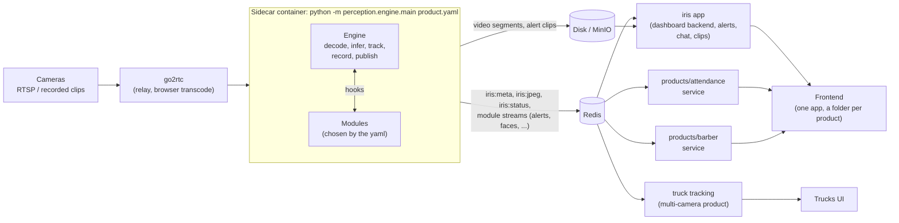
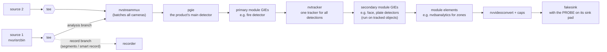
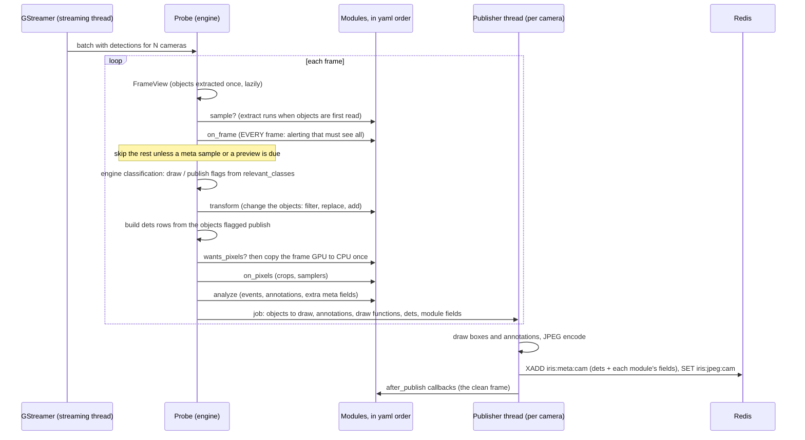
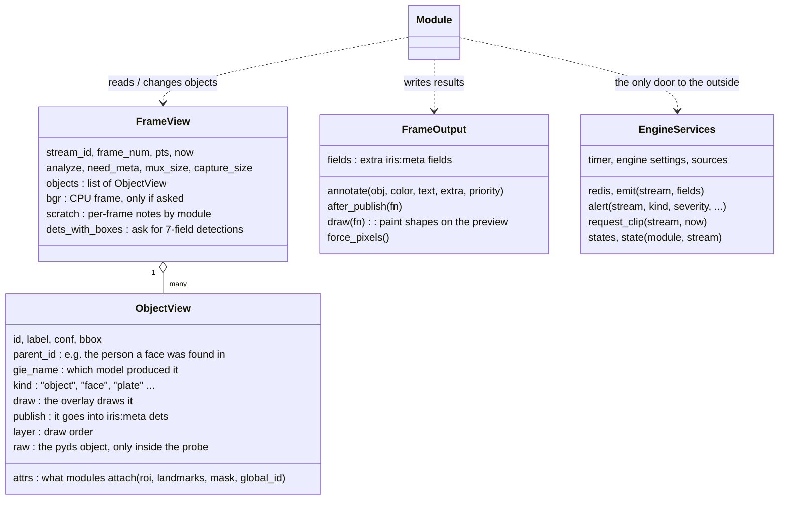
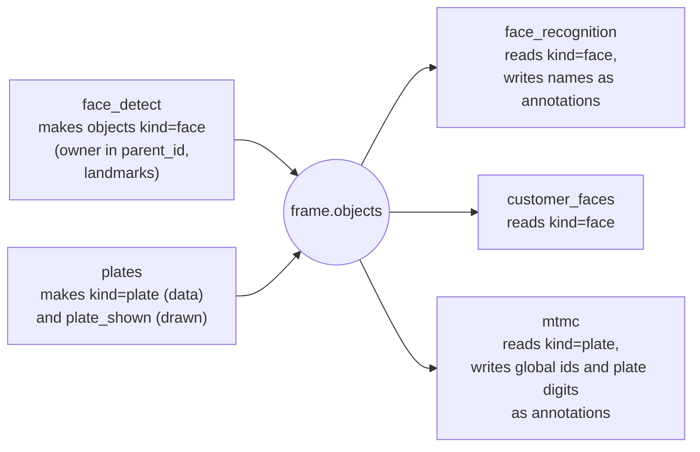
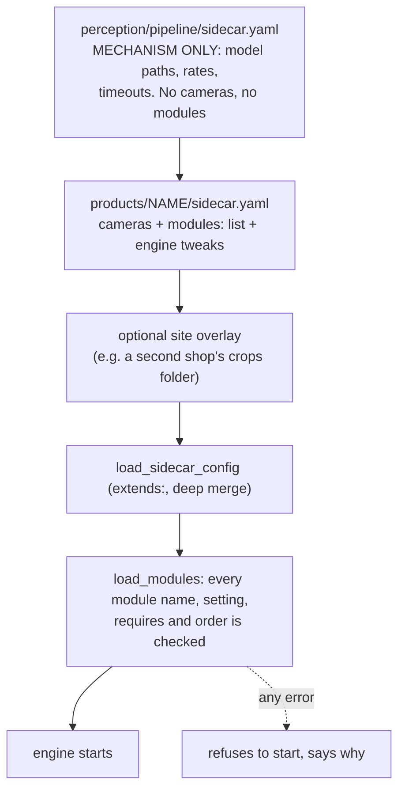

# The perception architecture: an engine and its modules

*(Entry point for the whole folder: [`README.md`](README.md). How changes are verified: [`TESTING.md`](TESTING.md).)*

*Read this first if you are new to the DeepStream side of IRIS, or want to add a use case. About 15 minutes. The
diagrams are Mermaid: GitLab and VS Code render them.*

## 1. The idea in one paragraph

DeepStream is **one program, the engine**. It decodes cameras, runs the detector, tracks objects, records video,
recovers from broken sources and publishes results to Redis. It knows **no use case**: no faces, fire, zones, plates or
vehicles. Everything a product does with the detections is a **module**, a folder under `perception/modules/`. A product
is a yaml file that lists which modules run, in what order, with what settings. The engine calls each module at fixed
points of every frame (the *hooks*); modules never call each other and never touch GStreamer.

```
        product yaml                    engine                      module
   modules:                    decode, infer, track,       zones, fire_alerts, face_detect,
     - face_detect      --->   record, publish        <--- mtmc, plates ...   (one folder each)
     - face_recognition        calls hooks per frame
```

A test (`tests/test_engine_boundary.py`) fails the build if `perception/engine/` imports a module or names a product,
so the boundary cannot erode quietly.

## 2. The system from above



Key points:

- The sidecar is **the same image and program for every product**. What differs is the yaml it is started with
  (`SIDECAR_CONFIG`, or the compose service's `command`).
- Everything leaves the sidecar through **Redis streams** (and files for video). Services never import sidecar code.
- Products are separate services that read those streams. They are owned by their own teams.

### Products today

| Product | Yaml | Modules, in order |
|---|---|---|
| Attendance | `products/attendance/sidecar.yaml` | `person_boxes`, `face_detect`, `face_recognition`, `fire_alerts` |
| Barber shop | `products/barber/sidecar.yaml` | `person_boxes`, `person_masks`, `appearance`, `face_detect`, `face_recognition`, `customer_faces` |
| Multi-camera vehicle tracking | `products/multicam/sidecar.yaml` | `box_stabilizer`, `zones`, `plates`, `mtmc` |
| VLM demo preset | `configs/presets/vlm/sidecar.yaml` | `zones`, `mtmc` |

The shared file `perception/pipeline/sidecar.yaml` lists **no module** and no camera: nothing is switched on by
inheritance.

## 3. Inside the engine

### 3.1 The GStreamer pipeline



- The **probe** at the end is where all Python logic runs, once per frame batch. It builds a `FrameView` per frame and
  calls the modules.
- A module can add inference elements (`gies()`) and other elements (`elements()`); the engine places them: *primary*
  GIEs before the tracker, *secondary* GIEs after it, other elements last.
- Recording is independent of the analysis branch: it keeps working when a module is slow or broken.

### 3.2 What the engine owns (and only this)

| Area | Where |
|---|---|
| Building the pipeline, sources, mux, GIE chain | `perception/engine/gst_build.py` |
| The per-frame probe and hook dispatch | `probe.py`, `modules.py`, `frame.py`, `objects.py` |
| Drawing the preview, JPEG encode, writing Redis | `publisher.py`, `jpeg_encoder.py` |
| Recording, smart-record clips, segment index | `recording.py`, `svr.py`, `svr_*.py`, `segment_index.py` |
| Recovery: stalled sources, watchdog, flight recorder | `source_recovery.py`, `flight.py`, `main.py` |
| Config loading, roles, sharding | `config.py`, `sources.py` |
| Telemetry (per-stage timings, Prometheus) | `telemetry.py` |
| Polling Redis control keys for modules | `control.py` |

## 4. One frame, step by step



Rules that follow from this:

- Hooks run **in yaml order**. A module that changes detections (the stabilizer, a filter) acts on what the modules above
  it left; one that reports on detections sees them as of where it is listed. Order is part of a product's configuration.
- `on_frame` sees every frame; everything after it runs only on frames that will be published.
- A hook that **raises** is logged and counted and never stops the pipeline. A build-time failure (`on_built`, `start`)
  **refuses startup**: a module that could not set itself up would otherwise do nothing, silently.
- Hooks run on the streaming thread: never block in one. Heavy work goes to a thread of your own, fed from
  `out.after_publish(fn)`.

## 5. The data a module sees



- **One object list.** Every detection, face box and plate box lives in `frame.objects`. A module decides what becomes
  of an object by setting `draw`, `publish`, `kind`, `layer`, or by replacing or adding objects. There are no parallel
  lists to keep in sync.
- **Annotations belong to an object, not to a track id.** A face is drawn on its owner's id, so a person box and the
  face box beside it share an id and must be styled apart. Colour and text carry a priority (a hazard colour, priority
  10, beats a zone colour, priority 1, whatever the module order).
- **Per-stream state** lives in `services.state(module_name, stream_id)`: a dict per module per camera, replacing
  attributes bolted onto the stream object.

## 6. The module contract

A module is a package whose `__init__.py` exposes `MODULE`, a subclass of `Module`:

| Hook | When | Typical use |
|---|---|---|
| `gies()` | build | inference models this module needs (a `GieSpec`: config, primary or secondary, engine path) |
| `elements()` | build | extra GStreamer elements (zones add `nvdsanalytics`) |
| `on_built(PipelineHandle)` | build | look up its elements, add pad probes, load models. Failure refuses startup |
| `start()` / `stop()` | run | start and stop worker threads |
| `control()` | run | `{redis key: handler}`, polled once a second (zones hot-reload) |
| `gauges()` | run | numbers for telemetry |
| `sample(frame)` | per frame | own the sampling clock (the face gate) |
| `extract(frame)` | when the frame's objects are first read | return a function that reads what this module needs off each object's metadata into `obj.attrs` (through `perception.engine.nvds`) |
| `on_frame(frame, out)` | every frame | alerting that must not miss a frame |
| `transform(frame)` | published frames | filter / replace / add objects |
| `wants_pixels(frame)` / `on_pixels(frame, bgr)` | published frames | ask for, then receive, the CPU frame |
| `analyze(frame, out)` | published frames | events, annotations, extra meta, `after_publish`, `draw` |

Settings are a `@dataclass`: unknown keys, missing required keys and bad values **refuse startup** with a clear message.
`requires = ("face_detect",)` makes the loader check that another module is configured and listed before this one;
`after = ("plates",)` only constrains the order when that module is configured.

The rules that keep the boundary real (`perception/modules/README.md`):

1. The engine never imports a module by name; a module never calls another module.
2. Data between modules flows only through `ObjectView` fields, `kind`s and `FrameOutput`; say so in `requires`.
3. Every tunable is a `Settings` field. No magic constants buried in logic.
4. Use `FrameView` / `ObjectView`, not pyds (what must come from metadata is read in `extract`, through
   `perception.engine.nvds`). Never block in a hook.
5. A module with a model also ships its tests, and a golden config if it changes what is published.

### How modules cooperate without talking



The shared vocabulary (kinds, labels and `attrs` keys, with who sets and who reads each) is the table in
`perception/modules/README.md`; a module that introduces one adds a row.

## 7. Configuration



A product declares what it needs:

```yaml
extends: ../../perception/pipeline/sidecar.yaml
sources:
  - {id: cam-1, uri: "rtsp://go2rtc:8554/raw-cam-1", roles: [attendance]}
modules:
  person_boxes: {}
  face_detect:
    owner_mode: legacy
    landmarks: true
  face_recognition:
    gallery_key: "attendance:face:gallery"
```

- `extends:` deep-merges nested mappings, so a site overlay can change one module setting without repeating the rest.
- **Order matters** (section 4). The multicam product lists `box_stabilizer` before `zones` on purpose.
- A *role* (`IRIS_SIDECAR_ROLE`) only selects cameras by their `roles:` tag; what else a role changes is the
  `role_overrides:` table in the shared yaml. A role can drop modules, never add one.
- `role_scoped_keys: true` (off by default) makes a role process write every per-camera Redis key under
  `<camera>@<role>` (`sources.stream_key_id`: status, meta, jpeg, overlay, alert, zone/overcrowd alerts, svr
  request/done, segments, watched), so several role processes can share a camera (products/safety). It needs a role,
  refuses the modules whose own workers write camera-keyed streams (face_recognition, customer_faces, appearance),
  and a booting process purges only its own role's stale status keys. A module that writes a per-camera stream itself
  names it with `services.key_id(stream_id)`; `tests/test_role_scoped_keys_guard.py` checks the engine and modules do.

## 8. Module catalogue

| Module | What it does | Models / elements | Writes |
|---|---|---|---|
| `fire_alerts` | Sustained fire/smoke incidents, clip requests, hazard-coloured boxes | primary GIE `pgie_fire` | `iris:overcrowd_alert:<cam>` (kind `fire_smoke`) |
| `zones` | Intrusion and overcrowding alerts, filter regions, zone colours, hot reload | `nvdsanalytics` element | `iris:zone_alert`, `iris:overcrowd_alert` |
| `box_stabilizer` | Steady whole-object boxes (drops nested part-boxes, holds across flicker) | none | replaces objects |
| `person_boxes` / `person_masks` | The tracked people's boxes / segmentation outlines as meta fields | none | `person_boxes`, `person_masks` fields |
| `face_detect` | Face detector on each person, who owns which face, sampling gate, idle switch | secondary GIE `sgie_face` | `faces` field, kind `face` objects |
| `face_recognition` | Names faces against a Redis gallery, voting, capture, enhancement | InsightFace (own thread) | `iris:face_rec:<cam>` |
| `customer_faces` | Quality-gated face pictures with embeddings (barber register) | ArcFace (own thread) | `iris:customer_face:<cam>` |
| `appearance` | Re-ID embedding and staff probability per person | ONNX models (own thread) | `iris:appearance:<cam>` |
| `plates` | One steady plate per vehicle | secondary GIE `sgie_plate` | `plates` field, kinds `plate`, `plate_shown` |
| `mtmc` | Cross-camera vehicle identity, VLM arbiter, plate reading, vehicle gallery | Re-ID, optional VLM, OCR | `global_ids` field, `iris:mtmc:*` |

## 9. What the sidecar publishes

| Key | Written by | Content |
|---|---|---|
| `iris:meta:<cam>` | engine (+ module fields) | `v`, `frame_num`, `pts`, `dets`, and each module's fields |
| `iris:jpeg:<cam>` | engine | the annotated preview |
| `iris:status:<cam>` | engine | running state, boot id, preview mode |
| `iris:segments:<cam>`, `iris:svr_done:<cam>` | engine | recorded segments, alert clips |
| `iris:alert:<cam>` | any module, through `services.alert(...)` | the one alert contract (below); one app usecase handles every kind |
| `iris:zone_alert:<cam>`, `iris:overcrowd_alert:<cam>` | zones, fire_alerts | the older alert streams; they name zones and open and resolve incidents, so the app keeps a usecase for each |
| `iris:face_rec`, `iris:appearance`, `iris:customer_face`, `iris:mtmc:*` | modules | each module's own streams |
| `iris:ctrl:*` | app to sidecar | control (pipeline play/pause, zones version) |

Every `iris:meta` entry is stamped `"v": "1"`: the legacy shape (`dets` of 3 fields, or 7 when a module such as `mtmc`
asks for the boxes). A fixed v2 shape is not done yet (section 12).

### The alert contract

A module raises an alert with `self.services.alert(stream_id, kind, severity=, category=, message=, pts=, zone=, count=, **extra)`,
which writes one entry to `iris:alert:<cam>`:

| field | meaning |
|---|---|
| `v` | contract version, `"1"` |
| `kind` | what happened (`proximity_warning`, `fall`, ...): the event's tag and, with no `message`, its text ("Proximity warning on cam-1") |
| `severity` | `critical` / `warning` / `info` (anything else is clamped down, never up) |
| `category` | `safety` / `security` / `storage` / `operations` |
| `message`, `zone`, `count`, `pts` | optional: text, an app zone id, a number the event carries, the frame time in seconds (the clip is centred on it) |
| anything else | kept on the entry, ignored by the app |

On the app side `ModuleAlerts` (`app/usecases/module_alerts.py`) is **one** reader over every camera's `iris:alert:*`
(`app/redis_streams.read_streams`: from each stream's tail, never `$`, one worker thread however many cameras); it calls
`AlertEvents.emit`, which saves the event, broadcasts it to the dashboards and queues its clip. A new module's alerts
therefore need no app code. A bespoke frontend card per kind is the only per-module UI work, and only if the generic
event card is not enough.

## 10. What changed, for people who knew the old code

| Before | Now |
|---|---|
| One 4331-line `perception/pipeline/sidecar.py` holding the engine and every use case | `perception/engine/` (about 26 files) plus 11 modules |
| Flat yaml keys per use case (`face_*`, `plate_*`, `mtmc:`, `analytics_enabled`, ...) read by the engine | `modules:` in the product yaml; the engine reads none of them |
| Hard-wired GIE slots (`pgie_fire`, `sgie_face`, `sgie_plate`) | Models come from `gies()` of whichever modules are listed |
| Three separate walks over the metadata, tuples (`dets`, `boxes`, `faces`, `plates`) kept in step by hand | One `frame.objects` list with `draw` / `publish` / `kind` flags |
| Zone colours, names and global ids hard-coded in the drawing code | Modules annotate objects; the engine only draws |
| Face recognition special-cased in the publisher | `out.after_publish(fn)`: any module can take the clean frame |
| Roles and product names in code (`KNOWN_ROLES`, "untagged recordings belong to attendance") | Data in the product's yaml (`role_overrides`, `untagged_recording_owner` in `products/attendance/sidecar.yaml`) |
| Helpers found each other by bare name through a `sys.path` trick; shim `sidecar.py` | A proper package; started with `python -m perception.engine.main` |
| A module failing at startup could be logged and ignored | It refuses startup |

### Where things live now

```
perception/
  engine/     the engine (knows no use case)
  modules/    one folder per capability; README.md lists them; _template/ to copy
  lib/        pure helpers more than one module needs
  pipeline/   deployment assets: Dockerfile, shared sidecar.yaml, tracker configs, diagnostics
  models/     vendored detectors (parsers, nvinfer configs)
products/     one folder per product: service code + its sidecar.yaml
app/          the IRIS backend (alerts, clips, chat, dashboard API)
tests/        unit tests, golden configs (tests/configs), baselines (tests/baselines)
tools/        golden-replay harness
```

## 11. How we know a change is safe: the golden replay

`tools/engine_golden_check.sh <configs>` replays a recorded clip through the sidecar and compares everything written to
Redis with a baseline recorded from the pre-refactor code on the same image. Attendance, zones and multicam must match
**byte for byte**; fire, barber and the barber-faces config are compared by counts and timing (GPU trackers and
wall-clock windows are noisy by nature). It takes about 14 minutes and needs the GPU alone: it restarts the sidecar per
config, so do not edit code while it runs. Also: `tests/test_engine_boundary.py` (the boundary), and the module unit tests
(`tests/test_*_module.py`), which run without a GPU.

## 12. Adding a module

1. `cp -r perception/modules/_template perception/modules/<capability>`; name it by **capability**, never by product.
2. Write `Settings` (defaults = your tuned values; validate in `__post_init__`) and only the hooks you need.
3. If it has a model: return `GieSpec`s from `gies()` (vendor the model under `perception/models/`); read its output from
   `frame.objects` (filter by `gie_name` or `label`). A custom output parser is a `nvdsinfer_custom_impl_*/` directory
   next to the model: the image builds it with no Dockerfile edit (`parser_flags` for `make` variables). Its Python
   dependencies go in the module's `requirements.txt`; `tools/engine_gpu_budget.sh <config>` shows what the model costs
   on the GPU.
4. Make decisions in `analyze`; write results with `out.fields[...]`, `out.annotate(...)`, `out.draw(fn)`,
   `services.alert(...)` (an event in the app with no app code of your own) and `services.request_clip(...)`. Keep
   per-camera state in `services.state(self.name, stream_id)`. A model with custom outputs (keypoints, masks) reads them in
   `extract` through `perception.engine.nvds`; settings the app edits live use `perception.lib.versioned`.
   A model on a secondary GIE that should run on fewer frames or objects uses `perception.engine.gie_gate`.
5. List it in the product yaml, in the right order. Add `requires` for modules whose objects you read.
6. Unit tests with stand-ins (no GPU needed; see `tests/test_zones_module.py`), and a golden config + baseline when
   it changes what is published.
7. Run the golden check for the products that list it.

If you find yourself editing `perception/engine/`, stop and ask: it should only be for a new generic capability (see the
list below), not for your use case.

## 13. Known limits (what is still not generic)

What used to be on this list and is now done: modules draw their own shapes (`out.draw`), objects carry a generic `attrs`
bag filled by a per-module `extract` (no pyds outside `perception.engine.nvds`), one alert contract (`services.alert` ->
`iris:alert:<camera>` -> one app usecase), the "run a GIE on fewer frames/objects" gate and the versioned hot-reload are
engine/lib helpers, parsers and Python dependencies are picked up from the module's own folders, a GPU budget tool exists,
and roles and the owner of untagged recordings are declared by the product yaml, not the shared one.

What remains, on purpose or for later:

- **Zones and fire keep their own alert streams** (`iris:zone_alert`, `iris:overcrowd_alert`): they name zones, open
  incidents and resolve them, which the generic alert does not model. New modules use `services.alert`.
- **Wire shape:** `iris:meta` is versioned (`v: "1"`) but not unified (`dets` of 3 or 7 fields; modules add ad-hoc fields).
  Unifying it changes the attendance, barber, app and mtmc readers, which their owners should review.
- **Per-product deployment:** per-product compose services and justfile recipes are still hand-written (see "A new
  product" below); the iris app backend reads some module names (`zones`, `fire_alerts`) to decide which usecases run.
- **One primary detector slot per process:** `pgie_config` is a single product-level model; extra detectors run as module
  GIEs.
- **One GPU:** modules share it; use the budget tool before and after adding one.

### A new product

A product is an overlay yaml plus a deployment:

1. `products/<name>/sidecar.yaml`: `extends: ../../perception/pipeline/sidecar.yaml`, its `sources`, `modules:` (in
   order), and, if it shares a process image with other products, `role_overrides` / `untagged_recording_owner`.
2. A compose service (copy `deepstream-sidecar-barber` in `docker-compose.yml`): `command` is
   `python3 -m perception.engine.main <the yaml>`, plus its ports, environment and, if it needs a model-specific image
   target, `build.target`.
3. A `just <name>-up` recipe (copy `barber-up`), the service that consumes `iris:meta` and the alerts, and a golden config
   under `tests/configs/` with a baseline.

See `perception/NEXT_MODULES.md` for how the next three use cases fit.
