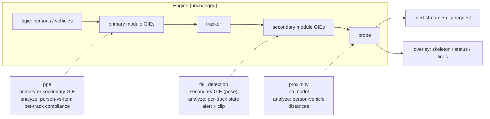

# Adding fall detection, PPE and vehicle-to-human proximity

*Assessment of how the next three use cases fit the module architecture (`perception/ARCHITECTURE.md`), what would conflict with
the pipelines already there, and what to change in the common core first. Written 2026-10-25 from the code as it is on
`refactor/deepstream-pipeline`. The models are not chosen yet, so section 1 states the assumptions; if the models differ,
sections 2 and 3 change with them.*

## Verdict

The three fit the architecture. Each is **a new folder under `perception/modules/`** plus a line in a product yaml, and
none of them needs to touch the engine. They do **not** conflict with the existing modules logically (no module calls
another, and the existing ones touch different labels). They compete for shared resources (GPU above all, section 3).

The three capabilities the core lacked when this was first written, and five smaller ones, are **done** (section 4):
modules can read a model's custom per-object output (`extract` / `attrs`), draw (`out.draw`), raise alerts the app
handles with no new code (`services.alert`), gate a GIE to fewer frames/objects, reload app-edited settings, add a
parser and dependencies from their own folders, and be measured on the GPU. What is left is per-module work.

## 1. What I assumed about each

| Use case | New model | New logic |
|---|---|---|
| **Fall detection** | A pose / keypoint model run on each tracked person (secondary GIE, like the face detector), or a person-state classifier | Per tracked person over time: torso angle, aspect ratio, speed of change, time lying still after a drop; alert once per event, with a clip |
| **PPE** | A detector for helmet, vest, gloves, boots (full frame as a second primary GIE like the fire detector, or on person crops as a secondary GIE) | Associate each PPE item with its person, decide compliance per person track with smoothing, usually only inside configured areas; alert and annotate |
| **Vehicle-to-human proximity** | **None strictly**: persons and vehicles come from the product's main detector. A product whose detector has no persons (the multicam vehicle model) needs a person detector added as a module GIE | Distance between each person and each vehicle (and their closing speed), against a calibrated safe distance; alert once per pair; clip |

## 2. How each one plugs in

### Fall detection

- **Model:** `gies()` returns a secondary `GieSpec` (keypoints per person). Same pattern as `face_detect`.
- **Output of the model:** keypoints are not boxes. The face module smuggles landmarks through the object's mask field;
  pose would do the same: an `extract` hook reads them through `perception.engine.nvds` into `obj.attrs["keypoints"]`
  (section 4, change 1, done).
- **Logic:** per-track history in `services.state(self.name, stream_id)`. Falls involve occlusion, so tracker ids can
  switch: reuse the spatial "inherit the id of a track that vanished here" idea (`ZoneReentryGrace`, in `perception/lib`).
- **Cost:** a secondary GIE on every person every frame. `face_detect` already has the pattern to cut this
  (run only on sampled frames by hiding persons from the GIE); that is now `perception.engine.gie_gate.GieGate`, usable by
  any secondary GIE.
- **Alert and clip:** `services.emit(...)` and `services.request_clip(...)` exist and are generic.
- **Needs from the core:** keypoint access, skeleton drawing, alert contract: all available (changes 1-3).

### PPE

- **Model:** two ways, with different trade-offs.
  - *Secondary GIE on person crops:* every item arrives with `parent_id` = the person, so association is free, and a
    non-detection means "not wearing". Costs one inference per person.
  - *Full-frame primary GIE* (like `fire_alerts`' `pgie_fire`): cheaper per frame, but the module associates items to
    persons by box containment, which is noisier.
- **Zone dependence:** compliance usually applies only inside an area. The zones module already tells every object which
  ROIs it is in (`attrs["roi"]`, filled by zones' `extract`). PPE should declare `requires = ("zones",)` and read `attrs["roi"]`. This
  is the approved pattern (data through objects), not a module-to-module call. It means PPE products also need the zones
  element and the app's zone editor.
- **Labels:** the engine marks an object as drawn and published only if its label is in the product's `relevant_classes`.
  The PPE module sets its own `draw` / `publish` flags in `transform`, so it does not need to be added there, but any
  product that wants PPE items in `dets` must list them.
- **Needs from the core:** attribute access if attributes come from a classifier head (`extract`), a distinct overlay
  (`out.draw`, optional: coloured boxes are enough for a first version), alert contract (`services.alert`): all available.

### Vehicle-to-human proximity

- **Model:** none. It reads `frame.objects`: persons and vehicles that the product's detector produced.
- **The catch is the detector, not the module.** The multicam product's main detector is a 1-class vehicle model with no
  persons; attendance's is a COCO model with both. A product with a vehicle-only detector has to add a person detector
  as a primary module GIE (as the fire detector does), at the cost of another full-frame inference.
- **Order:** list it **after** `box_stabilizer` (it should measure the steady vehicle boxes, not the flickering ones) and
  after `zones` if filter regions should apply.
- **Calibration:** pixel distance is meaningless across a perspective view. It needs per-camera calibration (a ground-plane
  homography, or a safe zone defined as a polygon around the vehicle scaled by its box). Only zones have a UI and a file
  the app writes today; proximity uses the same mechanism through `control()` with `perception.lib.versioned`
  (version key, reload, acknowledge). The app-side editor is the work.
- **Joining with MTMC:** `mtmc` now puts the vehicle's global id in `attrs["global_id"]`; list proximity after `mtmc`.
- **Needs from the core:** nothing missing: `services.alert`, `out.draw` and `attrs["global_id"]` exist.

## 3. Where they would conflict with what exists

| Shared resource | What happens | Severity | Mitigation |
|---|---|---|---|
| **GPU time and memory** | Each added model is another inference per frame. The development laptop (RTX 5050, 8 GB) has already run out of memory twice, once on 13 cameras. Multicam already carries torch Re-ID, an OCR model and two GIEs. | **High, per product** | Measure `gpu.infer.<name>` busy% per added model (telemetry already has it); use `interval` / sampled frames; cap camera counts in demos; decide per product which combinations are supported |
| **The tracker** | One `nvtracker` follows the output of the main detector **and** every primary module GIE. New classes (helmet, vest) become tracked objects, with more ids and more work. | Medium | Prefer secondary GIEs (attributes of a person) over primary ones for PPE; check the tracker config's per-class behaviour (`checkClassMatch` is on) |
| **One main-detector slot** | `pgie_config` is a single product-level model. Persons and vehicles in one product only work if that model has both, or a second primary is added. | Medium | Decide the detector per product before writing proximity |
| **`relevant_classes`** | A global per-process list decides what is drawn and published. A new label silently disappears from `dets` if not listed. | Low | Document it in each module's README; modules set their own flags |
| **Colours and annotation priorities** | Red = zone violation (priority 1), orange = fire/smoke hazard (priority 10). Three new alert kinds need colours that do not collide, and a rule for which wins. | Low, easy to get wrong | One table of colours and priorities (below) |
| **Alerts reach the app through hand-wired streams** | `iris:zone_alert` and `iris:overcrowd_alert` each have a usecase in `app/usecases/`; fire reuses the overcrowd stream with `kind=fire_smoke`. Each new alert would copy that. | **High work, not high risk** | One alert contract (change 3) |
| **Clip recording** | Smart-record allows one session per camera; alerts within `svr_coalesce_seconds` share a clip. A fall during a fire alert gets one clip, which is fine, but a clip's reason is whichever came first. | Low | Put the alert kind in the clip index when the contract is written |
| **Module order** | Modules that replace objects (`box_stabilizer`) change what later modules see. A new module that reads vehicles must be listed after it. | Low | Document the order in the product yaml, as multicam does |
| **Dockerfile and model parsers** | Done (change 6): every `nvdsinfer_custom_impl_*` directory is built by the image, and a module's pip dependencies are its own `requirements.txt`. The images (and the heavy `mtmc` target) still carry every module's dependencies, so the image grows with each model. | Low | Add the module to `BASE_MODULES` or `MTMC_MODULES`; split a target if a dependency is heavy |
| **Config files for models** | nvinfer configs live under `perception/models/<Name>/`; class selection is done inside the nvinfer config (the unused `GieSpec.operate_on_class_ids` was removed). | Low | Select classes in the model's nvinfer config |

### Colour and priority table (proposal; default, zone, fire and PPE exist today)

| Meaning | Colour (BGR) | Priority |
|---|---|---|
| Default | green `(0,255,0)` | none |
| Zone violation | coral `(94,111,255)` | 1 |
| Fire / smoke hazard | orange `(0,140,255)` | 10 |
| Fall (proposed) | magenta | 12 |
| PPE non-compliance (`ppe`) | yellow `(0,255,255)` | 8 |
| PPE item box (`ppe`) | sky blue `(255,191,0)` | 2 |
| Proximity danger (proposed) | red-purple | 11 |

## 4. What was changed in the common core (all done, golden replays identical)

| # | Change | Where |
|---|---|---|
| 1 | **Generic object attributes.** `ObjectView.landmarks` and `roi_labels` are gone; `ObjectView.attrs` carries what modules attach. A module's `extract(frame)` returns a function the engine runs on every object while its pyds metadata is valid. pyds is only touched through `perception/engine/nvds.py` (`analytics_roi`, `instance_mask`). `mtmc` publishes `attrs["global_id"]`. | `frame.py`, `objects.py`, `nvds.py`, `modules.py`; zones, face_detect, person_masks, mtmc |
| 2 | **A draw hook.** `out.draw(fn)`, `fn(img, sx, sy)`, runs on the publisher thread after the boxes. The publisher no longer special-cases `"face"`: `face_detect` annotates its own boxes with an empty caption at priority -1 (any other annotation replaces it, in any module order). | `frame.py`, `publisher.py`, `face_detect` |
| 3 | **One alert contract.** `services.alert(camera, kind, severity=, category=, message=, pts=, zone=, count=, ...)` writes `iris:alert:<camera>`; one app usecase (`ModuleAlerts`, a single reader over all cameras) turns each entry into an event with the module's own severity and category. Zones and fire keep their streams (they open and resolve incidents). Still to build per module: a frontend card by kind, if the generic event card is not enough. | `modules.py`, `app/usecases/module_alerts.py`, `app/redis_streams.py` (`read_streams`), `alert_events.py` |
| 4 | **The "run a GIE on sampled frames / inside areas" gate** is `perception/engine/gie_gate.py` (`GieGate.install`); `face_detect` is its first user. | `gie_gate.py`, `face_detect` |
| 5 | **GPU budget**: `tools/engine_gpu_budget.sh <config>` replays a golden clip and prints each GPU stage's busy% (`engine_gpu_budget.py` parses any log). | `tools/` |
| 6 | **Model onboarding**: the Dockerfile builds every `perception/models/*/nvdsinfer_custom_impl_*` (`build_parsers.sh`, flags in `parser_flags`) and installs each module's `requirements.txt` (`BASE_MODULES`, `MTMC_MODULES`); a test fails when a module imports something nothing declares. | `Dockerfile`, `perception/models/`, `tests/test_module_requirements.py` |
| 7 | **Versioned hot reload**: `perception/lib/versioned.py` (`VersionedConfig`) holds the version-bump, reload, acknowledge protocol; zones use it. | `perception/lib/versioned.py` |
| 8 | **Boundary test** also forbids quoted use-case labels in `perception/engine/`. | `tests/test_engine_boundary.py` |

Also done: `after = (...)` soft ordering on `Module` (`mtmc` after `plates`), the shared kinds/labels/`attrs` vocabulary
table in `perception/modules/README.md`, roles and the untagged-recording owner moved from the shared yaml into
`products/attendance/sidecar.yaml`, `GieSpec.operate_on_class_ids` removed.

Not done, on purpose: the `iris:meta` v2 shape. New modules write their own namespaced field; it only matters when the
attendance, barber, app and mtmc readers are migrated.

## 5. Suggested order

1. **Proximity first.** No new model, so it proves the alert contract, the draw hook and the versioned reload on the
   least risky module.
2. **PPE.** It proves attributes and a second secondary GIE next to the face detector in one product.
3. **Fall detection** last: the most demanding on GPU and on tracking quality, so it goes last with real measurements
   (`tools/engine_gpu_budget.sh`) behind it.

## 6. Questions that decide the details

- Which pose, PPE and person-detector models, and their licences and formats (ONNX, parser needed?)
- Which products get these: a new product, or added to attendance / multicam? (Decides GPU budget and the detector slot.)
- Where are alerts shown: the existing IRIS alert feed, or each product's own UI?
- Is proximity required in real metres (calibration per camera) or a relative danger zone around each vehicle?
- Does PPE only matter inside configured areas (then it depends on the zones module and its editor)?
