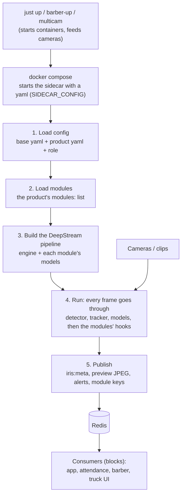
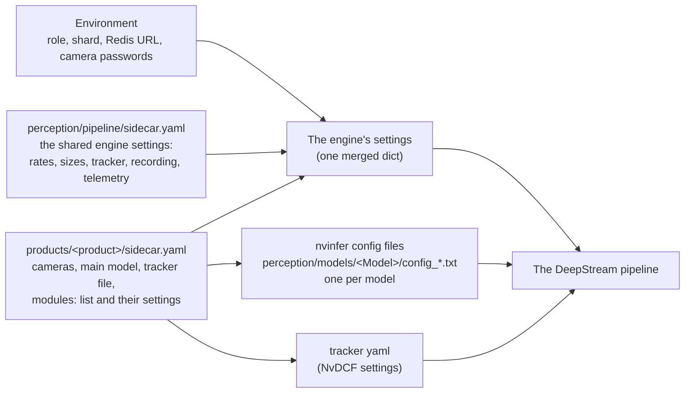
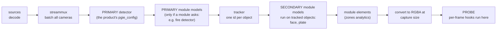
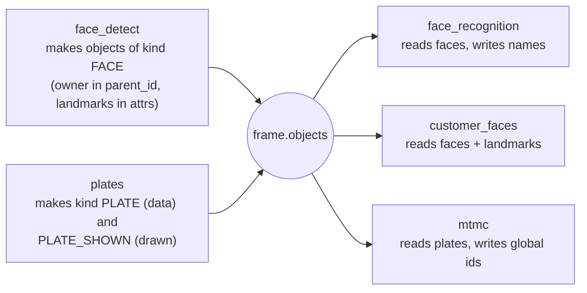
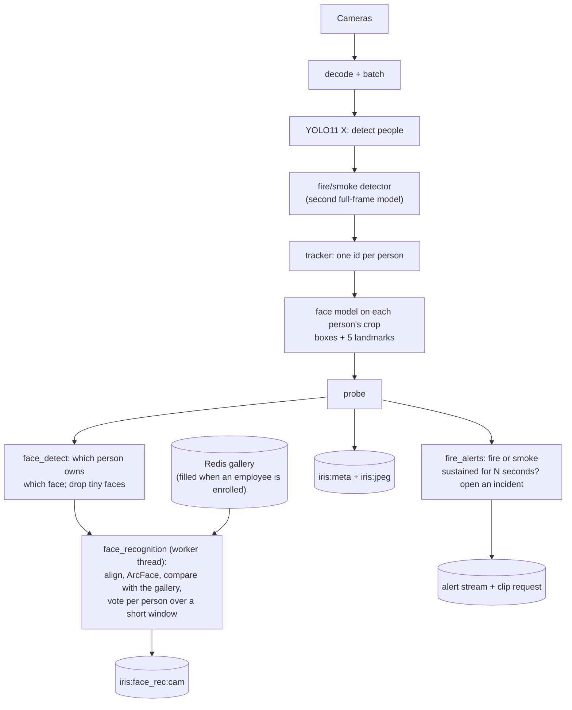
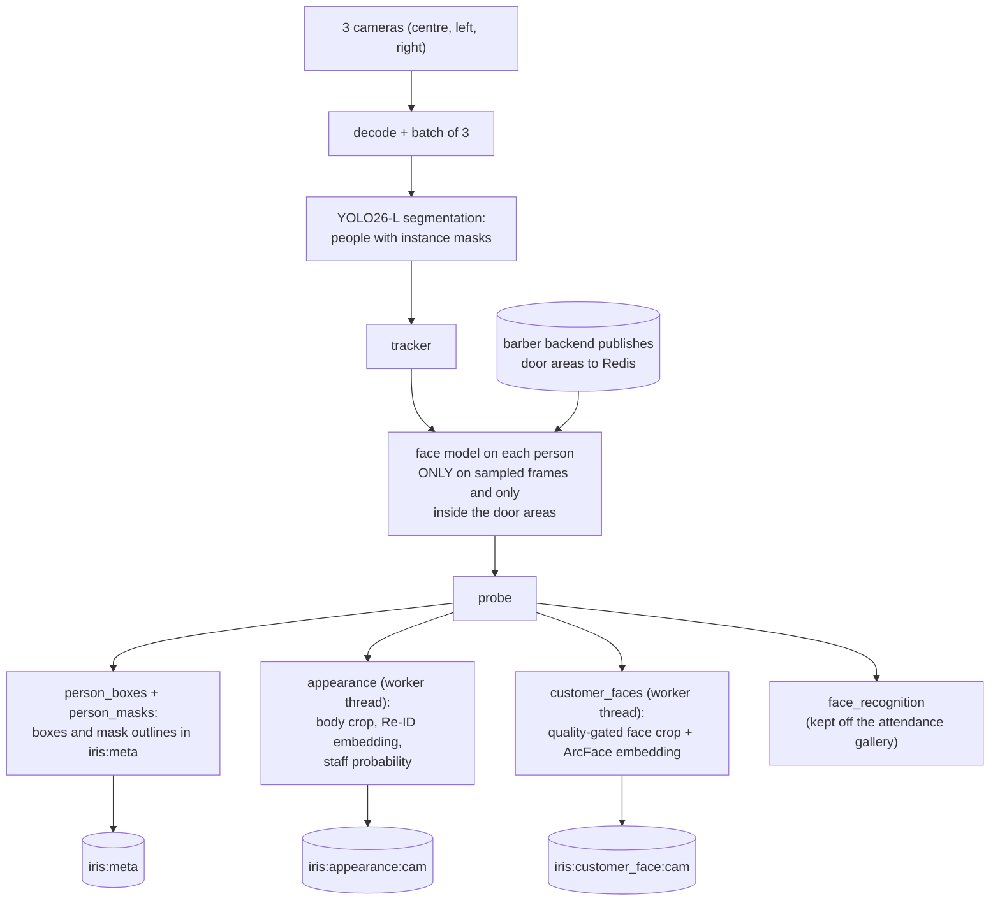
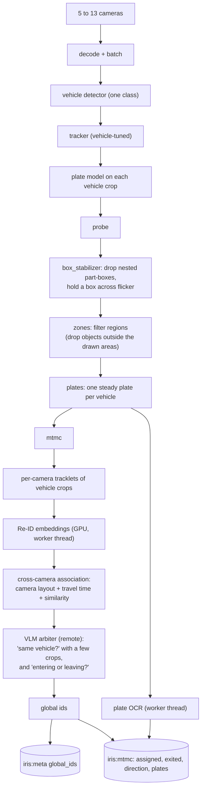

# How the AI pipeline runs, from `just ...` to the last Redis key

*A walkthrough for someone who wants to understand the AI side (DeepStream, the models and the modules) as blocks, not as
code. Everything outside the AI (the app, the product backends, the dashboards, the truck UI) appears only as a box that
reads or writes Redis. The design behind it is in [`ARCHITECTURE.md`](ARCHITECTURE.md); this page follows one run in
order and then does each use case end to end.*

**Contents**

1. [The whole run on one page](#1-the-whole-run-on-one-page)
2. [From `just` to a running sidecar](#2-from-just-to-a-running-sidecar)
3. [How DeepStream gets its configuration](#3-how-deepstream-gets-its-configuration)
4. [How a use case tells DeepStream what it needs](#4-how-a-use-case-tells-deepstream-what-it-needs)
5. [What DeepStream does with a frame](#5-what-deepstream-does-with-a-frame)
6. [How a use case gets its data from DeepStream](#6-how-a-use-case-gets-its-data-from-deepstream)
7. [Attendance, end to end](#7-attendance-with-fire-end-to-end)
8. [Barber, end to end](#8-barber-end-to-end)
9. [Multicam (trucks), end to end](#9-multicam-trucks-end-to-end)
10. [The end of the pipeline: what is written and who reads it](#10-the-end-of-the-pipeline)
11. [Controlling it while it runs, and when it breaks](#11-controlling-it-while-it-runs-and-when-it-breaks)
12. [Where do I change X?](#12-where-do-i-change-x)
13. [Glossary](#13-glossary)

---

## 1. The whole run on one page



In words: `just` brings up the containers and the camera feeds; the sidecar container reads **one yaml**, turns it into a
GStreamer/DeepStream pipeline with the models the listed modules ask for, and from then on every camera frame is detected,
tracked, interpreted by the modules, and published to Redis. Everything downstream only ever reads Redis.

---

## 2. From `just` to a running sidecar

The three use cases start differently outside the AI, and identically inside it.

| use case | command | what it starts besides the sidecar | the sidecar's yaml |
|---|---|---|---|
| **Attendance** (with fire) | `just up [cams]` (CHIRLA test cameras: `just up cam-15`) | Redis, MinIO, go2rtc (camera relay), the IRIS app, a host process streaming the test video into go2rtc, the attendance backend, the frontend; `_register_people` puts every enrolled employee's face embedding into Redis | `products/attendance/sidecar.yaml` |
| **Barber** | `just barber-up` | Redis, MinIO, go2rtc, the barber sidecar service, the barber backend (`:8003`), a clip streamer for a test run | `products/barber/sidecar.yaml` (or a site's chain, e.g. Palm Hills) |
| **Multicam (trucks)** | `just multicam` (runs `scripts/run_setup.sh multicam`) | applies the multicam app preset (**turns on the tracking service and the truck feed in `config.yaml`**), Redis, MinIO, go2rtc, the app, the `mtmc` sidecar image, the truck-tracking UI | `configs/presets/multicam/sidecar.yaml`, which extends `products/multicam/sidecar.yaml` |

Inside the container the start is always the same:

```mermaid
sequenceDiagram
  participant C as compose
  participant S as sidecar process<br/>python -m perception.engine.main
  participant R as Redis
  C->>S: start with the yaml named by SIDECAR_CONFIG, plus env (role, shard, Redis, camera credentials)
  S->>S: load the yaml and everything it extends
  S->>S: resolve the cameras; apply the role (which cameras, which modules); refuse unknown roles
  S->>R: purge status keys of cameras that no longer exist
  S->>S: build the pipeline (section 4) and set it PLAYING when autostart is on
  S->>R: iris:status:<camera> (running, boot id, preview mode): this is how the app discovers cameras
```

The camera side is a block you can ignore for the AI: live cameras (or a test streamer) publish RTSP into **go2rtc**, and the
sidecar pulls `rtsp://go2rtc:8554/raw-<camera>` (or a `file://` clip in the golden and demo configs), so DeepStream always
sees the original codec.

---

## 3. How DeepStream gets its configuration

There are four layers. Each answers a different question, and each lives in a different file.



| layer | file(s) | decides |
|---|---|---|
| **Run environment** | compose service, `.env`, `IRIS_SIDECAR_ROLE`, `IRIS_SHARD_*` | which yaml, which role (subset of cameras and modules), which shard of the cameras |
| **Engine settings** | `perception/pipeline/sidecar.yaml` (shared), overridden by the product yaml through `extends:` | the camera and batch geometry (`mux_width/height`), how often meta is published (`sample_fps`), how often the detector runs (`process_fps`), whether the preview is drawn (`pipeline_preview`), the tracker, which classes are drawn and published (`relevant_classes`), recording, telemetry |
| **Product settings** | `products/<name>/sidecar.yaml` | the cameras (`sources:`), the **main detector** (`pgie_config`), the tracker file, and the **`modules:` list** with each module's settings (in order) |
| **Model settings** | `perception/models/<Name>/config_*.txt` (nvinfer), the tracker yaml, the nvdsanalytics file | per model: the ONNX file, precision (FP32/FP16/INT8), classes, input size, the **custom output parser** library, and, for a secondary model, which detector and which classes it runs on |

How the merge works: `extends:` deep-merges the product yaml over the shared one, so a product only states what is
different. The shared file lists **no module and no camera**, so nothing is on by inheritance. A product can also declare
**roles** (`role_overrides`): a process started with `IRIS_SIDECAR_ROLE=fire` runs only the cameras tagged for it and drops
the modules it does not need (the fire process turns the COCO detector off and keeps the fire detector).

Strict by design: an unknown key, a missing required setting, an unknown module, or a module whose prerequisite is not
listed refuses to start with a message that names it. A stale config therefore cannot run half-configured.

A note on rates, because they decide the AI load:

| setting | meaning |
|---|---|
| `process_fps` | the detector processes this many frames per second per camera; `0` means every frame. A throttled frame still advances the tracker with the last detections |
| `sample_fps` | how often a frame becomes a **published sample** (`iris:meta`, recognition, appearance). Modules do their per-sample work on these frames |
| `stream_fps`, `pipeline_preview` | the annotated preview JPEG for the dashboard. `false` means the dashboard plays the raw stream and draws boxes from `iris:meta`, and the GPU does no preview work |

---

## 4. How a use case tells DeepStream what it needs

A use case is a **module**. Between loading the yaml and starting the pipeline, the engine asks each listed module what it
needs, in the order they are listed. The module answers through a small fixed set of build-time calls:

| the module says | meaning | example |
|---|---|---|
| `gies()` | "I need these inference models in the pipeline" (a model spec: nvinfer config, **primary** or **secondary**, engine file, interval) | `face_detect` asks for the face model as a secondary model; `fire_alerts` asks for a second full-frame detector; `plates` for the plate model |
| `elements()` | "I need these other pipeline elements" | `zones` asks for the analytics element that reports which region each object is in |
| `on_built(pipeline)` | "the pipeline exists; let me find my elements and add my probes" | `face_detect` installs its sampling gate on its model |
| `start()` / `stop()` | worker threads | recognition, appearance, plate OCR threads |
| `control()` | "tell me when these Redis keys change" | zones reload when the app saves a zone |
| `gauges()` | numbers for telemetry | |

The engine then assembles the chain **from those answers**; no model slot is hard-coded:



What changes per use case is only **which models sit in those boxes**:

| use case | primary detector (`pgie_config`) | primary module model | tracker config | secondary models (module) |
|---|---|---|---|---|
| **Attendance** | YOLO11 X, 80 COCO classes, FP32 (only `person` is used) | fire/smoke detector (`fire_alerts`), when listed | `config_tracker_nvdcf.yml` | face detector on each person (`face_detect`) |
| **Fire role** (a separate process) | none (`pgie_enabled: false` by role) | fire/smoke detector | same | none |
| **Barber** | YOLO26-L **instance segmentation** (people with masks), FP16, batch 3 | none | `products/barber/tracker.yml` | face detector on each person (`face_detect`) |
| **Multicam** | YOLO vehicle detector, one class `vehicle`, FP16 | none | `config_tracker_nvdcf_vehicle.yml` | plate detector on each vehicle (`plates`) |

A **primary** model looks at the whole frame. A **secondary** model looks only at the crop of each object a primary model
found (its nvinfer config says `operate-on-gie-id` and the class), which is why the face model runs only on people and the
plate model only on vehicles. Each model's **custom parser** (a compiled library built into the image) turns the raw network
output into boxes (or masks, or landmarks) that DeepStream understands.

Two safety checks happen here: two models may not share an engine file (a silent mix-up would load one model's weights for
another), and a module whose setup fails stops the whole start instead of running without it.

---

## 5. What DeepStream does with a frame

```mermaid
sequenceDiagram
  participant G as GStreamer chain<br/>(GPU)
  participant P as Probe (engine)
  participant M as Modules<br/>(in yaml order)
  participant W as Worker threads<br/>(recognition, Re-ID, OCR)
  participant PUB as Publisher thread
  participant R as Redis
  G->>P: a batch: every camera's frame with objects attached (boxes, ids, secondary results)
  loop each camera's frame
    P->>P: FrameView; objects read off the metadata ONCE
    P->>M: sample (who decides this is a published sample?)
    P->>M: on_frame (every frame, never gated)
    P->>P: decide what is drawn and published (relevant_classes, conf_threshold)
    P->>M: transform (filter, replace, add objects)
    P->>M: wants_pixels? one GPU to CPU copy if anyone asks
    P->>M: on_pixels (crops)
    P->>M: analyze (events, colours, extra output)
    M-->>W: hand crops / clean frames to worker threads (never blocking)
    P->>PUB: job: boxes, annotations, iris:meta fields
  end
  PUB->>PUB: draw boxes and names, encode JPEG (if the preview is on)
  PUB->>R: iris:meta, iris:jpeg
  PUB->>M: after_publish(clean frame): face recognition, customer faces
```

The things DeepStream itself produces for every object, before any module runs:

- the **label, confidence and box** (from the detector and its parser);
- the **tracker id**, stable across frames, with "shadow" tracks when the detector briefly misses an object;
- for a secondary model, its **parent** (the person a face was found in, the vehicle a plate was found on) and which model
  produced it;
- optional extras attached by a parser or an element: an **instance mask** (segmentation), a few packed floats (the face
  model puts five landmarks there), or the **analytics region** an object is inside.

The engine converts all of that **once per frame** into a single list of objects. Modules never read raw DeepStream
metadata; that is what keeps them testable without a GPU.

The heavy AI work is split on purpose:

| where | what runs there |
|---|---|
| **DeepStream, GPU, TensorRT** | the detectors and secondary models, the tracker (the frame's hot path) |
| **Module worker threads, GPU** | ArcFace embeddings (face recognition and customer faces, ONNX Runtime GPU), the vehicle Re-ID model (PyTorch), body Re-ID and the staff classifier (ONNX), plate OCR (ONNX) |
| **Outside the box** | an optional vision-language model that settles cross-camera vehicle matches and a vehicle's travel direction (a remote Ollama / OpenAI-compatible host); the pipeline never waits on it |

A rule that holds everywhere: the streaming thread only decides and hands off; anything slow runs on a worker thread, and a
worker's full queue drops the sample rather than blocking the pipeline (appearance documents this explicitly; the other
workers follow the same convention).

---

## 6. How a use case gets its data from DeepStream

A module gets data in exactly four ways:

| way | what it is | used by |
|---|---|---|
| **The object list** (`frame.objects`) | every detection, with label, box, id, parent and the model that produced it. A module may add, replace or hide objects, and mark an object with a **kind** (`face`, `plate`) so other modules can find it | everyone |
| **Object attributes** (`obj.attrs`) | extra values read off the DeepStream metadata by the module's own `extract` step: the analytics region an object is in, an instance mask, facial landmarks. Another module can read them by key | zones, person_masks, face_detect, mtmc |
| **Pixels** | a CPU copy of the frame, made only when some module asks (`wants_pixels`) and only on frames that need it; the **clean** frame (before boxes were drawn) arrives through `after_publish` | appearance, face_recognition, customer_faces, mtmc |
| **The publisher's output** | a module adds extra fields to `iris:meta`, colours and captions to boxes, even its own drawing, and raises alerts | everyone |

How the modules cooperate without calling each other:



A module that depends on another says so (`requires` it, or `after` it for order only) and the loader checks.

---

## 7. Attendance (with fire) end to end

**Goal:** know who is on camera, count each person once per visit, and raise an alert when fire or smoke persists.

**Modules, in order:** `person_boxes`, `face_detect`, `face_recognition`, `fire_alerts`
(`products/attendance/sidecar.yaml`).



Step by step:

1. **Setup.** `just up` brings up the stack; `_register_people` puts each enrolled employee's face embedding in a Redis hash
   (`attendance:face:gallery`). The sidecar builds the chain above. `face_detect` has an idle switch that turns its model **off** while the
   gallery is empty and nothing is capturing faces; attendance configures it with face capture on (unknown faces are saved
   as gallery candidates), so the face model stays on.
2. **Detection and tracking.** Each frame: YOLO finds people, the fire model scans the whole frame, the tracker gives each
   person an id.
3. **Faces.** The face model runs on each person's crop and returns a face box plus five landmarks (eyes, nose, mouth). In
   the probe, `face_detect` decides **whose face it is** when person boxes overlap (a rule per product; attendance keeps the
   `legacy` rule its recognition thresholds were tuned with) and drops faces too small to be read.
4. **Recognition.** On published frames that have faces, the frame's clean pixels go to a recognition thread, which straightens
   each face with its landmarks, embeds it with ArcFace, compares it to the gallery and **votes over a short window per
   tracked person** so a name does not flicker. A name needs several consistent votes and beat the runner-up by a margin
   (otherwise "unknown"); a locked name that teleports is re-checked.
5. **Output.** The result is written to `iris:face_rec:<cam>`; the preview draws the person's name on their box; `iris:meta`
   carries the boxes and the people list.
6. **Fire.** `fire_alerts` latches fire and smoke separately: when either stays detected for its sustain window it raises an
   incident on the alert stream and asks for a recording clip; when it clears, it sends a resolve.
7. **Consumers.** The attendance backend reads `iris:face_rec:*`, ignores "unknown", turns recognitions into visits in its
   database; the IRIS app turns fire alerts into incidents with clips and shows the live preview.

**What decides quality:** the face model and the recognition thresholds (`threshold`, `margin`, `min_votes`, `lock_seconds`)
are tuned together against this product's detector; changing the main model means re-validating them.

---

## 8. Barber end to end

**Goal:** per chair, know who is seated and for how long, tell staff from customers, keep customers apart over time, and give
the register a picture of each customer.

**Modules, in order:** `person_boxes`, `person_masks`, `appearance`, `face_detect`, `face_recognition`, `customer_faces`
(`products/barber/sidecar.yaml`). Three cameras share one batch.



Step by step:

1. **Setup.** `just barber-up` builds the pipeline with the **segmentation** detector: for each person it returns a box *and*
   a mask, which is what lets the chair engine tell who is seated where. The preview is **off** (the barber UI plays the raw
   streams and draws boxes from `iris:meta`), which frees the GPU of all preview encoding.
2. **A cheaper face model.** The face model normally runs on every person of every frame, but faces are only read on published
   samples. `face_detect`'s **sampling gate** hides people from the model on every frame that is not a published sample, and the **regions** setting
   hides people outside the door areas (the backend publishes the door and face areas to Redis). This is the main GPU saver
   of this product.
3. **Masks and boxes.** `person_masks` turns each person's instance mask into a compact outline (at most 40 corners,
   normalised) and `person_boxes` lists the boxes; both ride in `iris:meta` on published frames.
4. **Appearance.** For each tracked person, at most once per `interval_s`, `appearance` takes a body crop, embeds it with a
   Re-ID model (so the same customer stays the same across time and cameras) and scores it with the **staff classifier**
   (staff are told by uniform; their faces are masked), publishing `{track, embedding, staff_p}` on `iris:appearance`.
5. **Customer faces.** For each face the detector reports (inside the door area), `customer_faces` applies quality gates (size,
   how frontal it is from the landmarks, sharpness), embeds the aligned face with ArcFace, saves the crop and publishes it
   on `iris:customer_face`.
6. **Consumers.** The barber backend reads `iris:meta`, `iris:appearance` and `iris:customer_face` and builds chair sessions,
   customer cards and haircuts; it also publishes the door areas back. Zones are evaluated by the backend, not by DeepStream.

---

## 9. Multicam (trucks) end to end

**Goal:** one identity per truck across cameras, its plate, and its direction (entering or leaving), shown on the Trucks page.

**Modules, in order:** `box_stabilizer`, `zones`, `plates`, `mtmc`
(`products/multicam/sidecar.yaml` and the preset). This uses the `mtmc` image (PyTorch for Re-ID).



Step by step:

1. **Setup.** `just multicam` applies the preset to the app (tracking service and truck feed on) and starts the `mtmc` sidecar.
   The detector has one class, `vehicle`; the plate model is a secondary model that looks only inside each vehicle's box.
2. **Steady boxes.** `box_stabilizer` drops boxes nested inside a bigger box of the same label (a cab inside a truck) and holds
   a box for a short time when the detector flickers. `zones` filter regions (saved per camera) remove objects outside the areas that count.
3. **Plates.** `plates` keeps one plate per vehicle (the one nearest the bottom centre of the vehicle), holds it between
   detections so it moves with the vehicle, and leaves two kinds of object in the frame: the plate as detected (data) and the
   held plate (drawn).
4. **Tracklets and Re-ID.** `mtmc` follows each vehicle per camera, collects crops over time, and a worker thread embeds them
   with the Re-ID model once it has enough.
5. **Association.** When a new vehicle appears, `mtmc` considers only vehicles that could have come from a connected camera
   after a plausible travel time, ranks them by Re-ID similarity, and asks the **VLM arbiter** (a few time-spread crops of
   each) whether they are the same vehicle; the highest-confidence "same" wins, otherwise a new global id. Cameras that see
   the same area are grouped; only vehicles first seen at the entrance cameras and decided as **entering** start a track.
6. **Direction and plates.** A second question to the VLM decides entering or leaving; the best plate per vehicle is read by
   an OCR model and announced with the digits.
7. **Output.** Global ids go in `iris:meta` (`global_ids`) and as a coloured `gid:` tag under each box;
   `iris:mtmc:assigned/exited/direction/plates` announce events.
8. **Consumers.** The app's **tracking service** reads detections and `iris:mtmc:*`, builds journeys and transitions between
   cameras; the **truck feed** forwards them to the truck-tracking platform's Redis queue, which fills the Trucks page. (If
   the preset was not applied, the sidecar tracks fine but the Trucks page stays empty.)

---

## 10. The end of the pipeline

Everything the AI produces leaves through Redis, one set of keys per camera:

| key | written by | content | read by |
|---|---|---|---|
| `iris:meta:<cam>` | engine (+ every module's fields) | frame number, time, detections, extra fields (`faces`, `person_masks`, `global_ids`, ...) | products, app, tracking |
| `iris:jpeg:<cam>` | engine | the annotated preview (if the preview is on) | dashboards |
| `iris:status:<cam>` | engine | running, boot id, preview mode: how the app discovers cameras | app |
| `iris:face_rec:<cam>` | face_recognition | names with confidence per tracked person | attendance backend |
| `iris:appearance:<cam>`, `iris:customer_face:<cam>` | appearance, customer_faces | embeddings, staff probability, face crops | barber backend |
| `iris:mtmc:*` | mtmc | assignments, exits, directions, plates | app tracking, truck feed |
| `iris:alert:<cam>` | any module through `services.alert(...)` | `kind`, `severity`, `category`, optional `message`, `zone`, `count`, `pts` | the app: one reader turns each entry into an event with a clip |
| `iris:zone_alert`, `iris:overcrowd_alert` | zones, fire_alerts | intrusion, overcrowding, fire/smoke with resolve | the app's zone and count/fire usecases |
| `iris:segments:<cam>`, `iris:svr_done:<cam>` | engine | recorded segments and alert clips | app (clips) |

The consumers are blocks to you: the **IRIS app** (events, clips, chat, dashboards), the **attendance backend**, the **barber
backend**, and the **tracking service plus truck UI**. They never talk to DeepStream; they read these keys.

**Recording and clips** (engine, no model): every camera can record rolling segments; when a module asks for a clip
(`request_clip`), the engine saves a smart-record clip around the event and announces it so the app can attach it to the
alert. Overlapping alerts share one clip.

---

## 11. Controlling it while it runs, and when it breaks

**While it runs**

- `iris:ctrl:pipeline` (`playing` / `paused`) starts and stops processing **without rebuilding**, so the TensorRT engines stay loaded.
- Modules can declare Redis keys to watch: for example the app bumps a version when a zone is saved, the `zones` module
  reloads the analytics config live, and writes back which version it applied so the app can warn if a reload keeps failing.
- Telemetry (per-stage timings, per-camera fps, GPU stage busy %) is logged and exported for Prometheus/Grafana.
  `tools/engine_gpu_budget.sh <config>` prints what each model costs on the GPU.

**When something breaks**

| failure | what happens |
|---|---|
| a camera stops sending frames | the engine notices a stall, restarts that source with back-off, records the episode; other cameras keep running |
| the main loop wedges | a watchdog thread notices, logs it and exits the process, so compose restarts the sidecar |
| a module's per-frame hook raises | logged and counted, rate-limited; the frame and the other modules continue |
| a module cannot set itself up (model missing, bad setting) | the sidecar **refuses to start** with a message naming the module |
| a model engine is missing | nvinfer rebuilds it from the ONNX on first start (slow once), then reuses it |
| a worker queue is full | the sample is dropped, never the pipeline blocked |

---

## 12. Where do I change X?

| I want to... | change |
|---|---|
| use another main detector for a product | `pgie_config` in the product yaml (+ the model's nvinfer config and parser) |
| tune how often the detector or the meta runs | `process_fps`, `sample_fps` in the product yaml |
| turn a capability on or off for a product | add or remove it under `modules:` (mind the order) |
| tune a capability | its settings under `modules.<name>` (see the module's README) |
| add a model for a new capability | a module returning a model spec from `gies()`, the model under `perception/models/` |
| change what is drawn on boxes | the module's annotations, or `relevant_classes` for the main detector |
| raise an alert from a module | `services.alert(...)` (shows up in the app with a clip) |
| run a model on fewer frames or objects | the GIE gate (`perception.engine.gie_gate`), as `face_detect` does with `sample_only` |
| see what a model costs | `tools/engine_gpu_budget.sh <config>` |
| prove I did not change behaviour | the golden replay, [`TESTING.md`](TESTING.md) |
| add a whole new use case | [`modules/README.md`](modules/README.md) |

---

## 13. Glossary

| term | meaning |
|---|---|
| **DeepStream** | NVIDIA's GStreamer-based video analytics SDK that runs models on the GPU |
| **nvinfer / GIE** | the DeepStream element that runs one model (TensorRT); "GIE" is its inference engine |
| **primary / secondary model** | a primary model runs on the whole frame; a secondary runs on each object a primary found |
| **pgie / sgie** | names for the primary and secondary inference elements |
| **nvstreammux** | batches the frames of all cameras into one so the GPU processes them together |
| **tracker (NvDCF)** | gives each object a stable id across frames and keeps "shadow" tracks through brief misses |
| **custom parser** | a compiled library that turns a model's raw output into boxes, masks or landmarks |
| **TensorRT engine** | the model compiled for this GPU (built from the ONNX the first time, then reused) |
| **probe** | the engine's per-frame callback after the chain, where the modules' hooks run |
| **module** | one capability under `perception/modules/`, switched on by the product yaml |
| **kind** | a label modules put on objects they create (`face`, `plate`) so others can find them |
| **sample (meta frame)** | a frame chosen to be published and analysed by the modules, `sample_fps` times a second |
| **gallery** | the Redis hash of registered face embeddings that recognition compares against |
| **Re-ID** | an embedding that says "this looks like the same person or vehicle" across time and cameras |
| **global id** | the one identity MTMC gives a vehicle across all cameras |
| **VLM arbiter** | a vision-language model asked a yes/no question about crops (same vehicle? entering or leaving?) |
| **SVR / smart record** | saving a clip around an event from a rolling cache |
| **role** | a way to run one product as several processes (for example fire cameras apart from attendance cameras) |
| **golden replay** | replaying a recorded clip and comparing every Redis write with a baseline |
