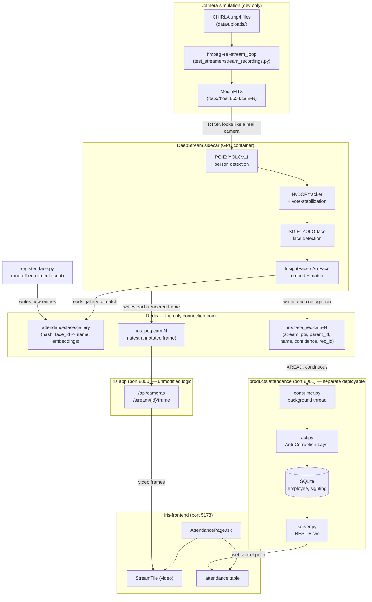

# Attendance pipeline — architecture & runbook

Reference doc for the products/attendance spike (ticket 02,
`.scratch/attendance-system/issues/02-*.md` in the planning bundle). Full
decision history: `~/.claude/mentor/decisions/attendance-system.md`.

This covers two things: **how the pieces fit together**, and **how to bring
the whole thing back up** after it's been torn down. Revisit this file
whenever picking the pipeline back up after a break.

## `just` recipes (kw-repo root)

A `justfile` at the `kw-repo` root (one level up from this repo and
`iris-frontend`) wraps all of this: `just up-build`, `just up`, `just down`,
`just clean`, `just logs`. See its own header comment for the design
(Option B: docker-compose owns the GPU-heavy stack; the other three pieces —
CHIRLA streaming, products/attendance, the frontend dev server — stay plain
host processes, tracked via PID files in `.run/`).

`up`/`up-build` take an optional camera list (default `cam-9`), passed
straight through to `stream_recordings.py --ids`: `just up cam-11`,
`just up "cam-9,cam-11"`. Default is `cam-9` specifically because it's one
of only two cameras (the other is `cam-11`) where Person-8 is confirmed
absent from CHIRLA's own annotations — every other camera shows all 8
people, which makes for a boring/misleading absence test. Full per-camera
breakdown:

| Camera | Who's absent |
|---|---|
| `cam-3`, `cam-10`, `cam-12`, `cam-13`, `cam-14` | nobody — all 8 appear |
| `cam-9`, `cam-11` | Person-8 |

Switching cameras doesn't need any code change — `consumer.py` already
iterates all 7 configured cameras regardless of which are actually
streaming, and just gets no new entries for ones that aren't live. The one
thing switching *does* require if you want a clean test: the `sighting`
table isn't cleared automatically on `up` (that's deliberately not a default
side effect), so stale rows from a previous, wider camera set will still
show someone "seen today" even after narrowing to a camera that shouldn't
see them. Clear it manually first: `DELETE FROM sighting` against
`products/attendance/data/attendance.db`.

**Gotcha: `iris`'s own Dockerfile can't actually build in this checkout.**
It bundles a *different* frontend than the one we work in — a git submodule
at `surveillance-camera-sys/frontend/` pointing at the same `iris-frontend`
repo, meant to produce a single self-contained backend+frontend image. That
submodule was never initialized here (empty directory, `npm ci` fails
immediately), and even initialized it's pinned to a commit before our
Attendance page work — so it wouldn't help anyway. We don't touch `iris`'s
Python backend in this project, so `just up-build` deliberately excludes
`iris` from `--build` and just starts it from whatever image is already
cached. Only `deepstream-sidecar` gets rebuilt.

## Gotcha: the live simulation's `pts` never resets, but the file does

`test_streamer` loops each source file forever (`ffmpeg -stream_loop -1`).
The file's actual content repeats every ~285s, but the sidecar's own `pts`
(and the `offset` field `/api/cameras` reports) keeps counting up forever —
it does **not** reset each loop. Left alone, a wall-clock computed as
`recording_start + pts` drifts arbitrarily far past the file's real ~5-minute
length (we saw values like `13:46:32`, over an hour past the nominal
`12:29:08` start) — which then can't be related to anything the seekable
player can show, since that's bounded to the file's real duration.

**The fix, applied everywhere a wall-clock gets computed:** mod `pts` by the
camera's real file duration first (`acl.wall_clock_for_spike`, and the
frontend's `CameraTile` overlay — both take a `duration_seconds` sourced from
`cameras.CAM_DURATIONS`, itself `ffprobe`'d once and hardcoded). This also
meant the sighting-coalescer's flush trigger needed to change: it used to
compare video-wall-clock minutes to decide "this bucket is done," but that
clock now wraps every loop, so minute comparison breaks. `SightingCoalescer.flush_due_buckets`
now flushes based on **real (processing) time since a bucket was last
touched**, entirely decoupled from the video clock — see `acl.py`.

**Confirmed working** by direct user verification after the fix: scrubbing
the synced recorded-footage player to a table's "last seen" timestamp shows
that person on screen at that moment, and vice versa — the table, the live
camera-tile overlay, and the recorded player all agree now.

## Quick start

The 30-second version, assuming Redis was wiped since last time (it has no
volume — see "What survives a teardown" below) but `products/attendance/data/attendance.db`
already has the 7 employees from a prior run, with `--face-id`s `person-1`..`person-7`.

```bash
cd /data/IRIS/kw-repo/surveillance-camera-sys

# 1. Backend up
docker compose up -d redis minio deepstream-sidecar iris go2rtc
until docker logs surveillance-camera-sys-deepstream-sidecar-1 2>&1 | grep -qE "pipeline PLAYING|ERROR"; do sleep 3; done

# 2. Re-register all 7 (Redis gallery is empty after a teardown — SQLite isn't)
for id in 1 2 3 4 5 6 7; do
  docker run --rm --device nvidia.com/gpu=all --network surveillance-camera-sys_default \
    -v <path-to-enrollment-photos>:/photos:ro \
    -v "$(pwd)/sidecar:/workspace/iris/sidecar:ro" -w /workspace/iris --entrypoint python3 \
    surveillance-camera-sys-deepstream-sidecar:latest \
    perception/pipeline/register_face.py --name "Person-$id" --photo "/photos/person_${id}_face.jpg" \
      --redis-url "redis://redis:6379/0" --gallery-key "attendance:face:gallery" \
      --face-id "person-$id" --gpu
done

# 3. Streaming + products/attendance + frontend (each in its own terminal/background)
cd test_streamer && python3 stream_recordings.py --ids cam-3,cam-9,cam-10,cam-11,cam-12,cam-13,cam-14
cd ../products/attendance && .venv/bin/uvicorn server:app --host 0.0.0.0 --port 8001
cd ../../iris-frontend && npm run dev -- --port 5173

# open http://localhost:5173/attendance
```

**Never run before, or want a totally fresh roster?** Use "Full clean
rebuild" further down instead of step 2 above — it also recreates
`attendance.db` so the Employee rows are guaranteed to match.

**Tear down:**

```bash
cd /data/IRIS/kw-repo/surveillance-camera-sys
docker compose down
pkill -f stream_recordings.py; pkill -f "uvicorn server:app"; pkill -f "vite --port 5173"
```

## 1. Component architecture



**The one rule that makes this whole design work:** `products/attendance`
never imports or depends on `surveillance-camera-sys`'s code. It only reads
one thing — the Redis recognition stream — through `acl.py`, which is the
*only* file that understands the sidecar's wire format. If the sidecar's
internals change, only `acl.py` needs updating.

### File-by-file responsibilities

| File | Role |
|---|---|
| `test_streamer/stream_recordings.py` | Loops a video file through `ffmpeg`, publishes as RTSP — the only thing simulating "a camera exists" |
| `perception/pipeline/sidecar.yaml` | Which RTSP sources to connect to, which gallery key to match against (`face_gallery_key`) |
| `perception/engine/` (+ `perception/modules/face_detect`, `face_recognition`) | The engine builds the GStreamer pipeline, draws boxes on frames and writes JPEG + meta to Redis; the face modules find faces and write the recognition JSON (see `perception/ARCHITECTURE.md`) |
| `perception/modules/face_recognition/recognizer.py` | `FaceGallery`/`FaceRecognizer` — loads the gallery, cosine-similarity match, per-track vote-stabilization |
| `perception/pipeline/register_face.py` | Enrollment: photo → embedding → gallery hash entry |
| **Redis** | The *only* connection between the sidecar and everything downstream |
| `app/server.py` (iris app, :8000) | `/api/cameras`, `/stream/{id}/frame` — serves video for *any* configured camera, ours included. Unmodified logic. |
| `products/attendance/acl.py` | Reads `iris:face_rec:*`, drops "unknown", resolves `rec_id` → `Employee`, buckets into `Sighting`s |
| `products/attendance/consumer.py` | Background loop keeping `acl.py` running continuously, flushes closed buckets to SQLite |
| `products/attendance/storage.py` | SQLite persistence + the retrospective daily-attendance query |
| `products/attendance/server.py` (:8001) | REST + websocket — broadcasts a fresh snapshot every flush |
| `iris-frontend/src/pages/AttendancePage.tsx` | Talks to **both** backends at once: :8000 for video, :8001 for the attendance table |

### What survives a teardown, what doesn't

| State | Where it lives | Survives `docker compose down`? |
|---|---|---|
| Gallery embeddings (`attendance:face:gallery`) | Redis (no volume mounted) | **No** — must re-register after every teardown |
| Recognition stream history | Redis (`maxlen=64`, trimmed anyway) | No, and wouldn't matter if it did |
| Employee roster + Sighting history | `products/attendance/data/attendance.db` (SQLite, on disk) | **Yes** |
| CHIRLA videos, enrollment photos | Local filesystem | Yes |

This mismatch matters: if you re-register with *different* face IDs than
what's already in `attendance.db`, the `Employee.gallery_rec_id` links break
silently (nobody gets recognized, no error). Always re-register with
`--face-id` pinned to the same values, or wipe `attendance.db` and rebuild
both together (see below).

**Embedding-model compatibility (`buffalo_l` → `auraface`):** Both packs emit
512-D embeddings, so `attendance:face:gallery` entries created with `buffalo_l`
load and compare without raising an error under `auraface`, yielding meaningless
similarity scores. Whenever switching recognition models—or deploying over a
persisted/non-fresh Redis—clear `attendance:face:gallery` (`redis-cli DEL
attendance:face:gallery`) and re-enroll all employees from `data/face_photos/`
with `products/attendance/reregister_all.py` (run automatically by `just up`
after a `just down` teardown).

## 2. Runbook

### Bring everything up

```bash
cd /data/IRIS/kw-repo/surveillance-camera-sys

# 1. Backend stack (reuses cached images — no rebuild)
docker compose up -d redis minio deepstream-sidecar iris go2rtc

# wait for the sidecar to finish loading before registering faces
until docker logs surveillance-camera-sys-deepstream-sidecar-1 2>&1 | grep -qE "pipeline PLAYING|ERROR"; do sleep 3; done

# 2. Enroll people into the forked gallery (repeat per person)
#    Photos live in the scratchpad from the original spike — copy them
#    somewhere durable if you want this to survive session cleanup.
docker run --rm --device nvidia.com/gpu=all --network surveillance-camera-sys_default \
  -v <path-to-enrollment-photos>:/photos:ro \
  -v "$(pwd)/sidecar:/workspace/iris/sidecar:ro" -w /workspace/iris --entrypoint python3 \
  surveillance-camera-sys-deepstream-sidecar:latest \
  perception/pipeline/register_face.py --name "Person-N" --photo "/photos/person_N_face.jpg" \
    --redis-url "redis://redis:6379/0" --gallery-key "attendance:face:gallery" \
    --face-id "person-N" --gpu

# 3. Link each registration to an Employee row (only if attendance.db is fresh —
#    skip if you're reusing an existing db with matching face-ids already linked)
cd products/attendance
.venv/bin/python -c "
from domain import Employee
from storage import connect, add_employee
conn = connect('data/attendance.db')
add_employee(conn, Employee(id='emp-N', name='Person-N', gallery_rec_id='person-N'))
"

# 4. Start streaming the CHIRLA cameras
cd ../test_streamer
python3 stream_recordings.py --ids cam-3,cam-9,cam-10,cam-11,cam-12,cam-13,cam-14

# 5. Start products/attendance
cd ../products/attendance
.venv/bin/uvicorn server:app --host 0.0.0.0 --port 8001

# 6. Start the frontend
cd ../../iris-frontend
npm run dev -- --port 5173
# open http://localhost:5173/attendance
```

### Full clean rebuild (all registered people, matching Employee rows)

```bash
cd /data/IRIS/kw-repo/surveillance-camera-sys/products/attendance
rm -f data/attendance.db     # start SQLite fresh — safe, gallery is being rebuilt too

cd ../
for id in 1 2 3 4 5 6 7; do
  docker run --rm --device nvidia.com/gpu=all --network surveillance-camera-sys_default \
    -v <path-to-enrollment-photos>:/photos:ro \
    -v "$(pwd)/sidecar:/workspace/iris/sidecar:ro" -w /workspace/iris --entrypoint python3 \
    surveillance-camera-sys-deepstream-sidecar:latest \
    perception/pipeline/register_face.py --name "Person-$id" --photo "/photos/person_${id}_face.jpg" \
      --redis-url "redis://redis:6379/0" --gallery-key "attendance:face:gallery" \
      --face-id "person-$id" --gpu
done

cd products/attendance
.venv/bin/python - <<'PYEOF'
from domain import Employee
from storage import connect, add_employee
conn = connect("data/attendance.db")
for i in range(1, 8):
    add_employee(conn, Employee(id=f"emp-{i}", name=f"Person-{i}", gallery_rec_id=f"person-{i}"))
PYEOF
```

### Bring everything down

```bash
cd /data/IRIS/kw-repo/surveillance-camera-sys
docker compose down          # stops + removes redis, minio, sidecar, iris app, go2rtc

pkill -f stream_recordings.py
pkill -f "uvicorn server:app"   # products/attendance
pkill -f "vite --port 5173"     # iris-frontend
```

### Sanity checks while it's running

```bash
# Employees currently enrolled
curl -s http://localhost:8001/api/employees

# Today's (spike day: 2023-06-08) attendance
curl -s "http://localhost:8001/api/attendance?day=2023-06-08"

# Latest recognition result on one camera
docker exec surveillance-camera-sys-redis-1 redis-cli XREVRANGE iris:face_rec:cam-3 + - COUNT 1

# A live annotated frame (has boxes + names drawn in)
curl -s -o frame.jpg http://localhost:8000/stream/cam-3/frame
```
