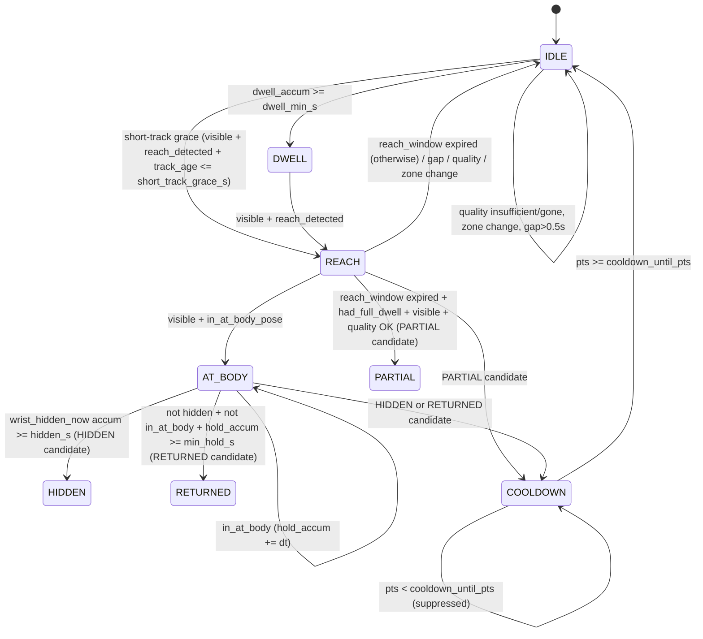

# Concealment FSM — diagram and scenario traces

## State diagram

Candidates are only emitted from REACH (`PARTIAL`) and AT_BODY (`HIDDEN`, `RETURNED`); IDLE and DWELL never emit, so they never enter COOLDOWN directly. Track loss supplies no terminal evidence and emits nothing.

Terminal candidate types: `RETURNED` (hand returns after hold), `HIDDEN` (wrist stays hidden), `PARTIAL` (reach expired after full dwell). Opt-in knobs add `RETURNED_FAST`, `HIDDEN_SPATIAL` and `EXIT`; see "Measured adoption" below.

Numbers below use the code defaults (`DetectorSettings`), with the deployed `concealment_detection.yaml` value in brackets where it differs: dwell_min_s 2.0, short_track_grace_s 1.2 [1.5], reach_window_s 2.5, min_hold_s 0.35, hidden_s 0.45 [0.40], max_conceal_elbow_deg 135 [140], cooldown_s 8.

## Scenario traces

| # | Scenario | Trace | Outcome |
|---|----------|-------|---------|
| 1 | Full clothing concealment (test) | IDLE→DWELL (dwell ≥ 2.0s)→REACH (reach frames)→AT_BODY (hold 0.5s)→RETURNED on hand return | high-tier candidate, cooldown 8s |
| 2 | Personal bag, sustained hidden wrist (test) | IDLE→DWELL→REACH→AT_BODY; wrist conf drops 0.5s ≥ hidden_s | HIDDEN candidate, target=personal_bag |
| 3 | Short-track grace (test) | IDLE→REACH (track age ≤ 1.2s [1.5s], dwell < 2.0s)→AT_BODY→RETURNED | medium-tier candidate |
| 4 | Brief brush (negative test) | REACH→AT_BODY but hold<min_hold_s, then reset | no candidate |
| 5 | Standing/walking (negative test) | never reaches reach_detected | no candidate |
| 6 | Insufficient quality (test) | quality INSUFFICIENT on first frame | assessment logged, no candidate |
| 7 | Walk-away with hand in pocket | AT_BODY… track lost → flush_on_track_end (no terminal evidence) → reset | **no candidate** (gap) |
| 8 | Hand switch mid-sequence | features stay locked to the reaching hand, so the other hand is ignored; the sequence ends on the locked hand's own evidence (RETURNED/HIDDEN, brief-hold reset, or reach expiry) — the stage is never stuck | **no candidate** if the item is concealed by the other hand (gap) |
| 9 | Slow reach >2.5s | REACH expires; PARTIAL only if had_full_dwell+visible+OK else reset | often **no candidate** |
| 10 | Zone change (shelf-a→shelf-b) | `_last_zone_id` changes → `_reset_to_idle` | **no candidate** |
| 11 | Observation gap >0.5s | gap check resets track | **no candidate** |
| 12 | Repeat within cooldown | COOLDOWN suppresses | **no candidate** |
| 13 | Conceal into shoe/hood/sleeve | body zone = "outside" | **no candidate** (gap) |
| 14 | Bag not flagged (has_bag=False) | no bag zone at all (the synthetic anchor is only used when has_bag=True without a bag_box); the hand counts only if it is near a waist/chest/under-arm target | often **no candidate** |
| 15 | Concealment with straight elbow (> 135° [140°]) and wrist not medial | in_at_body_pose false | **no candidate** |
| 16 | Fast drop-in (<min_hold_s) | hold_accum < min_hold → reset | **no candidate** (by design) |
| 17 | Multiple items quickly | second within 8s cooldown | **only first reported** |

## Predicted failure scenarios (from FSM audit)

### A. Breaks FSM recognition (would fail a hypothetical test)
1. Hand switch mid-sequence (pose flip / both hands) — features stay locked to the reaching hand; the other hand's concealment is never seen → no candidate.
2. Concealment ending in walk-away (no hand return) — flush_on_track_end has no terminal evidence → reset, no candidate.
3. Slow/long reach > reach_window_s — expires; PARTIAL only if had_full_dwell+visible+quality OK else reset.
4. Zone change (shelf-a→shelf-b or jitter None) — `_reset_to_idle` → no candidate.
5. Observation gap > 0.5 s — gap check resets track.
6. Reach without prior dwell after short_track_grace_s (1.2 s [1.5 s]) — never enters REACH.
7. Hidden-wrist path requires conf drop — visible hand in bag/pocket never triggers HIDDEN.
8. Hold accumulation stalls on a single non-at-body frame — reset if hold < min_hold_s.
9. Elbow not flexed enough (> max_conceal_elbow_deg, 135° [140°]) and wrist not crossing the torso midline — in_at_body_pose false → no AT_BODY.
10. Active-hand tie-break locks onto wrong hand when both move.
11. Repeat concealment within cooldown (8 s) — suppressed.
12. Non-modeled body zones (shoe, hood, sleeve, mouth) — classified "outside".
13. Personal bag not flagged (has_bag=False) — no bag zone is modelled at all; with has_bag=True but no bag_box, a fixed synthetic anchor beside the hip may mis-zone.
14. Quality degradation — DEGRADED keeps accruing dwell in IDLE/DWELL but blocks every transition there; INSUFFICIENT/GONE resets the sequence immediately (reason `quality`), not via the gap check.

### B. Real-life supermarket cases not covered
- Concealment while walking (no shelf dwell).
- Concealment into a visible personal bag (no conf drop).
- Concealment into accomplice's bag / stroller / cart.
- Concealment into shoe/hood/sleeve/mouth.
- Two-handed or hand-switching concealment.
- Very fast drop-in (< min_hold_s).
- Concealment then immediate exit (track lost).
- Multiple items in one visit (cooldown).
- Occlusion / facing away (INSUFFICIENT quality).
- Slow, deliberate reach over several seconds.
- Concealment with straight elbow (waistband slide).
- Concealing while holding a basket in the other hand.
- Zone-free deployment (no shelf zones).
- Re-ID remapping merging two shoppers.
- Concealment spanning camera handoff / >0.5 s gap.

## Original upgrade proposal (not deployed)

> This section is the original proposal. Each change was built as a default-off `DetectorSettings` knob and measured; none was adopted. See "Measured adoption" below for the results.

Design goals: (1) never abort a plausible concealment because of hand switch, zone change, or brief occlusion; (2) emit on track exit when evidence is sufficient; (3) model more body targets and both hands; (4) keep false positives low via evidence thresholds, not hard aborts.

### State diagram

```mermaid
stateDiagram-v2
    [*] --> IDLE
    IDLE --> DWELL: in shelf zone (dwell accum, cross-zone allowed)
    IDLE --> REACH: reach_detected (seed dwell; no age limit)
    DWELL --> REACH: reach_detected
    REACH --> AT_BODY: wrist in body/bag zone (proximity; elbow OR medial)
    REACH --> PARTIAL: reach window expired + (had dwell OR reach+inward) + visible
    AT_BODY --> AT_BODY: wrist in body/bag zone (hold accum, tolerant to flicker)
    AT_BODY --> HIDDEN: wrist in body/bag zone for >= hidden_s (spatial OR conf drop)
    AT_BODY --> RETURNED: wrist leaves body zone after hold_accum >= min_hold_s
    AT_BODY --> PARTIAL: reach expired but at-body time >= min_hold_s
    REACH --> IDLE: gap > 2.0s OR quality GONE/INSUFFICIENT>1.0s
    AT_BODY --> IDLE: gap > 2.0s OR quality GONE/INSUFFICIENT>1.0s
    REACH --> COOLDOWN: after candidate
    AT_BODY --> COOLDOWN: after candidate
    HIDDEN --> COOLDOWN: after candidate
    RETURNED --> COOLDOWN: after candidate
    PARTIAL --> COOLDOWN: after candidate
    COOLDOWN --> IDLE: cooldown elapsed (per track+zone+target)
    note right of AT_BODY
      Track end: if stage in AT_BODY/HIDDEN/REACH
      and (hold_accum>=min_hold_s OR hidden_accum>=hidden_s
      OR (reach_detected AND at_body_time>=min_hold_s))
      -> emit candidate (EXIT) instead of reset
    end note
```

### Key changes vs. original
- **Hand switch**: active hand can transfer if the new hand shows reach/at-body; both hands tracked in aggregate; no permanent abort.
- **Zone change**: dwell/stage persist across shelf zones; reset only when leaving all shelf zones or a large gap.
- **Gaps**: reset threshold raised to 2.0 s (stage-specific); AT_BODY tolerates up to 1.5 s.
- **Quality**: only GONE/INSUFFICIENT for >1.0 s resets; degraded continues.
- **Reach window**: extended; expiry emits PARTIAL if any at-body time or full dwell, not only full-dwell tracks.
- **Dwell prerequisite**: reach can seed dwell (low-tier) for walk-by concealment.
- **Hidden detection**: spatial containment in body/bag zone for hidden_s counts even if wrist conf stays high.
- **Hold accumulation**: tolerant to single-frame flicker (uses last in-body time + grace).
- **Elbow flexion**: relaxed — proximity to body zone suffices for AT_BODY; elbow only affects tier/score.
- **Track end**: emits candidate if evidence threshold met (fixes walk-away).
- **Body targets**: expanded to shoe, hood, sleeve, mouth, cart (cart as separate target).
- **Cooldown**: per (track, zone, target), shorter (4 s), and allows new candidate for a different target/zone.
- **Bag handling**: spatial bag zone used even without has_bag flag (fallback to person box).

### Expected traces if the rejected/deferred proposal were enabled

| # | Previously failing case | New trace | Result |
|---|------------------------|-----------|--------|
| 7 | Walk-away with hand in pocket | AT_BODY hold accumulates; on track end stage=AT_BODY with hold≥min_hold → EXIT candidate | candidate emitted |
| 8 | Hand switch mid-sequence | active hand transfers; hold continues → RETURNED/HIDDEN | candidate emitted |
| 9 | Slow reach >2.5s | REACH window extended; expiry emits PARTIAL if at-body time | PARTIAL candidate |
| 10 | Zone change shelf-a→shelf-b | stage persists; dwell continues | candidate emitted |
| 11 | Gap 0.5–1.5s in AT_BODY | tolerated; no reset | candidate emitted |
| 12 | Repeat within cooldown (different target) | per-target cooldown; new target allowed | second candidate |
| 13 | Conceal into shoe/hood/sleeve | new body zones modeled | candidate emitted |
| 14 | Bag not flagged | spatial fallback to person box | candidate emitted |
| 15 | Straight elbow waistband slide | proximity suffices; tier lowered | candidate emitted |
| 16 | Fast drop-in <min_hold | low-tier emit if reach+at-body+hidden/return | low-tier candidate |
| 1 | (AC) no dwell, walk-by reach | reach seeds dwell → REACH→AT_BODY→... | low/medium candidate |
| 17 | Immediate exit after concealment | track-end emit | candidate emitted |

### Remaining caveats
- Lowering aborts increases false-positive risk; mitigate via tiering (low/medium/high) and evidence thresholds.
- Both-hands aggregation may double-count if two people overlap; rely on track IDs.
- Expanded body zones need calibration data to set radii; defaults conservative.

## Measured adoption

Every implemented change in the proposal ships as a `DetectorSettings` knob. Its default reproduces the original FSM, and the ablation script checks the recorded baseline identity and metrics before publishing comparisons. Deferred targets and bag fallback are not implemented.

**Data.** RetailS development split only:
- positives: staged-dev clips (311 GT events, 229 single-person);
- negatives: 36 tune clips (21.9 span-hours);
- zones: proposed from the training clips, the same way `calibrate.py` does it.

Staged-test, realworld and the holdout days are never loaded.

**Objective.** `recall_single_person − 0.035 · fa_per_span_hour`, scored over all emitted tiers. The warning objective counts only high and medium tiers.

**Adoption rule.** A knob is adopted only if all of these hold:
- Δobjective ≥ +0.010;
- it gains at least 2 net single-person GT events;
- a paired clip bootstrap gives P(Δ > 0) ≥ 0.9;
- warning FA/h rises by no more than 3%;
- neither alternating half of the negatives (ordered by camera and day) gets more than 5% worse in FA.

**Baseline** (deployed yaml): objective −0.4623, single-person recall 0.389, FA/h 24.31. The full settings hash is `68ba454ba794`, the normalized legacy-profile hash is `e67fb7e6cc76`, and the standard-preload metric hash remains `13e60d27d32e` (prefix).

Long-loss variants use a separate paired baseline with a 2.6 s preload flush instead of 1.6 s. Its aggregate recall and FA counts match, but tier and reset breakdowns differ; exact baseline equality is required only within an identical preload identity.

**Result: no knob passed, so `concealment_detection.yaml` is unchanged.** Every knob stays off. With no passing solo variant, there was no eligible greedy combination. `tests/test_deployed_profile.py` pins this, and re-runs the main scenario traces under the deployed profile.

| Proposed change | Knob, value | ΔObj | ΔObj (warning) | Recall | FA/h | Events +/− | P(Δ>0) | Verdict |
|---|---|---|---|---|---|---|---|---|
| Low tier emitted (control) | `emit_low_tier` | −0.136 | +0.050 | 0.406 | 28.69 | +4/−0 | 0.00 | rejected |
| Gap tolerance | `sequence_max_gap_s` 1.0 | −0.008 | −0.008 | 0.389 | 24.54 | 0/0 | 0.00 | rejected |
| | 1.4 | −0.013 | −0.013 | 0.389 | 24.68 | 0/0 | 0.00 | rejected |
| | 2.0, with `lost_s` = `reid_max_gap_s` = 2.5 | −0.010 | −0.010 | 0.389 | 24.59 | 0/0 | 0.04 | rejected |
| Longer track loss only | `lost_s` = `reid_max_gap_s` = 2.5 | −0.002 | −0.002 | 0.389 | 24.36 | 0/0 | 0.30 | rejected |
| Quality grace | `insufficient_grace_s` 0.3 / 0.6 | 0 | 0 | 0.389 | 24.31 | 0/0 | — | no effect on RetailS |
| Zone persistence | `zone_persist_across_shelves` | 0 | 0 | 0.389 | 24.31 | 0/0 | — | no effect on RetailS |
| Zone-exit grace | `zone_exit_grace_s` 0.2 / 0.4 | 0 | 0 | 0.389 | 24.31 | 0/0 | 0.00 | no effect on RetailS |
| Longer reach expiry | `reach_expiry_s` 3.5 | −0.004 | −0.004 | 0.397 | 24.68 | +2/−0 | 0.32 | rejected |
| | 5.0 | −0.006 | −0.006 | 0.397 | 24.72 | +2/−0 | 0.26 | rejected |
| PARTIAL from near-body time | `partial_min_near_body_s` 0.2 (+low tier) | −0.006 | +0.002 | 0.389 | 24.49 | 0/0 | 0.00 | rejected |
| | 0.4 (+low tier) | −0.003 | 0.000 | 0.389 | 24.40 | 0/0 | 0.00 | rejected |
| Reach seeds dwell | `reach_seeds_dwell`, speed ≤ 0.3 (+low tier) | −0.209 | +0.300 | 0.432 | 31.52 | +11/−1 | 0.00 | rejected |
| | speed ≤ 0.6 (+low tier) | −0.227 | +0.333 | 0.445 | 32.43 | +14/−1 | 0.00 | rejected |
| Elbow flexion optional | `at_body_requires_flex` False | −0.356 | −0.356 | 0.323 | 32.61 | +28/−43 | 0.00 | rejected |
| Hold flicker tolerance | `hold_flicker_grace_s` 0.1 | −0.039 | −0.039 | 0.397 | 25.68 | +5/−3 | 0.01 | rejected |
| | 0.2 | −0.094 | −0.094 | 0.419 | 27.87 | +11/−4 | 0.00 | rejected |
| | 0.3 | −0.102 | −0.102 | 0.424 | 28.23 | +14/−6 | 0.00 | rejected |
| Fast drop-in | `fast_dropin_min_hold_s` 0.1 (+low tier) | −0.296 | +0.135 | 0.528 | 36.76 | +32/−0 | 0.00 | rejected |
| | 0.2 (+low tier) | −0.240 | +0.109 | 0.493 | 34.16 | +24/−0 | 0.00 | rejected |
| Spatial hidden | `spatial_hidden_s` 0.7 | −0.041 | −0.041 | 0.480 | 28.10 | +21/−0 | 0.11 | rejected |
| | 1.0 | −0.038 | −0.038 | 0.463 | 27.50 | +17/−0 | 0.10 | rejected |
| | 1.5 | −0.024 | −0.024 | 0.441 | 26.50 | +12/−0 | 0.15 | rejected |
| Track-exit emission (hidden-gated) | `exit_min_hidden_frac` 0.5 | −0.011 | −0.011 | 0.389 | 24.63 | 0/0 | 0.00 | rejected |
| | 1.0 | 0 | 0 | 0.389 | 24.31 | 0/0 | — | no effect on RetailS |
| Hand transfer | `hand_transfer`, meet 0.35 | −0.086 | −0.086 | 0.415 | 27.50 | +17/−11 | 0.00 | rejected |
| | meet 0.5 | −0.094 | −0.094 | 0.419 | 27.87 | +19/−12 | 0.00 | rejected |
| Cooldown per (track, zone) | `cooldown_scope` "track_zone" | 0 | 0 | 0.389 | 24.31 | 0/0 | — | no effect on RetailS |
| Shorter cooldown | `cooldown_s` 6 | −0.064 | −0.064 | 0.389 | 26.14 | 0/0 | 0.00 | rejected |
| | 4 | −0.112 | −0.112 | 0.389 | 27.50 | 0/0 | 0.00 | rejected |

**Deferred, not built.** These can't be measured on RetailS, which is keypoints-only with `has_bag=False` and no carts:
- the shoe, hood, sleeve, mouth and cart body targets;
- cart as a separate target;
- the bag fallback to the person box.

**What the numbers say**
- **Spatial hidden, fast drop-in, flicker tolerance and hand transfer recover net events,** up to +32 single-person events for fast drop-in (and +6 to +7 net events for `hand_transfer` after fixing `AT_BODY` active-hand precedence and bounding `_hands_met` lookback to `min(reach_window_s, 1.0)`), but each costs more false alarms than the objective pays for (e.g., +3.19 to +3.56 FA/h for `hand_transfer`), so none clear the adoption gate.
- **Low-tier emissions act as cooldown suppressors.** Every `+low tier` variant worsens the all-tier objective but improves the warning objective. The low-tier candidate starts the track's cooldown and swallows later high/medium false alarms; for example, warning FA/h falls from 24.31 to 13.55 for `reach_seeds_dwell`. A low-tier cooldown that does not raise an alert is worth testing in the follow-up.
- **The tested gap, quality, shelf-persistence, exit and cooldown-scope knobs recovered no events on this RetailS development split.** This does not establish their value on other footage. Brief gaps within one camera may be tolerated when enabled; cross-camera handoff is not implemented.

