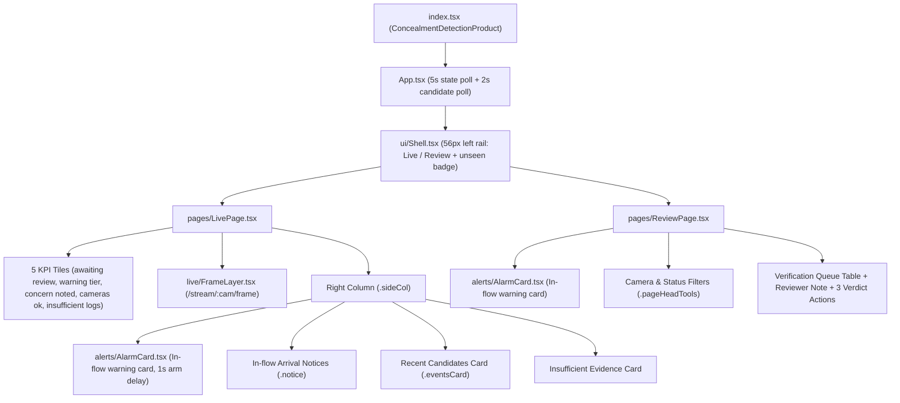

# Concealment Detection — Frontend Design Specification (`Concealment Review`)

## 1. Purpose & Scope

The `concealment_detection` frontend (`frontend/src/products/concealment_detection/`) is a self-contained React + TypeScript product tab mounted at `#/concealment_detection` inside the unified IRIS shell (`frontend/src/shared/Shell.tsx`).

It provides retail loss-prevention operators with a real-time monitoring and human-verification surface backed by the `products/concealment_detection/server.py` sidecar (`CONCEALMENT_BACKEND_PORT`, default `8005`) and the platform's published frame endpoint (`/stream/<camera>/frame`).

## 2. Core Product Invariants

1. **Human-in-the-Loop Non-Accusatory Framing (AC-4, AC-5)**:
   - Every emitted event is a **suspected concealment candidate requiring human verification** (`requires_human_verification: true`).
   - The UI never uses accusatory language (`confirmed theft`, `theft detected`, `theft confirmed`, `shoplifter`, `guilty`, `stolen`).
   - Review verdicts (`POST /review/{id}`) are strictly restricted to:
     - `acknowledged`
     - `concern_noted`
     - `dismissed`
   - Candidate severities map tiers 1:1 to platform severities: `critical` (`high` tier), `warning` (`medium` tier), and `info` (`low` tier). Both `critical` and `warning` still carry non-accusatory wording and `requires_human_verification: true`.
2. **Insufficient Evidence Transparency (AC-6)**:
   - Sequences that abort due to pose loss, short dwell, or low keypoint quality are recorded in `concealment_assessments` (`GET /assessments`) and displayed in a dedicated **insufficient evidence** card on the Live page without triggering pop-up alarms.
3. **Architecture & Transport Guards**:
   - **No WebSockets**: All sidecar state is polled over HTTP JSON via `/concealment_detection/api/*` with a 4000 ms `AbortSignal.timeout`.
   - **No `<canvas>` overlays**: Annotated MJPEG frames are rendered exclusively by `<FrameLayer camera={...} />` using sequential `` `onLoad`/`onError` scheduling against `/stream/<camera>/frame`.
   - **No Redis stream keys**: No `iris:` or `XADD` strings exist in the frontend bundle.
   - **Single `/frame` owner**: Only `live/frameUrl.ts` and `live/FrameLayer.tsx` reference `/stream/<camera>/frame`.

## 3. House Style & Design Tokens

The module copies the IRIS house stylesheet verbatim from `frontend/src/products/barber/app.css` and `frontend/src/products/fall_detection/app.css` (verified byte-for-byte in `app.test.ts`):

- **House Tokens (`barber/app.css`)**: `--green-900` (`#0c3527`), `--green-800` (`#114633`), `--green-700` (`#16593f`), `--green-600` (`#1b7a52`), `--green-500` (`#14a05e`), `--green-50` (`#e8f5ee`), `--ground` (`#eef1ef`), `--card` (`#ffffff`), `--ink` (`#17251f`), `--ink-soft` (`#5c6b63`), `--ink-mute` (`#8a968f`), `--line` (`#e4e9e5`), `--line-strong` (`#cdd6d0`), `--red-500` (`#d64550`), `--red-50` (`#fdecee`), `--amber-600` (`#b97c10`), `--amber-500` (`#d98b1f`), `--amber-50` (`#fdf3e0`), `--radius` (`14px`), `--shadow`.
- **IRIS Frame Override (`iris/styles/tokens.css`)**: `html, body` overrides the outer frame backdrop with `--bg-deep` (`#050507`) and the 4-stop `--mesh` radial glow while keeping `.page` on `--ground`.

## 4. Backend API Contract (`/concealment_detection/api`)

Vite proxies `/concealment_detection/api/*` to `http://localhost:${CONCEALMENT_BACKEND_PORT || 8005}/*`.

| Method & Path | Query / Body | Response Shape (`server.py`) |
|---|---|---|
| `GET /status` | — | `{ running: boolean, ready: boolean, cameras: Record<string, { camera_ok: boolean, reason: string }>, capabilities: { cart_detection: boolean, bag_context_requires_boxed_detections: boolean, durable_clips: boolean } }` |
| `GET /cameras` | — | `Array<{ id: string, location: string } \| string>` |
| `GET /candidates` | `camera?`, `review_status?`, `since?`, `limit?`, `before?` | `Candidate[]` (newest-first, `id > since`) |
| `GET /candidates/{id}` | — | `Candidate` |
| `GET /assessments` | `camera?`, `limit?` | `Assessment[]` (newest-first `insufficient_evidence` logs) |
| `POST /review/{id}` | `{ status: 'acknowledged' \| 'concern_noted' \| 'dismissed', note?: string, reviewer?: string }` | `Candidate` |

## 5. Layout & Component Architecture

### 5.1 Alert Channels (`alerts/severity.ts`) & Queue (`alerts/queue.ts`)
- **Unreviewed `critical` (`high` tier) or `warning` (`medium` tier) candidate** (`status === 'candidate'`):
  - `{ toast: true, card: true, badge: true }`
  - Enqueued into the FIFO `AlarmState` queue (`current` + `queued`) with `ARM_DELAY_MS = 1000`.
  - Visually distinguished: `high` / `critical` uses red styling (`.alarmCritical`, `.feedRing`, `.feedLive` `VERIFY · HIGH`, `.noticeCritical`, `.eventDotCritical`, `.chipRed`); `medium` / `warning` uses amber styling (`.alarmWarning`, `.feedRingWarn`, `.feedWarn` `VERIFY`, `.noticeWarning`, `.eventDotWarning`, `.chipAmber`).
- **Unreviewed `info` candidate** (`status === 'candidate'` and `severity === 'info'`, i.e., `tier === 'low'`):
  - `{ toast: true, card: false, badge: true }`
  - Appears in notices, increments the rail badge, and populates the Live/Review lists without opening an alarm card.
- **Reviewed candidate** (`status !== 'candidate'`):
  - `{ toast: false, card: false, badge: false }`

### 5.2 Live Page (`pages/LivePage.tsx`)
- **Header (`.pageHead`)**:
  - Title: `Concealment Review`
  - `.subLine`: Runtime status (`running` / `stopped`), durable clips capability, and non-accusatory reminder (`Suspected activity only · requires human verification`).
  - `.pageHeadTools`: Readiness `.chip` (`ready` / `not ready`) and camera `<select>`.
- **KPI Strip (`.kpiGrid`, 5 tiles)**:
  1. `awaiting review`: Count of candidates with `status === 'candidate'`.
  2. `high / warning`: Count of candidates with `effectiveSeverity(r)` equal to `'critical'` or `'warning'`.
  3. `concern noted`: Count of candidates with `status === 'concern_noted'`.
  4. `cameras ok`: `{okCount}/{totalCount}` from `status.cameras`.
  5. `insufficient logs`: Count of recent `Assessment` records (`insufficient_evidence`).
- **Two-Column Live Grid (`.liveGrid`)**:
  - **Left (`.feedTile`)**: Live annotated feed via `<FrameLayer camera={camera} />`. Ringed in red (`.feedRing`, `.feedLive` `VERIFY · HIGH`) for `high` alarms or amber (`.feedRingWarn`, `.feedWarn` `VERIFY`) for `medium` alarms when the active alarm is on that camera. Caption shows camera location/id and `"the engine's published frame"`.
  - **Right (`.sideCol`)**:
    1. `<AlarmCard />` (in-flow, never covering the camera): Header `VERIFY · {tier}`, location, target & zone, score & timestamp & track, stage chain & dwell/hold durations, 500 ms `<FrameLayer />` thumbnail, and `acknowledge` + `show camera` buttons.
    2. In-flow `.notice` items for recent candidate arrivals.
    3. **the candidates** card (`.eventsCard`): Latest candidates with severity dot, target label, location & score, and tier chip.
    4. **insufficient evidence** card: Latest `Assessment` rows (`camera`, `#track_id`, `reason`, `seconds(pts)`).

### 5.3 Review Page (`pages/ReviewPage.tsx`)
- **Header (`.pageHead`)**:
  - Title: `Review`
  - `.subLine`: `suspected incidents requiring human verification`
  - `.pageHeadTools`: Camera filter `<select>` and Status filter `<select>`.
- **In-Flow Alarm Card**: Renders above the table when an active warning is queued.
- **Verification Table (`.dataTable`)**:
  - Columns: `time`, `camera / zone`, `track`, `target`, `stages`, `tier`, `score`, `status`, and verdict actions (`acknowledged`, `concern_noted`, `dismissed`) plus optional reviewer note input for `candidate` rows.
