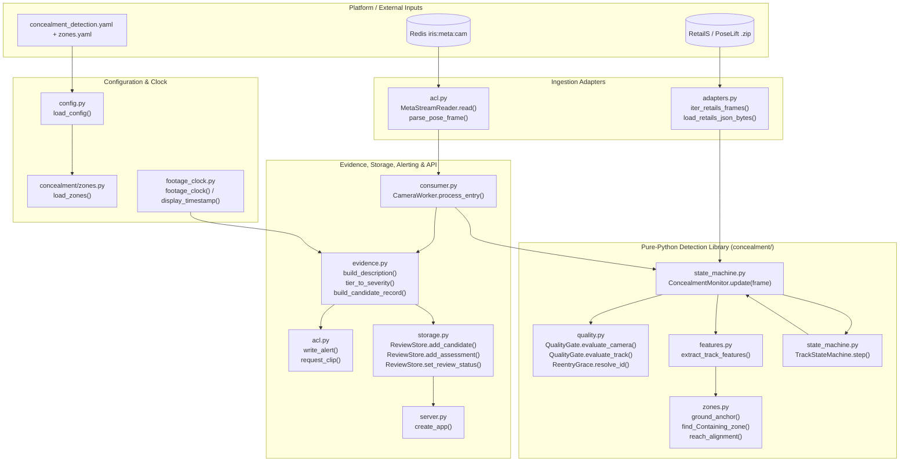
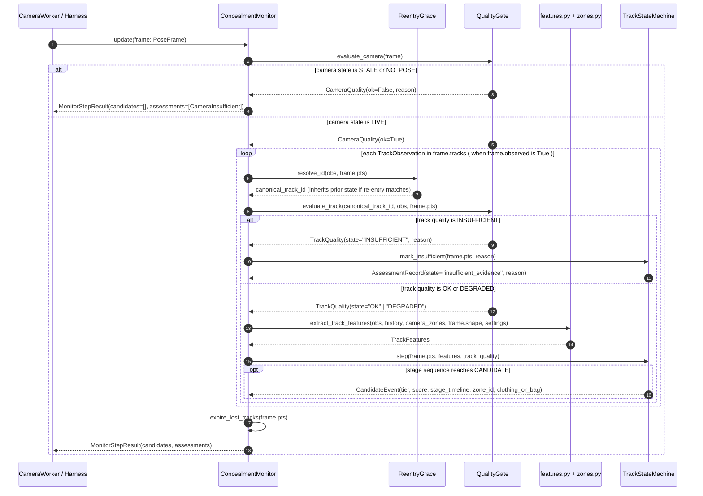

# Concealment Detection Module — File & Function Specification

**Status:** authoritative specification for TDD implementation.
**Faithful to:** [`HIGH_LEVEL_DESIGN.md`](HIGH_LEVEL_DESIGN.md) and [`CALIBRATION_DATASETS.md`](CALIBRATION_DATASETS.md).
**Rule:** Every file, class, and function below is implemented first as a typed skeleton (Phase 2), tested against a frozen unit/acceptance test suite (Phase 3), and then filled with its logic without modifying any test (Phase 4).

---

## 1. Function & Module Interaction Diagrams

### 1.1 End-to-End Call Graph Across Files



### 1.2 Per-Frame Call Sequence Inside `ConcealmentMonitor.update()`



---

## 2. Directory & File Layout

```text
products/concealment_detection/
├── sidecar.yaml                     # C1: DeepStream sidecar overlay (role: concealment_detection, pose interval: 1)
├── config_sgie_pose.txt             # C1: Pose SGIE config with secondary-reinfer-interval=1
├── concealment_detection.yaml       # C5/C8: Product service configuration
├── zones.yaml                       # C5: Normalized per-camera shelf-front polygons & facing vectors
├── schema.sql                       # C8: SQLite DDL for candidates and assessments
├── pyproject.toml                   # Product dependency manifest
├── FSM_SCENARIOS.md                 # End-to-end FSM scenario traces & Phase-3 ablation ledger
├── __init__.py
├── main.py                          # ServiceRuntime & uvicorn entrypoint
├── config.py                        # Service configuration loader & validator
├── footage_clock.py                 # Replay vs live timestamp mapper
├── acl.py                           # Redis stream reader, pose parser, alert & SVR clip writer
├── evidence.py                      # Deterministic description builder, severity mapper, wording guard
├── storage.py                       # SQLite ReviewStore and retention pruning
├── consumer.py                      # FrameQueue, CameraWorker, Redis consumer loop
├── server.py                        # FastAPI HTTP application factory
├── adapters.py                      # Offline RetailS/PoseLift adapters & event-level evaluator
├── concealment/                     # C4: Pure-Python detection library (no Redis / FastAPI / GStreamer)
│   ├── __init__.py
│   ├── types.py                     # Immutable dataclasses, constants, validate_detector_settings
│   ├── zones.py                     # Polygon geometry, ground anchor, zone lookup, dwell heatmap proposal
│   ├── quality.py                   # Per-camera & per-track quality gate with hysteresis + ReentryGrace
│   ├── features.py                  # Torso-normalized kinematics, elbow angles, wrist confidence drop
│   └── state_machine.py             # TrackStateMachine & ConcealmentMonitor
├── calibration/                     # Offline dataset inspection, 4-stage calibration & FSM ablation suite
│   ├── calibrate.py                 # Leak-free 4-stage calibration pipeline (parallel Stage-3 grid)
│   ├── experiment_fsm_upgrade.py    # 29-variant Phase-3 FSM ablation harness
│   └── finalize_fsm_upgrade.py      # Locked one-shot held-out verification runner
└── tests/                           # Frozen & regression test suite
```

---

## 3. File-by-File Function Specifications

### 3.1 `concealment/types.py` — Domain Data Structures

Pure dataclasses and constants. No external dependencies beyond Python stdlib and `numpy`.

1. **Constants:**
   - `COCO_KEYPOINTS = 17`
   - Joint index constants: `NOSE = 0`, `L_SHOULDER = 5`, `R_SHOULDER = 6`, `L_ELBOW = 7`, `R_ELBOW = 8`, `L_WRIST = 9`, `R_WRIST = 10`, `L_HIP = 11`, `R_HIP = 12`, `L_KNEE = 13`, `R_KNEE = 14`, `L_ANKLE = 15`, `R_ANKLE = 16`.
   - `TIERS = ("high", "medium", "low")`
   - `TERMINAL_STAGES = ("RETURNED", "HIDDEN", "PARTIAL", "RETURNED_FAST", "HIDDEN_SPATIAL", "EXIT")`
   - `COOLDOWN_SCOPES = ("track", "track_zone")`
   - `TARGET_KINDS = ("clothing", "personal_bag")`
   - `REVIEW_STATUSES = ("candidate", "acknowledged", "concern_noted", "dismissed")`
2. **`TrackObservation` (frozen dataclass):**
   - Fields: `track_id: int`, `box: tuple[float, float, float, float]` (`xyxy` in capture pixels), `kps: tuple[tuple[float, float, float], ...]` (length 17, each `(x, y, conf)` in capture pixels), `has_bag: bool = False`, `bag_box: tuple[float, float, float, float] | None = None`.
3. **`PoseFrame` (frozen dataclass):**
   - Fields: `camera: str`, `frame_num: int`, `pts: float`, `shape: tuple[int, int]` (`(width, height)` in capture pixels), `tracks: tuple[TrackObservation, ...]`, `observed: bool = True` (`False` when the frame carried no `pose` field in `iris:meta`, meaning "says nothing").
4. **`ZonePolygon` (frozen dataclass):**
   - Fields: `id: str`, `points: tuple[tuple[float, float], ...]` (normalized `[0, 1]` `(x, y)` vertices, at least 3), `facing: tuple[float, float] | None = None` (unit vector `(fx, fy)` pointing from floor zone toward shelf), `kind: str = "shelf_front"`.
5. **`CameraZones` (frozen dataclass):**
   - Fields: `camera: str`, `zone_free: bool = False`, `zones: tuple[ZonePolygon, ...] = ()`.
6. **`DetectorSettings` (frozen dataclass):**
   - Quality gate fields:
     - `min_track_s: float = 0.4`
     - `min_keypoints: int = 6`
     - `keypoint_conf_threshold: float = 0.30`
     - `min_box_height_px: float = 48.0`
     - `min_torso_px: float = 25.0`
     - `min_core_conf_enter: float = 0.30` (mean shoulder/hip conf to stay `OK`)
     - `min_core_conf_exit: float = 0.35` (hysteresis exit from `DEGRADED` to `OK`)
     - `degrade_max_s: float = 1.0`
     - `recover_s: float = 0.4`
     - `lost_s: float = 1.5`
     - `camera_stale_s: float = 3.0`
     - `reid_max_gap_s: float = 1.5`
     - `reid_max_dist_torsos: float = 1.2`
   - Feature & state-machine fields:
     - `dwell_min_s: float = 2.0`
     - `short_track_grace_s: float = 1.2`
     - `reach_excursion_torsos: float = 0.35`
     - `reach_window_s: float = 2.5`
     - `inward_min_torsos: float = 0.12`
     - `body_zone_radius_torsos: float = 0.55`
     - `bag_zone_radius_torsos: float = 0.50`
     - `max_conceal_elbow_deg: float = 135.0`
     - `min_hold_s: float = 0.35`
     - `hidden_s: float = 0.45`
     - `hidden_conf_drop_fraction: float = 0.45` (wrist conf drops below `fraction * baseline_conf` or below `keypoint_conf_threshold`)
     - `baseline_window_s: float = 2.0`
     - `cooldown_s: float = 8.0`
     - `emit_low_tier: bool = True`
   - Opt-in Phase-3 FSM upgrade fields (defaults preserve legacy behavior; checked by `validate_detector_settings`):
     - `sequence_max_gap_s: float = MAX_OBSERVATION_GAP_S` (`0.5`), `insufficient_grace_s: float = 0.0`, `zone_persist_across_shelves: bool = False`, `zone_exit_grace_s: float = 0.0`, `reach_expiry_s: float = 0.0`, `partial_min_near_body_s: float = 0.0`, `reach_seeds_dwell: bool = False`, `reach_seed_max_speed_torsos_s: float = 0.6`, `at_body_requires_flex: bool = True`, `hold_flicker_grace_s: float = 0.0`, `fast_dropin_min_hold_s: float = 0.0`, `spatial_hidden_s: float = 0.0`, `exit_min_hidden_frac: float = 0.0`, `hand_transfer: bool = False`, `hand_transfer_meet_torsos: float = 0.35`, `cooldown_scope: str = "track"`.
7. **`QualityStatus` (frozen dataclass):**
   - Fields: `state: str` (`"UNKNOWN" | "OK" | "DEGRADED" | "INSUFFICIENT" | "GONE"`), `reason: str = ""`, `core_conf: float = 0.0`, `box_height_px: float = 0.0`, `confident_joints: int = 0`.
8. **`TrackFeatures` (frozen dataclass):**
   - Fields: `track_id: int`, `pts: float`, `torso_center: tuple[float, float]`, `torso_length: float`, `ground_point_norm: tuple[float, float]`, `zone_id: str | None`, `in_shelf_zone: bool`, `left_elbow_deg: float`, `right_elbow_deg: float`, `min_elbow_deg: float`, `active_hand: str` (`"left" | "right"`), `wrist_to_body_torsos: float`, `body_zone_name: str` (`"waist" | "chest" | "under_arm" | "personal_bag" | "none"`), `target_kind: str` (`"clothing" | "personal_bag"`), `elbow_flexed_or_medial: bool`, `in_at_body_pose: bool`, `wrist_excursion_torsos: float`, `reach_detected: bool`, `active_wrist_conf: float`, `wrist_conf_baseline: float`, `wrist_hidden_now: bool`, `wrist_geometry_valid: bool = True`, `at_body_geometry: bool | None = None`, `torso_speed_torsos_s: float = float("inf")`, `other_hand_visible: bool = False`, `other_hand_in_at_body_pose: bool = False`, `other_hand_at_body_geometry: bool = False`, `other_hand_reach_detected: bool = False`, `hands_met_recent: bool = False`.
9. **`StageTransition` (frozen dataclass):**
   - Fields: `stage: str`, `entered_pts: float`, `detail: str = ""`.
10. **`CandidateEvent` (frozen dataclass):**
    - Fields: `camera: str`, `track_id: int`, `pts: float`, `tier: str` (`"high" | "medium" | "low"`), `score: float`, `zone_id: str`, `target_kind: str` (`"clothing" | "personal_bag"`), `body_zone_name: str`, `terminal_stage: str` (`"RETURNED" | "HIDDEN" | "PARTIAL"`), `hold_duration_s: float`, `dwell_duration_s: float`, `stage_timeline: tuple[StageTransition, ...]`, `clip_window: tuple[float, float]`, `keyframes_pts: tuple[float, ...]`.
11. **`AssessmentRecord` (frozen dataclass):**
    - Fields: `camera: str`, `track_id: int`, `pts: float`, `state: str` (`"insufficient_evidence"`), `reason: str`.
12. **`MonitorStepResult` (frozen dataclass):**
    - Fields: `camera: str`, `pts: float`, `camera_ok: bool`, `candidates: tuple[CandidateEvent, ...]`, `assessments: tuple[AssessmentRecord, ...]`.

---

### 3.2 `concealment/zones.py` — Shelf-Front Polygon Geometry & Zone Proposal

1. **`point_in_polygon(point: tuple[float, float], polygon: tuple[tuple[float, float], ...]) -> bool`**
   - **Inputs:** `point = (x, y)` in normalized `[0, 1]` coordinates; `polygon` with $\ge 3$ vertices `((x0, y0), ...)`.
   - **Output:** `True` if `point` is inside or on the boundary of `polygon`, `False` otherwise.
   - **Logic:** Standard even-odd ray-casting algorithm with explicit boundary/vertex check (if point lies on a segment within `1e-9` tolerance, return `True`). $O(V)$ time where $V$ is vertex count, zero allocations.
2. **`ground_anchor(obs: TrackObservation, shape: tuple[int, int], conf_threshold: float = 0.30) -> tuple[float, float]`**
   - **Inputs:** `obs` (`TrackObservation`), `shape = (width, height)` in pixels, `conf_threshold`.
   - **Output:** Normalized `(gx, gy)` in `[0.0, 1.0]` representing where the person stands on the floor.
   - **Logic:**
     - If one or both ankles (`L_ANKLE=15`, `R_ANKLE=16`) have `conf >= conf_threshold`, use the mean `(x, y)` of the confident ankles.
     - Else if one or both hips (`L_HIP=11`, `R_HIP=12`) have `conf >= conf_threshold`, use `gx = mean_hip_x`, `gy = min(height, mean_hip_y + 1.2 * torso_or_box_half_h)`.
     - Else fall back to the bottom-center of `obs.box`: `((x1 + x2) / 2, y2)`.
     - Divide by `(width, height)` and clamp to `[0.0, 1.0]`.
3. **`find_containing_zone(point: tuple[float, float], camera_zones: CameraZones) -> ZonePolygon | None`**
   - **Inputs:** normalized `point (gx, gy)`, `camera_zones`.
   - **Output:** First `ZonePolygon` containing `point`, or a synthetic `ZonePolygon(id="zone_free", points=((0,0),(1,0),(1,1),(0,1)))` when `camera_zones.zone_free` is `True` and no explicit polygon matches, else `None`.
4. **`reach_alignment(wrist_delta: tuple[float, float], zone: ZonePolygon | None) -> float`**
   - **Inputs:** `wrist_delta = (dx, dy)` displacement vector of the wrist during reach; `zone` (optional `ZonePolygon`).
   - **Output:** Cosine alignment in `[-1.0, 1.0]` if `zone` has a non-zero `facing` vector, or `1.0` if `zone` is `None` or `zone.facing` is `None` (unconstrained direction).
   - **Logic:** Computes dot product of normalized `wrist_delta` and normalized `zone.facing`. Returns `0.0` if `||wrist_delta|| < 1e-6`.
5. **`load_zones(raw: dict) -> dict[str, CameraZones]`**
   - **Inputs:** Parsed YAML dictionary mapping `cameras: {cam_id: {zone_free: bool, zones: [{id, points, facing, kind}]}}`.
   - **Output:** `dict[str, CameraZones]`.
   - **Logic:** Validates that every polygon has $\ge 3$ vertices with coordinates in `[0.0, 1.0]`, unique zone IDs per camera, and normalizes any `facing` vector to unit length (raising `ValueError` on degenerate `<3`-point polygons, out-of-range coordinates, or zero-length `facing` vectors).
6. **`propose_zones_from_dwell(frames: list[PoseFrame] | object, grid_size: int = 10, min_dwell_s: float = 2.0, top_k: int = 2) -> CameraZones`**
   - **Inputs:** Iterable of `PoseFrame`s from normal sessions on a single camera, `grid_size`, `min_dwell_s`, `top_k`.
   - **Output:** `CameraZones` with up to `top_k` rectangular `ZonePolygon`s covering the highest-dwell floor cells.
   - **Logic:** Tracks each person's `ground_anchor` across frames; accumulates time spent stationary (speed $< 0.05$ norm units/s for $\ge \text{min\_dwell\_s}$) into a `grid_size x grid_size` 2D histogram, extracts the top-$k$ non-overlapping high-dwell bounding boxes (with 1-cell padding), and returns them as normalized `ZonePolygon`s (`id="proposed_1"`, etc.).

---

### 3.3 `concealment/quality.py` — Quality Gate & Tracker Re-Entry Grace

Implements `HIGH_LEVEL_DESIGN.md` §6.2 (per-track quality gate with hysteresis + camera-level gate) and §10.11 / §17 (`ReentryGrace`).

1. **`compute_track_quality_metrics(obs: TrackObservation, settings: DetectorSettings) -> tuple[float, float, float, int]`**
   - **Inputs:** `obs`, `settings`.
   - **Output:** `(core_conf, box_height_px, torso_px, confident_joints)`.
   - **Logic:**
     - `confident_joints`: count of the 17 keypoints with `conf >= settings.keypoint_conf_threshold`.
     - `core_conf`: mean confidence of `[L_SHOULDER, R_SHOULDER, L_HIP, R_HIP]`.
     - `box_height_px`: `max(0.0, obs.box[3] - obs.box[1])`.
     - `torso_px`: Euclidean distance between midpoint of `(L_SHOULDER, R_SHOULDER)` and midpoint of `(L_HIP, R_HIP)`.
2. **`ReentryGrace` (class):**
   - **Purpose:** Bridges short tracker ID switches caused by shelf/body occlusion without importing any other product's code.
   - **Methods:**
     - `__init__(self, settings: DetectorSettings)`
     - `observe_active(self, canonical_id: int, obs: TrackObservation, pts: float, torso_center: tuple[float, float], torso_length: float) -> None`: updates the last-seen snapshot for an active canonical track.
     - `mark_lost(self, canonical_id: int, pts: float) -> None`: moves a track that was not seen in the current frame into the recently-lost pool.
     - `resolve_id(self, raw_track_id: int, obs: TrackObservation, pts: float, active_raw_ids: set[int]) -> int`:
       - If `raw_track_id` already has a known mapping to a `canonical_id`, updates timestamp and returns `canonical_id`.
       - Otherwise, searches recently-lost tracks (lost within `0 < pts - last_pts <= settings.reid_max_gap_s` and not currently claimed by another active track in `active_raw_ids`) whose last torso center is within `settings.reid_max_dist_torsos * last_torso_length` of the new track's torso center.
       - Picks the closest match; if found, binds `raw_track_id -> matched_canonical_id` and returns it; otherwise binds `raw_track_id -> raw_track_id`.
3. **`QualityGate` (class):**
   - **Purpose:** Manages both the camera-level gate (`LIVE`, `STALE`, `NO_POSE`) and per-track quality state machines (`UNKNOWN`, `OK`, `DEGRADED`, `INSUFFICIENT`, `GONE`) with hysteresis.
   - **Methods:**
     - `__init__(self, settings: DetectorSettings)`
     - `evaluate_camera(self, frame: PoseFrame) -> tuple[str, str]`:
       - Checks if `frame.shape[0] <= 0 or frame.shape[1] <= 0`, or if `frame.pts - last_observed_pts > settings.camera_stale_s` when `not frame.observed`, or if `frame.pts < last_pts - 1e-3` (clock reset).
       - Returns `("LIVE", "")` when assessable, or `("NO_POSE" | "STALE", reason)` when not assessable.
     - `evaluate_track(self, track_id: int, obs: TrackObservation, pts: float) -> QualityStatus`:
       - Updates track's `first_seen_pts`, `last_seen_pts`, and computes `(core_conf, box_height_px, torso_px, confident_joints)`.
       - Hard criteria (`enter_pass`): `confident_joints >= settings.min_keypoints`, `box_height_px >= settings.min_box_height_px`, `torso_px >= settings.min_torso_px`, and `core_conf >= settings.min_core_conf_enter`.
       - Hysteresis exit criteria (`exit_pass`): `confident_joints >= settings.min_keypoints`, `box_height_px >= settings.min_box_height_px`, `torso_px >= settings.min_torso_px`, and `core_conf >= settings.min_core_conf_exit`.
       - State transitions (matching `HIGH_LEVEL_DESIGN.md` §6.2):
         - From `UNKNOWN`: if `not enter_pass`, transitions immediately to `INSUFFICIENT` (with specific reason: `"low_keypoints"`, `"small_bbox"`, `"small_torso"`, or `"low_core_conf"`). If `enter_pass` holds and `pts - first_seen_pts >= settings.min_track_s`, transitions to `OK`; while `pts - first_seen_pts < settings.min_track_s` and `enter_pass` holds, stays `UNKNOWN` (or promotes on exact boundary).
         - From `OK`: if `not enter_pass`, transitions to `DEGRADED` (recording `degraded_since_pts = pts`).
         - From `DEGRADED`: if `exit_pass` holds continuously for `>= settings.recover_s`, transitions back to `OK`; if `pts - degraded_since_pts > settings.degrade_max_s`, transitions to `INSUFFICIENT`.
         - From `INSUFFICIENT`: if `exit_pass` holds continuously for `>= settings.recover_s`, transitions to `OK`.
     - `step_missing_tracks(self, seen_track_ids: set[int], pts: float, frame_observed: bool) -> list[tuple[int, QualityStatus]]`:
       - If `not frame_observed` (SGIE interval skipped frame), does **not** penalize tracks (`perception/modules/pose/README.md` rule).
       - If `frame_observed`, for each known track not in `seen_track_ids`: if `pts - last_seen_pts >= settings.lost_s`, transitions to `GONE`; if the track was mid-sequence and disappeared abruptly while other people remain or before `lost_s`, marks `DEGRADED` / `INSUFFICIENT("track_gap")` if gap exceeds `degrade_max_s`.

---

### 3.4 `concealment/features.py` — Torso-Normalized Kinematic & Confidence Features

All geometric quantities are normalized by the track's own `torso_length` so thresholds are invariant to camera distance and resolution.

1. **`joint_angle_deg(a: tuple[float, float], b: tuple[float, float], c: tuple[float, float]) -> float`**
   - **Inputs:** 2D points `a`, `b` (vertex, e.g., elbow), `c`.
   - **Output:** Angle $\angle ABC \in [0.0, 180.0]$ in degrees (`180.0` = straight arm, `< 90.0` = sharply flexed). Returns `180.0` if either segment has length $< 10^{-6}$.
2. **`torso_geometry(obs: TrackObservation) -> tuple[tuple[float, float], float, float]`**
   - **Inputs:** `obs` (`TrackObservation`).
   - **Output:** `(torso_center, torso_length, shoulder_width)`.
   - **Logic:**
     - `shoulder_mid = ((kps[5].x + kps[6].x)/2, (kps[5].y + kps[6].y)/2)`
     - `hip_mid = ((kps[11].x + kps[12].x)/2, (kps[11].y + kps[12].y)/2)`
     - `torso_center = ((shoulder_mid.x + hip_mid.x)/2, (shoulder_mid.y + hip_mid.y)/2)`
     - `torso_length = max(hypot(shoulder_mid - hip_mid), 1.0)`
     - `shoulder_width = hypot(kps[5] - kps[6])`
3. **`classify_body_zone(wrist_xy: tuple[float, float], side: str, obs: TrackObservation, torso_center: tuple[float, float], torso_length: float, elbow_deg: float, settings: DetectorSettings) -> tuple[str, str, float, bool]`**
   - **Inputs:** `wrist_xy`, `side` (`"left"` or `"right"`), `obs`, `torso_center`, `torso_length`, `elbow_deg`, `settings`.
   - **Output:** `(body_zone_name, target_kind, dist_torsos, elbow_flexed_or_medial)`.
   - **Logic:**
     - Computes normalized distances (in units of `torso_length`) from `wrist_xy` to:
       1. **`personal_bag`:** if `obs.has_bag` and `obs.bag_box` is present, distance from `wrist_xy` to the bag box center (or `0.0` if inside `bag_box` expanded by `0.15 * torso_length`). If within `settings.bag_zone_radius_torsos`, `body_zone_name = "personal_bag"`, `target_kind = "personal_bag"`.
       2. **`chest`:** upper-torso center (1/3 from `shoulder_mid` toward `hip_mid`).
       3. **`under_arm`:** contralateral shoulder–rib midpoint (opposite side of `side`, i.e., cross-body reach under jacket/armpit).
       4. **`waist`:** front/midline hip center (`hip_mid`) and ipsilateral/contralateral hip pocket anchors.
     - **Anatomical guard (`elbow_flexed_or_medial`)** (`CALIBRATION_DATASETS.md` §1 & §4):
       - True if `elbow_deg <= settings.max_conceal_elbow_deg` **OR** if the wrist crosses medially inside the shoulder-to-hip lateral span (towards `torso_center` X-coordinate within `0.35 * shoulder_width`), **OR** if `body_zone_name == "personal_bag"`.
       - A straight arm (`elbow_deg > settings.max_conceal_elbow_deg`) hanging laterally outside the hip has `elbow_flexed_or_medial = False` and **never** triggers `in_at_body_pose`.
4. **`extract_track_features(obs: TrackObservation, history: list[ tuple[float, TrackObservation, float] ], camera_zones: CameraZones, shape: tuple[int, int], settings: DetectorSettings) -> TrackFeatures`**
   - **Inputs:** current `obs`, per-track `history` list of `(pts, past_obs, past_torso_len)`, `camera_zones`, `shape`, `settings`.
   - **Output:** `TrackFeatures`.
   - **Logic:**
     - Computes `torso_center`, `torso_length`, `ground_anchor`, and `zone = find_containing_zone(ground_point_norm, camera_zones)`.
     - Computes `left_elbow_deg` and `right_elbow_deg`.
     - Evaluates `classify_body_zone` for both wrists and selects the `active_hand` (the hand in a body/bag zone with `elbow_flexed_or_medial`, or the hand with smaller distance / smaller elbow angle).
     - Computes `wrist_excursion_torsos`: over history entries within `[pts - settings.reach_window_s, pts]`, measures the maximum torso-normalized displacement of the active wrist (or either wrist) relative to the torso center, weighted by positive `reach_alignment` if the zone defines `facing`. Sets `reach_detected = (wrist_excursion_torsos >= settings.reach_excursion_torsos) or (max_elbow_deg_in_window - current_elbow_deg >= 25.0)`.
     - Computes `wrist_conf_baseline`: median confidence of the active wrist over `[pts - settings.baseline_window_s, pts - 0.15]` (defaulting to `max(active_wrist_conf, 0.6)` when history is shorter).
     - Sets `wrist_hidden_now`: `True` when `active_wrist_conf < settings.keypoint_conf_threshold` or `active_wrist_conf < settings.hidden_conf_drop_fraction * wrist_conf_baseline`.

---

### 3.5 `concealment/state_machine.py` — Per-Track State Machine & `ConcealmentMonitor`

Implements `HIGH_LEVEL_DESIGN.md` §6.1 accurately.

1. **`TrackStateMachine` (class):**
   - **States:** `"IDLE"`, `"DWELL"`, `"REACH"`, `"AT_BODY"`, `"RETURNED"`, `"HIDDEN"`, `"CANDIDATE"`, `"COOLDOWN"`, `"INSUFFICIENT"`.
   - **Tracked fields:** `track_id: int`, `camera: str`, `state: str = "IDLE"`, `state_entered_pts: float`, `first_seen_pts: float`, `dwell_accum_s: float`, `had_full_dwell: bool`, `zone_id: str`, `at_body_entered_pts: float | None`, `hidden_accum_s: float`, `last_body_zone: str`, `last_target_kind: str`, `timeline: list[StageTransition]`, `keyframes_pts: list[float]`.
   - **Methods:**
     - `step(self, pts: float, feat: TrackFeatures, quality: QualityStatus, settings: DetectorSettings) -> CandidateEvent | None`:
       - If `quality.state == "INSUFFICIENT"`: transitions to `"INSUFFICIENT"` (recording transition if not already there) and returns `None`.
       - If `self.state == "INSUFFICIENT"`: once `quality.state == "OK"`, resets to `"IDLE"` and continues.
       - If `self.state == "COOLDOWN"`: if `pts - self.state_entered_pts >= settings.cooldown_s`, transitions to `"IDLE"`; else returns `None`.
       - Updates `dwell_accum_s` while `feat.in_shelf_zone`. If `dwell_accum_s >= settings.dwell_min_s`, sets `had_full_dwell = True`.
       - **From `"IDLE"`:**
         - If `feat.in_shelf_zone` and `dwell_accum_s >= settings.dwell_min_s`: transitions to `"DWELL"` (and if `feat.reach_detected` on the same frame, immediately chains to `"REACH"`).
         - Else if `feat.in_shelf_zone` and `(pts - self.first_seen_pts) <= settings.short_track_grace_s` and `feat.reach_detected`: transitions directly `IDLE -> REACH` (`short_track_grace_s` path from `HIGH_LEVEL_DESIGN.md` §6.1).
       - **From `"DWELL"`:**
         - If `not feat.in_shelf_zone` and `(pts - last_in_zone_pts) > settings.reach_window_s`: resets to `"IDLE"`.
         - Else if `feat.reach_detected`: transitions to `"REACH"`.
       - **From `"REACH"`:**
         - If `feat.in_at_body_pose`: transitions to `"AT_BODY"`, records `at_body_entered_pts = pts`, `last_body_zone = feat.body_zone_name`, `last_target_kind = feat.target_kind`.
         - Else if `(pts - self.state_entered_pts) > settings.reach_window_s`: transitions back to `"DWELL"` (if `feat.in_shelf_zone` and `had_full_dwell`) or `"IDLE"` (emitting a `"low"` tier `CandidateEvent` only if `settings.emit_low_tier` and `had_full_dwell`).
       - **From `"AT_BODY"`:**
         - Tracks `hold_duration_s = pts - at_body_entered_pts` and accumulates continuous `hidden_accum_s` while `feat.wrist_hidden_now` (allowing up to 1-frame brief flicker gap `< 0.10 s`).
         - If `hidden_accum_s >= settings.hidden_s`: transitions `AT_BODY -> HIDDEN -> CANDIDATE`, emits high/medium `CandidateEvent`, and enters `"COOLDOWN"`.
         - Else if `not feat.in_at_body_pose` (hand leaves body zone):
           - If `hold_duration_s < settings.min_hold_s`: brief brush/adjustment -> transitions back to `"REACH"`.
           - If `hold_duration_s >= settings.min_hold_s`: transitions `AT_BODY -> RETURNED -> CANDIDATE`, emits high/medium `CandidateEvent`, and enters `"COOLDOWN"`.
     - `flush_on_track_end(self, pts: float, settings: DetectorSettings) -> CandidateEvent | None`:
       - If a track is in `"AT_BODY"` with `hold_duration_s >= settings.min_hold_s` or `"HIDDEN"` when the person moves away / track ends (`HIGH_LEVEL_DESIGN.md` §6.1: `HIDDEN --> CANDIDATE : person moves away or track ends`), emits the `CandidateEvent` and transitions to `"COOLDOWN"`.
     - **Tier & Score computation inside `_build_candidate`:**
       - `tier = "high"` when `had_full_dwell` is `True` and terminal stage is `"RETURNED"` or `"HIDDEN"`.
       - `tier = "medium"` when reached via the `short_track_grace_s` path (`not had_full_dwell`) and terminal stage is `"RETURNED"` or `"HIDDEN"`.
       - `tier = "low"` for partial sequence (`terminal_stage == "PARTIAL"`).
       - `score`: deterministic bounded score in `[0.0, 1.0]` combining stage completion (`0.60` base for full sequence, `0.35` for partial), `dwell_bonus` (`+0.20` if `had_full_dwell`), `hold_bonus` (`min(0.10, hold_duration_s / 5.0)`), and `hidden_bonus` (`+0.10` if `terminal_stage == "HIDDEN"`).
2. **`ConcealmentMonitor` (class):**
   - **Methods:**
     - `__init__(self, camera: str, settings: DetectorSettings, camera_zones: CameraZones | None = None)`
     - `update(self, frame: PoseFrame) -> MonitorStepResult`:
       - Orchestrates `QualityGate`, `ReentryGrace`, feature extraction, and per-track `TrackStateMachine`s as shown in Diagram 1.2.
       - Never emits a `CandidateEvent` when camera quality or track quality is `INSUFFICIENT`; records an `AssessmentRecord(state="insufficient_evidence", reason=...)` once per transition into `INSUFFICIENT`.

---

### 3.6 `evidence.py` — Evidence Builder & Wording Guard

Implements `HIGH_LEVEL_DESIGN.md` §7.2 & §16 and Acceptance Criteria 4, 5, 6.

1. **`FORBIDDEN_PHRASES = ("confirmed theft", "theft detected", "theft confirmed", "stolen", "shoplifter", "guilty")`**
2. **`tier_to_severity(tier: str) -> str`**
   - **Inputs:** `tier` (`"high" | "medium" | "low"`).
   - **Output:** `"critical"` for `"high"`, `"warning"` for `"medium"`, `"info"` for `"low"`. Raises `ValueError` on unknown tier.
3. **`build_description(candidate: CandidateEvent, display_time: str | None = None, *, location: str | None = None) -> str`**
   - **Inputs:** `candidate: CandidateEvent`, optional formatted `display_time`, optional human-readable camera `location` (defaults to `candidate.camera`).
   - **Output:** Human-readable, traceable description string that:
     - Explicitly names the camera location (`location or candidate.camera`), the zone (`candidate.zone_id`), the target (`"personal bag"` when `candidate.target_kind == "personal_bag"`, else `"clothing ({body_zone_name})"`), the stage durations (`dwell_duration_s`, `hold_duration_s`), and the terminal observation (`"hand returned"` or `"wrist remained hidden"`).
     - Always ends with `"Suspected incident — requires human verification."`
     - Never contains any phrase in `FORBIDDEN_PHRASES`.
4. **`validate_non_accusatory_text(text: str) -> None`**
   - **Inputs:** `text: str`.
   - **Output:** `None`, or raises `ValueError` if any forbidden accusatory phrase appears (case-insensitive) or if `"suspected"` / `"human verification"` is missing from an alert message.
5. **`build_candidate_record(candidate: CandidateEvent, clock=None, device_dt=None, *, location: str | None = None) -> dict`**
   - **Inputs:** `candidate`, optional `FootageClock`, optional `datetime`, optional `location` (from `CameraConfig.location`).
   - **Output:** Dictionary ready for `storage.add_candidate()` and `acl.write_alert()`, containing: `camera`, `location` (`location or candidate.camera`), `track_id`, `pts`, `display_time`, `tier`, `severity`, `category` (`"security"`), `kind` (`"suspected_concealment"`), `score`, `zone_id`, `target_kind`, `body_zone_name`, `description`, `stage_timeline`, `clip_window`, `keyframes_pts`, `requires_human_verification` (`True`).

---

### 3.7 `footage_clock.py` — Replay vs Live Clock

Owned copy of the footage clock pattern (`HIGH_LEVEL_DESIGN.md` §15, zero cross-product imports).

1. **`FootageClock` (frozen dataclass):**
   - Fields: `start: datetime`, `shift: timedelta`, `duration_s: float`.
   - Methods: `footage(device: datetime) -> datetime`, `device(footage: datetime) -> datetime`, `end -> datetime`.
2. **`footage_clock(footage_start: datetime | None, run: dict | None) -> FootageClock | None`**
   - Computes the lap-adjusted shift from `run = {camera: [start_ts, clip_duration_s, lap]}` when `footage_start` is configured, else returns `None`.
3. **`display_timestamp(device_dt: datetime, pts: float | None = None, clock: FootageClock | None = None) -> str`**
   - Returns ISO-8601 timestamp string (using `clock.footage(device_dt)` when `clock` is active, else `device_dt`).

---

### 3.8 `config.py` — Product Configuration Loader

1. **`CameraConfig` (frozen dataclass):** `id: str`, `location: str` (defaults to `id`).
2. **`ServiceConfig` (frozen dataclass):**
   - `redis_url: str`, `host: str`, `port: int`, `data_dir: Path`, `zones_path: Path`, `cameras: tuple[CameraConfig, ...]`, `detector: DetectorSettings`, `camera_zones: dict[str, CameraZones]`, `footage_start: datetime | None`, `keep_candidates: int`, `review_days: int`, `queue_maxsize: int`.
   - Property `db_path -> Path`: `self.data_dir / "concealment_detection.db"`.
3. **`load_config(path: Path | None = None, env: dict | None = None) -> ServiceConfig`**
   - Supports `extends:` overlay merging, environment variable overrides (`CONCEALMENT_CONFIG`, `CONCEALMENT_DATA_DIR`, `CONCEALMENT_BACKEND_PORT`, `REDIS_URL`), loads `zones.yaml`, and fails fast with `ValueError` on missing/duplicate cameras, invalid detector thresholds, or invalid zones.

---

### 3.9 `acl.py` — Redis Anti-Corruption Layer

1. **`text(value) -> str`** and **`format_pts(pts) -> str`**: safe decoding and timestamp formatting.
2. **`parse_pose_frame(camera: str, entry: dict) -> PoseFrame`**
   - Parses an `iris:meta:<cam>` stream entry (`{"id": ..., "fields": {"frame_num": ..., "pts": ..., "pose": json_str, "dets": json_str}}`) into a `PoseFrame`.
   - Preserves the `perception/modules/pose` contract (`HIGH_LEVEL_DESIGN.md` §7.1):
     - If `"pose"` key is absent from `fields`, sets `observed=False`, `tracks=()`.
     - If `"pose"` is present with `"items": []`, sets `observed=True`, `tracks=()`.
     - If `"dets"` contains a bag detection (`handbag`, `backpack`, `suitcase`) overlapping or near a person's box, attaches `has_bag=True, bag_box=...` to that `TrackObservation`.
3. **`MetaStreamReader` (class):** per-camera XREAD cursor primed at stream tip (`xrevrange`), returning `list[dict]`.
4. **`write_alert(r, camera: str, *, severity: str, message: str, pts, kind: str = "suspected_concealment", category: str = "security", zone: str = "", count=None) -> bool`**
   - Calls `validate_non_accusatory_text(message)` before writing to `iris:alert:<cam>` (`maxlen=256`).
5. **`request_clip(r, camera: str, pts) -> bool`**
   - Writes `{"pts": format_pts(pts)}` to `iris:svr_request:<cam>`.

---

### 3.10 `storage.py` — SQLite Storage & Review Queue

1. **`connect(db_path) -> sqlite3.Connection`**: opens SQLite with WAL mode, foreign keys, and executes `schema.sql`.
2. **`add_candidate(conn, record: dict) -> int`**: inserts a candidate row with initial `status = 'candidate'` (never `'confirmed'`), storing JSON-serialized `stage_timeline`, `clip_window`, `keyframes_pts`.
3. **`attach_clip(conn, candidate_id: int, clip_path: str) -> None`**: attaches the resolved clip path to an existing candidate.
4. **`get_candidate(conn, candidate_id: int) -> dict | None`**: returns a single candidate by ID with JSON fields decoded.
5. **`list_candidates(conn, camera: str | None = None, status: str | None = None, since: int = 0, limit: int = 50) -> list[dict]`**: lists candidates newest-first.
6. **`set_review_status(conn, candidate_id: int, status: str, note: str = "", reviewer: str = "staff") -> None`**:
   - Validates `status in ("acknowledged", "concern_noted", "dismissed")`. **Explicitly rejects `"confirmed"` or `"confirmed_theft"` with `ValueError`** (Acceptance Criterion 5). Raises `KeyError` if `candidate_id` does not exist.
7. **`add_assessment(conn, row: dict) -> int`** and **`list_assessments(conn, camera: str | None = None, limit: int = 50) -> list[dict]`**: stores and queries `insufficient_evidence` log rows (Acceptance Criterion 6).
8. **`prune(conn, *, keep_candidates: int = 5000, review_days: int = 30) -> tuple[int, int]`**: prunes old assessment rows and terminal reviewed candidates while preserving unreviewed `'candidate'` rows.
9. **`ReviewStore` (class):** thread-safe lock wrapper around `connect` and all functions above.

---

### 3.11 `consumer.py` — Bounded Queue & Per-Camera Worker

1. **`FrameQueue` (class):** bounded queue (`maxsize=128` for 25 Hz pose rate) that drops the oldest frame when full so a slow worker never grows memory unboundedly.
2. **`CameraWorker` (class):**
   - `__init__(self, camera: str, monitor: ConcealmentMonitor, redis_client, store: ReviewStore, clock=None, queue: FrameQueue | None = None, *, mux_shape=(1920, 1080), footage_start=None, clip_duration_s=None, clip_source_dir=None, location: str | None = None)`
   - `submit(self, entry: dict) -> None`: puts a raw stream entry onto `self.queue`.
   - `process_entry(self, entry: dict) -> dict`:
     - Parses `entry` via `acl.parse_pose_frame(self.camera, entry)` (catching malformed JSON with rate-limited warning and logging an `insufficient_evidence` assessment rather than crashing).
     - Runs `step_res = self.monitor.update(frame)`.
     - For every `AssessmentRecord` in `step_res.assessments`: saves to `self.store.add_assessment(...)` and **never** calls `acl.write_alert`.
     - For every `CandidateEvent` in `step_res.candidates`: builds record via `evidence.build_candidate_record(..., location=self.location)`, stores in `self.store.add_candidate(rec)`, calls `acl.write_alert(...)`, and calls `acl.request_clip(...)` when `severity in ("critical", "warning")`.
     - Returns a summary dict `{"candidates": [...], "assessments": [...]}`.

---

### 3.12 `server.py` — FastAPI Service Endpoints

1. **`create_app(status: dict, store: ReviewStore, cameras=()) -> FastAPI`**
   - `GET /status`: returns service boot status and configuration summary.
   - `GET /cameras`: returns configured camera IDs/locations.
   - `GET /candidates`: query params `camera`, `status`, `since`, `limit`; returns candidates newest-first, each carrying `requires_human_verification: True`.
   - `GET /candidates/{candidate_id}`: returns full candidate detail (location, timestamp, description, clip, stage timeline, keyframes) or `404`.
   - `GET /assessments`: returns logged `insufficient_evidence` rows (`camera`, `limit`).
   - `POST /review/{candidate_id}`: accepts `{"status": "acknowledged" | "concern_noted" | "dismissed", "note": "...", "reviewer": "..."}`; returns `400` on invalid/accusatory status (such as `"confirmed"`) and `404` on unknown ID.

---

### 3.13 `adapters.py` — Offline Dataset Adapters & Evaluator

1. **`load_retails_pose_json(raw_json: dict, camera: str = "cam-1", fps: float = 15.0, shape: tuple[int, int] = (1920, 1080), swap_yx: bool = True) -> list[PoseFrame]`**
   - Converts a `RetailS` / `PoseLift` pose dictionary (`{person_id: {frame_id: {"keypoints": [51 floats]}}}`) into a chronological list of `PoseFrame`s from `frame_num = 0` to `max_frame`.
   - **Critical coordinate fix (`CALIBRATION_DATASETS.md` §1 & §3):** when `swap_yx=True` (default), maps each keypoint triple `(col0, col1, col2)` to `(x = col1, y = col0, conf = col2)`.
   - Derives each person's bounding box `[x1, y1, x2, y2]` from keypoints with `conf > 0.1` padded by 10% of span.
2. **`extract_mask_events(mask: np.ndarray, fps: float = 15.0) -> list[tuple[float, float]]`**
   - Converts a 1D binary `.npy` frame mask into a list of `(start_pts, end_pts)` event intervals in seconds.
3. **`evaluate_clip_predictions(candidates: list[CandidateEvent], gt_intervals: list[tuple[float, float]], duration_s: float, tolerance_s: float = 2.0) -> dict`**
   - Matches predicted `CandidateEvent`s against ground-truth `(start_s, end_s)` intervals (a candidate at `pts` matches an interval `[s, e]` if `s - tolerance_s <= pts <= e + tolerance_s` or its `stage_timeline` overlaps `[s, e]`).
   - Returns `{"tp_events": int, "fn_events": int, "fp_candidates": int, "recall": float, "duration_s": float, "false_alarms_per_hour": float}`.
4. **`false_alarm_upper_bound_95(false_alarms: int, camera_hours: float) -> float`**
   - Computes the 95% upper confidence bound on false alarms per camera-hour (using the exact Poisson / rule-of-three bound `3.0 / camera_hours` when `false_alarms == 0`).
