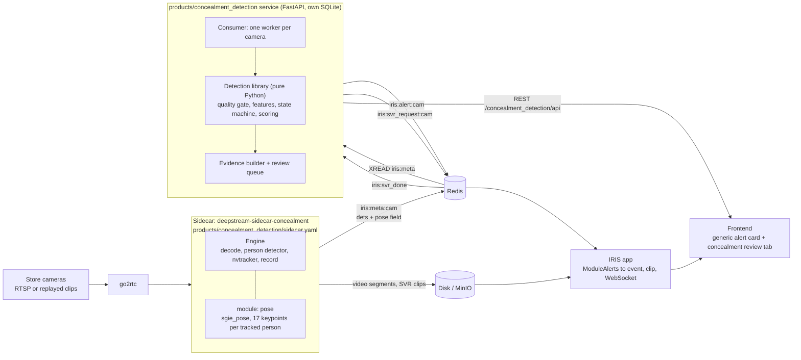
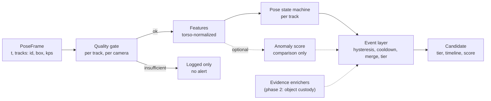
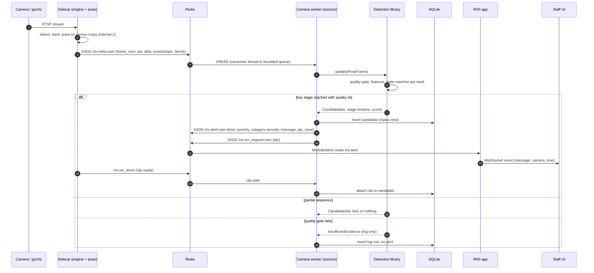
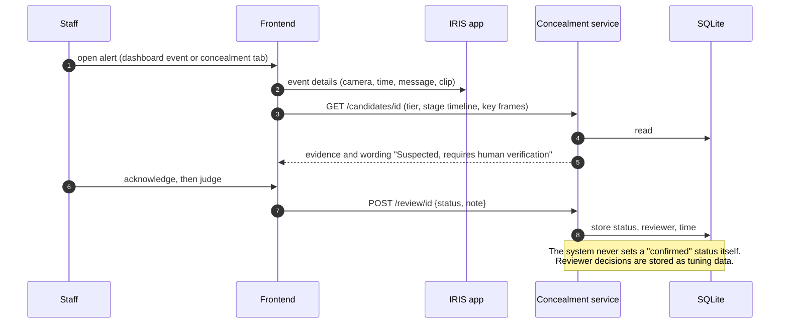
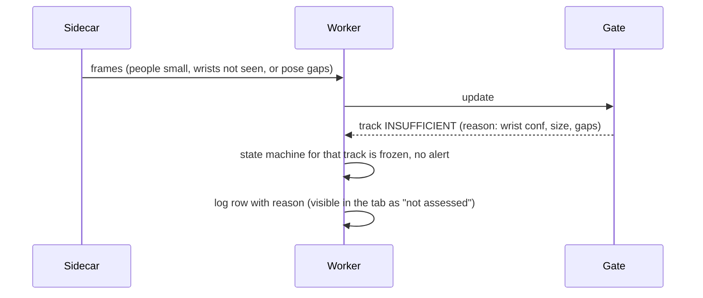
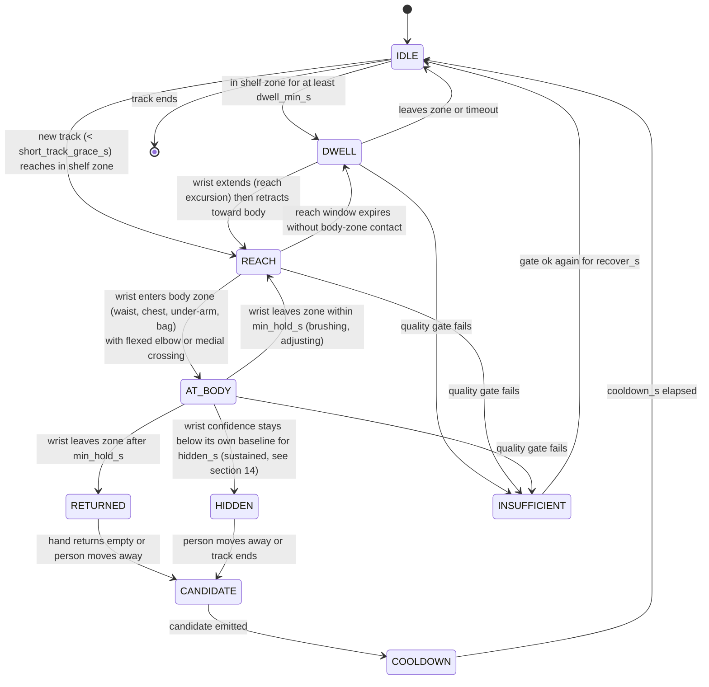
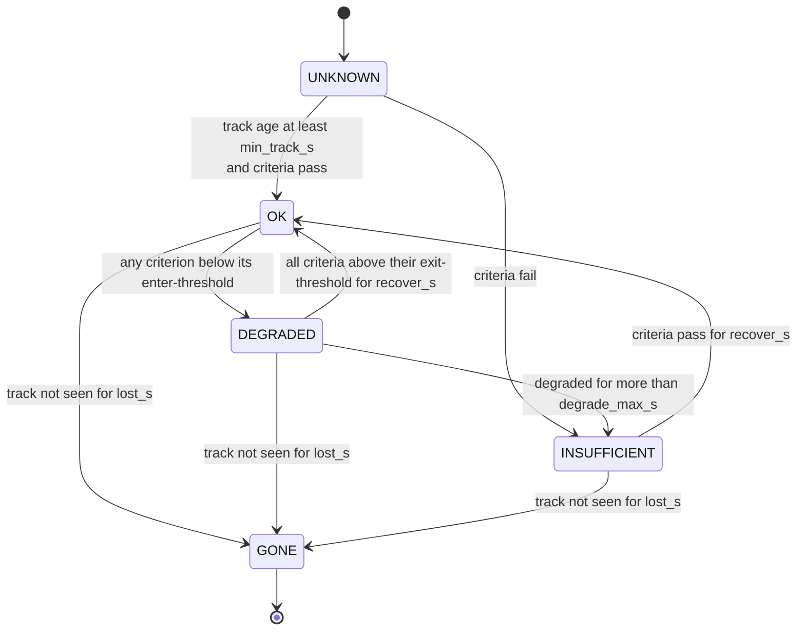
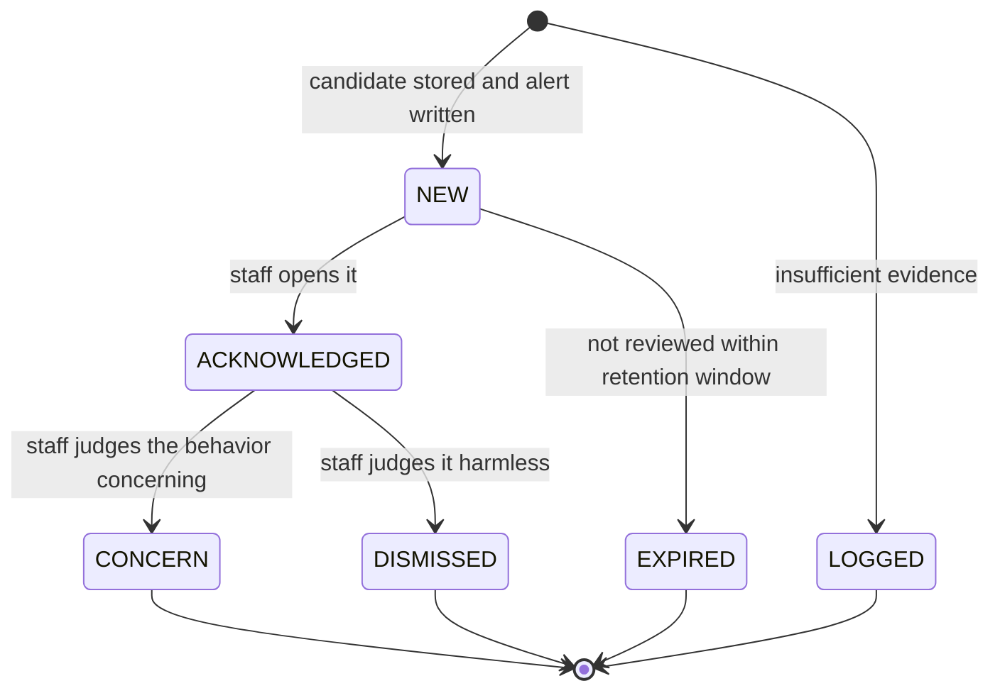
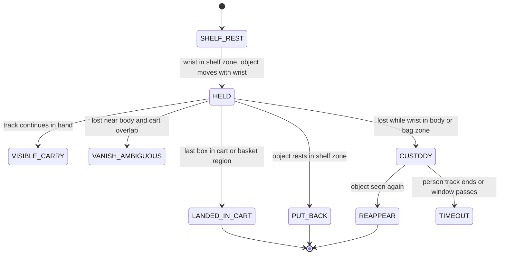

# Concealment detection (suspected theft) on IRIS: high-level design

**Status:** Implemented PoC. Measured on 2026-11-13 with this checkout: `509` product tests (`products/concealment_detection/tests/`) + `22` sidecar contract tests (`tests/test_concealment_sidecar_contracts.py`) passing (`531` total). Calibration is described in section 18, and every accuracy figure there is labelled with the artifact that does -- or does not -- back it.
**Working name:** `concealment_detection`. The module never says "theft" or "confirmed" in its output; the folder name is internal only.
**Builds on:** `pose_first_design.md`, `hybrid_custody_pose_design.md`, `datasets_plan.md`, `paza_summary.md` (the research notes), [`FUNCTION_SPEC.md`](FUNCTION_SPEC.md) (function-level TDD specification), [`CALIBRATION_DATASETS.md`](CALIBRATION_DATASETS.md) (dataset inspection), [`../calibration/reports/CALIBRATION_REPORT.md`](../calibration/reports/CALIBRATION_REPORT.md) (4-stage offline calibration & verification report), and in this repo `perception/ARCHITECTURE.md`, `perception/modules/pose/README.md`, `products/fall_detection/` (the closest existing product).

> Convention: **[Repo]** = verified in this repository. **[Design]** = architectural proposal (now implemented). **[Calibrated]** = verified empirically on `RetailS` and `PoseLift`.

---

## 1. Goal and scope

User story: alert staff when a person appears to conceal a product in clothing or a personal bag, with camera, time, a behavior description and a clip. Alerts are *suspected incidents requiring human verification*. Footage too poor to judge is never presented as theft.

PoC scope decision from the earlier discussion: **pose-first (design B) is the core**. The object-custody channel (design C/D) is a later enrichment that plugs in at one defined point (section 7). Out of scope, as in the story: face recognition, intent, automated interventions, production deployment.

## 2. The key architectural decision: follow the fall-detection pattern

This repo already has two ways to add a use case on top of the DeepStream engine:

| | **A. Module inside the sidecar** (`ppe`, `zones`, `fire_alerts`) | **B. Product service reading Redis** (`fall_detection`) |
|---|---|---|
| Where the logic runs | In the engine's probe, on the GStreamer streaming thread **[Repo]** | In a separate FastAPI process with its own SQLite **[Repo]** |
| Constraint | Must never block; heavy work needs its own thread | Free to use any libraries, GPU or CPU; can fall behind without hurting the pipeline |
| Offline replay / calibration | Needs the GPU pipeline | Replay recorded `pose` fields or RetailS/PoseLift JSON through the same code, no GPU, no DeepStream |
| Pixels | `on_pixels` gives a CPU frame | Only what is published to Redis (`iris:jpeg`, clips) |
| Fit to our needs | Weaker | **Better for the pose-first PoC** |

**[Design] Use B.** The sidecar runs the existing `pose` module and publishes keypoints. A new product service owns the state machine, scoring, tiers, evidence and the review queue. This also matches the earlier recommendation: *detection logic is a pure library with a thin adapter*, so we can calibrate on RetailS/PoseLift before any live run.

What we reuse unchanged **[Repo]**: engine, `nvtracker` (NvDCF), `pose` module and `yolo26x-pose` GIE, `iris:meta`, the `iris:alert` contract, `iris:svr_request` clips, `ModuleAlerts` in the app, `go2rtc`, the golden-replay harness.
What is new: one product folder, one sidecar overlay yaml, one service, one frontend tab.

## 3. System context



## 4. Components

| # | Component | Lives in | Responsibility |
|---|---|---|---|
| C1 | Sidecar overlay & SGIE config | `sidecar.yaml`, `config_sgie_pose.txt` | Cameras (`roles: [concealment_detection]`), `sample_fps: 25`, `svr_duration_seconds: 12`, `relevant_classes: [person]`, `modules: {pose: {interval: 1, model: yolo26x-pose}}` |
| C2 | Pose module | `perception/modules/pose` **[Repo, reused]** | Keypoints in capture pixels, owner id = tracker id |
| C3 | Consumer | `consumer.py`, `footage_clock.py` | `XREAD iris:meta:<cam>` and `iris:svr_done`, parse `pose` + `dets` via `acl.py`, per-camera bounded queue (`maxlen=256`, drop oldest), one worker per camera, replay footage clock |
| C4 | Detection library | `concealment/types.py`, `zones.py`, `quality.py`, `features.py`, `state_machine.py` (no Redis, no GStreamer imports) | Quality gate, Re-ID grace, torso-normalized skeleton features, cart/basket negative context, directional shelf-facing check, per-track FSM, scoring and tiers |
| C5 | Zone config | `zones.yaml`, `concealment/zones.py` | Normalized `shelf_front` polygons and unit `facing: [dx, dy]` vectors per camera (calibrated via `propose_zones_from_dwell`) |
| C6 | Evidence builder | `evidence.py` | Stage timeline formatting, non-accusatory template descriptions (clothing AC-2 vs. personal bag AC-3), key frames, clip window calculation |
| C7 | Anti-corruption layer (ACL) | `acl.py` | Parses `iris:meta:<cam>` (`pose` + `dets` for `BAG_LABELS` and `CART_LABELS`) and formats `iris:alert:<cam>` and `iris:svr_request:<cam>` |
| C8 | Store and API | `schema.sql`, `storage.py`, `server.py`, `config.py` | SQLite `candidates` and `assessments` tables; FastAPI REST endpoints (`/healthz`, `/candidates`, `/candidates/{id}`, `/review/{id}`, `/assessments`) |
| C9 | Offline adapters | `adapters.py` | `PoseSource` adapters for `RetailS` (`.npy`) and `PoseLift` (`.pkl`) converting `[y, x, conf]` to `PoseFrame` |
| C10 | Calibration suite (separated) | `calibration/dataset_utils.py`, `calibration/calibrate.py`, `calibration/reports/` | Separated offline dataset loaders, event-level interval matcher, 4-stage calibration harness, and calibration reports (`CALIBRATION_REPORT.md`, `calibration_results.json`, `proposed_zones.yaml`) |

### Module boundary inside C4



## 5. Sequence diagrams

### 5.1 Live path: frame to alert



Alert latency is the time from the last stage to the XADD. The clip arrives after the SVR post-roll (**[verify]** the sidecar's pre/post-roll and `svr_coalesce_seconds`; see Q8).

### 5.2 Staff review



### 5.3 Insufficient evidence



## 6. State machines

### 6.1 Per-track pose state machine (the core detector)

States are per tracker id. Every transition records its timestamp (it feeds the evidence description). All windows and radii are `Settings` fields, calibrated offline.



Tier rule and kinematic refinements (**[Calibrated]** on `RetailS` and `PoseLift`, see [`CALIBRATION_DATASETS.md`](CALIBRATION_DATASETS.md) and [`../calibration/reports/CALIBRATION_REPORT.md`](../calibration/reports/CALIBRATION_REPORT.md)):
- Reaching `CANDIDATE` through `DWELL -> REACH -> AT_BODY -> (RETURNED | HIDDEN)` with gate ok (or via re-ID inheritance from a dwelling track) gives **`REVIEW` (high, `warning`)**.
- Reaching `CANDIDATE` via the short-track path (`IDLE -> REACH -> AT_BODY -> (RETURNED | HIDDEN)` when `track_age < short_track_grace_s`, which covers tracker ID switches near a shelf and tightly trimmed benchmark clips whose median pre-event lead-in is `0.47–1.0 s`) gives **`REVIEW` (medium, `warning`)**.
- Entering only `REACH` or a brief `AT_BODY` gives **`REVIEW (low confidence)` (`info`)** when `emit_low_tier: true`.
- `INSUFFICIENT` never produces an alert.
- **Anatomical & inward-motion guard on `AT_BODY`:** when a person stands or walks normally, relaxed wrists hang next to the hips (`0.064` torso lengths median in `RetailS`, and `72%–88%` of idle browsing frames on RGB retail footage pass static proximity + elbow/medial checks alone). Therefore `AT_BODY` requires **all three** of:
  1. Wrist proximity to a torso-normalized body zone (`waist`, `chest`, `under_arm`, or `personal_bag`),
  2. Elbow flexion (`elbow_angle <= max_conceal_elbow_deg`) or medial crossing toward the torso midline, and
  3. **Same-hand inward retraction toward the body** (`max_prior_radial - cur_rad >= inward_min_torsos`, default `0.12` torso lengths over a `4.0 s` lookback window) on the reaching hand, preventing passive arms hanging at the hip from triggering `AT_BODY` during idle browsing or while the opposite hand reaches to a shelf.
- **Shopping cart / basket negative context (`cart_boxes`):** `acl.py` extracts shopping cart/basket detections (`shopping_cart`, `cart`, `basket`, `trolley`, `stroller`) from `dets` on `iris:meta:<cam>` into `TrackObservation.cart_boxes`. When an active wrist enters a cart/basket bounding box (expanded by `0.15 * torso_length`) without overlapping a worn `personal_bag`, `classify_body_zone` suppresses `in_at_body_pose` (`None`) so normal item placement into a cart or basket does not trigger false `AT_BODY` transitions.
- **Directional shelf-facing check (`facing: [dx, dy]`):** each shelf-front zone optionally defines a unit `facing` vector inferred from elevated outward wrist reaches during normal browsing (`propose_zones_from_dwell`). When present, `extract_track_features` verifies that outward reach aligns with the shelf direction (`dot >= -0.35`).
- **Signal-processing & self-occlusion resilience:**
  1. *Same-frame `REACH -> AT_BODY` chaining:* when `reach_detected` (retraction from peak extension) and `in_at_body_pose` occur on the same frame, the FSM transitions `DWELL/IDLE -> REACH -> AT_BODY` immediately without losing the first hold frame.
  2. *`0.15 s` pose-jitter debounce in `AT_BODY`:* tolerates 1–2 frames of keypoint jitter before resetting `AT_BODY -> REACH`.
  3. *`DEGRADED` self-occlusion tolerance:* once a track is actively in `REACH` or `AT_BODY`, temporary keypoint degradation (`QualityState.DEGRADED` while the hand/arm is occluded inside a bag or jacket) does not abort the sequence unless the track degrades all the way to `INSUFFICIENT`.
  4. *Partial-occlusion `torso_length` floor & cross-hand aggregation:* clamps collapsed shoulder-hip projections (`raw_torso < 0.18 * box_h`) to `0.30 * box_h` when the lower body is occluded behind an aisle shelf, and aggregates `reach_detected = l_reach or r_reach` across hands.

The "bag on the floor" scenario is **out of scope** for the PoC (owner decision), so bags are only handled when worn or held at the body.

### 6.2 Quality gate (per track, with hysteresis)



Criteria: shoulder/hip/wrist keypoint confidence, person box height in pixels, fraction of frames with the track present, pose cadence.
Camera-level gate (separate, simpler): `LIVE` / `STALE` / `NO_POSE`. It marks a camera as not assessable when `iris:meta` stops, `pose` is missing for too long, or the capture size changes. All tracks on a non-`LIVE` camera are `INSUFFICIENT`.

### 6.3 Candidate / review lifecycle



`CONCERN` is deliberately not called "confirmed theft". The status names are open (Q9).

### 6.4 Phase 2 (deferred): object-custody channel

Kept only so the extension point is clear. Not part of the PoC core. It would run as another module/worker publishing per-track `custody` events that fuse with the pose candidate (rules in `hybrid_custody_pose_design.md` section 6).



## 7. Data contracts

### 7.1 In: `iris:meta:<cam>` **[Repo]**

The service reads `frame_num`, `pts`, the module-published `pose` field, and `dets` (`perception/engine/publisher.py:337-353`, `perception/engine/frame.py:157-172`):

```json
"pose": {"shape": [1920, 1080],
         "items": [{"id": 42, "box": [x1,y1,x2,y2], "kps": [[x, y, conf], "... 17 ..."]}]},
"dets": [["person", 0.92, 42], ["backpack", 0.88, 17, 940.0, 500.0, 70.0, 70.0]]
```

- **Wire format of `dets` [Repo]:** `detection_rows(view.objects, full=view.dets_with_boxes)` publishes 3-element rows `[label, conf, id]` by default (`dets_with_boxes = False`), or 7-element rows `[label, shown_conf, id, left, top, width, height]` when a module sets `frame.dets_with_boxes = True`.
- When bounding boxes are present in `dets` (7-element rows `item[3:7]` or 6-element/dict test fixtures), `acl.parse_pose_frame` extracts `BAG_LABELS = ("handbag", "backpack", "suitcase", "bag")` into `TrackObservation.bag_box` and `CART_LABELS = ("shopping_cart", "cart", "basket", "trolley", "stroller")` into `TrackObservation.cart_boxes` (negative context for item placement into carts/baskets).
- **Semantics that matter for the gate [Repo]:** no `pose` field means "says nothing" (the network did not run, or ran and published nobody); an empty `items` means the scene is empty; a person with fewer than `min_keypoints` (6) joints above `keypoint_confidence_threshold` (0.30) is omitted rather than published.

### 7.2 Out: alert **[Repo contract, Design values]**

`iris:alert:<cam>` fields: `v=1`, `kind`, `severity`, `category`, `message`, `zone`, `count`, `pts`, plus anything else (kept but **ignored by the app**).

| Field | Value |
|---|---|
| `kind` | `suspected_concealment` |
| `category` | `security` |
| `severity` | tier mapping: `high` -> `critical`, `medium` -> `warning`, `low` -> `info` (updated per operator review so high-tier alarms render in red alongside non-accusatory wording) |
| `message` | the templated description, e.g. "Suspected concealment behavior near Shelf A: reached, hand to waist zone for 2.1 s. Requires human verification." |
| `pts` | time of the key stage; the clip is centred on it |
| `zone` | shelf zone id (an app zone id, **[verify]** it must exist in the app, else leave empty) |
| extras | `tier`, `candidate_id`, `score` (for the service API, not shown by the app) |

Because the app shows only `kind` / `message` / camera / time / clip, **everything staff must see in the generic card has to be in `message`**. The richer view (stage timeline, key frames, skeleton overlay) lives in the service's own tab.

### 7.3 Service DB (SQLite, own schema)

`candidates(id, camera, track_id, pts, wall_time, tier, score, status, stage_timeline_json, description, clip_path, keyframes_json, reviewer, reviewed_at, note)` and `assessments(camera, track_id, pts, state, reason)` for the logged-only rows. The review `status` is set by staff only.

## 8. Configuration

Following decisions 1, 3, 7 of `MULTI_PRODUCT_PLAN.md` **[Repo]**:

| File | Content |
|---|---|
| `products/concealment_detection/sidecar.yaml` | extends the shared yaml; cameras tagged `roles: [concealment_detection]`; `relevant_classes: [person]`; `modules: {pose: {...}}` |
| `products/concealment_detection/concealment_detection.yaml` | service config: gate thresholds, windows, zone radii, tiers, cooldown, retention |
| `products/concealment_detection/zones.yaml` | per camera: shelf polygons in capture pixels (the `shape` is in the pose field) |
| `.env` | ports, `REDIS_URL`, data dir |

Plus the repo's norms: a smoke test that the sidecar yaml and service config agree on camera ids and frame size (`tests/test_product_declarations.py` pattern), a golden config under `tests/configs/`, a compose service `deepstream-sidecar-concealment` and a `just concealment-up` recipe, and an `IRIS_PRODUCT` entry for the frontend.

## 9. Verification mapping (one test per acceptance criterion)

| Criterion | How it is shown |
|---|---|
| Alert when configured behavior detected | Replay a staged clip through the sidecar; assert one `iris:alert` entry |
| Clothing / bag concealment flagged | Staged clips per concealment type; per-scenario recall in the offline harness |
| Alert shows location, time, description, clip | Assert the app event and the service record contain all four (needs Q3, Q4) |
| Suspected, not confirmed | String scan of every output and UI text; review status set only by staff |
| Insufficient footage not presented as theft | Degraded clips (small people, gaps, blocked camera) give a `LOGGED` row and no alert |

Offline-first order: library on RetailS/PoseLift JSON, then recorded `pose` streams, then the live sidecar on a replayed clip (`ppe-live-sim`-style), then staged footage.

## 10. Concerns and ambiguities (first round)

> **Superseded in part:** the owner answered these on 2026-11-02. Outcomes, and the design changes they cause, are in sections 12 to 17. Items below are kept as the record of what was asked.

Ordered by how much each can change the design. Items marked **Decision** needed an answer before detailed design.

### Blocking or design-shaping

1. **Camera exclusivity and sharing the pose pipeline.** **[Repo]** `just fall-up` refuses to start if another sidecar already holds a camera. Concealment and fall both need the same `pose` output. If a store wants both on one camera we would run two sidecars on the same camera (refused) or share one sidecar with two readers of `iris:meta` (Redis supports it, but the fall product tags its cameras `roles: [fall_detection]`). **Decision:** is the PoC on its own cameras/clips, with sharing deferred?
2. **Q3 Camera location.** The story requires "camera location" in the alert. I found no camera-to-location registry in `app/` (the lookup for "location" only hit the prompt/analyzer code) **[verify]**. Camera ids like `cam-1` are not locations. **Decision:** where does the location name live (a field in the product yaml is the cheapest)?
3. **Shelf zones source.** The `zones` module and the app's zone editor exist, but the zone semantics are intrusion/overcrowding, and I could not confirm that an object's zone membership (`attrs["roi"]`) is published to Redis for a separate service to read **[verify]**. The PoC plan is a per-camera `zones.yaml` in capture pixels. **Decision:** accept a yaml for the PoC, or integrate with the app editor now?
4. **What counts as "the timestamp".** `pts` is the stream time; wall-clock time for replayed footage is wrong by design (barber has a `footage_clock.py` for this **[Repo]**). The acceptance test uses test footage, so we need to decide what the alert shows for replays.

### Technical risks

5. **"Bag on the floor" and clothing zones.** The pose-first state machine ends in a *body zone*. A bag set on the floor, or a bag held away from the body, has no body zone; the hand goes to the floor. Either the state machine gets a floor/bag-zone branch, or the PoC explicitly scopes to bags worn on the body. **Decision.**
6. **Effective pose rate.** **[Repo]** `sample_fps: 12` governs `iris:meta` and the pose SGIE `interval: 2` runs at about 12.5 Hz on a 25 Hz pipeline. The `pose` field only appears when both line up, so the effective cadence could be lower or irregular. Fine for walking falls; the reach-to-body sequence has faster wrist motion. Measure the real cadence before setting stage windows.
7. **Tier to severity mapping.** The alert contract clamps severity to `critical` / `warning` / `info`. **Decision:** is `info` visible to staff in the app, or hidden in a feed they might not look at (it matters for "low confidence" tiers)?
8. **Clip window.** One SVR session per camera, alerts within `svr_coalesce_seconds` share a clip **[Repo]**. A concealment sequence (dwell, reach, hide) can span 10 to 30 s, longer than a fall. **[verify]** how long a clip centred on `pts` is, and whether it needs to be longer or anchored on the first stage rather than the last.
9. **Review vocabulary.** Fall uses `acknowledged / confirmed / dismissed` **[Repo]**. For concealment, "confirmed" risks being read as confirmed theft. Proposed `concern_noted / dismissed`. **Decision.**
10. **Hidden-wrist cue vs the pose module's own filter.** **[Repo]** the module omits people with fewer than 6 confident joints. A heavily occluded or crowded person disappears entirely, which looks the same as "gone". The gate must treat a track that blinks out mid-sequence as `INSUFFICIENT`, not as "left". This ties to the cue itself: YOLO pose often hallucinates occluded joints with moderate confidence **[Mine, unverified]**, so a confidence drop may not be reliable.
11. **Track ID switches.** NvDCF ids can switch under shelf occlusion and crowding. The state machine is per id, so a switch mid-sequence loses the sequence. The fall module has a re-id grace idea (`ZoneReentryGrace`, `perception/lib`) **[Repo]** that we could reuse.
12. **GPU budget.** `yolo26x-pose` is the extra-large model, run on every tracked person. The notes say the dev laptop (RTX 5050, 8 GB) has run out of memory before, and the fall pilot targets a 5090. A busy aisle has many people. **Decision:** which hardware is the PoC target, and is `yolo26x` fixed, or can the module use a smaller model (the module supports switching by `MODEL_SWITCH.md`)?
13. **Domain shift of the models.** RetailS/PoseLift keypoints come from other pose models (the PoseLift README names HRNet) **[datasets_plan.md]**. Thresholds calibrated on them may not transfer to `yolo26x-pose` output. Plan: re-extract poses on any pixel clips; keep thresholds per camera in config.

### Product and compliance

14. **Face and re-ID modules.** The repo has `face_detect`, `face_recognition`, `appearance` (re-ID). The story excludes facial recognition; the product yaml must never list them, and ideally a test asserts that.
15. **Data protection.** Alert clips are raw video of shoppers, retained in MinIO/disk. Retention period, who can open them, and signage/legal basis are not decided. The research notes list a skeleton-only review view as optional; with the `pose` JSON already in Redis it is cheap to build, but it must be decided before demos with real footage.
16. **False accusation wording** in alerts: fine in the design, but the app's generic event card may render `kind` or severity colours that read as accusatory (red `critical`). Needs a look at the actual card.
17. **Staged data dependency.** As the research notes say, the PoC can only claim concealment recall on staged clips. If recording is not possible, the PoC demonstrates plumbing and false-alarm rates, not detection quality.

### Naming and process

18. **Q1 Product name** (`concealment_detection`, `theft_suspicion`, `retail_loss_prevention`?). It also becomes the role id, the compose service, the frontend folder and the Redis consumer key.
19. **Where this lives in git.** `MULTI_PRODUCT_PLAN.md` says products are folders, not branches, and shared files (`docker-compose.yml`, `justfile`, `frontend/` shared shell, `perception/pipeline/`) need review. The new product touches the compose file, justfile and frontend registry, so it needs reviewers from the shared-file owners.

## 11. Suggested build order (PoC)

1. **Library + offline harness** (C4, C10): gate, features, state machine; calibrate on RetailS/PoseLift; false alarms per camera-hour. No DeepStream.
2. **Sidecar overlay + consumer** (C1, C3): run on a replayed clip, record the `pose` stream, measure real cadence (concern 6).
3. **Alert, clip and storage** (C6 to C8): verify the acceptance criteria 1 to 6 on the replay.
4. **Review tab** (C9).
5. **Staged recording and evaluation** (datasets plan, section 4).
6. **Phase 2:** object-custody enrichment, only if step 5 shows pose-only is not enough.

---

## 12. Decisions log (owner answers, 2026-11-02)

| # | Topic | Decision | Effect on the design |
|---|---|---|---|
| 1 | Camera sharing | Concealment is a **separate product, the only one running** on its cameras, treated like fall detection treats itself. Products will be split into separate repos later. | Own sidecar service, own camera block tagged `roles: [concealment_detection]`, own preflight like fall's. No sharing design needed. |
| 2 | Camera location | The **camera id is the location** for now; revisit later. | `message` and the tab show the camera id. One optional `location` field per camera is left in the service config (unused), so the later change is data, not code. |
| 3 | Shelf zones | Open: owner asked for my thoughts. | Section 13. |
| 4 | Timestamps on replays | **Copy barber's approach** if it does not change the design much. | Section 15. It adds one small component and one config field. The design is unchanged. |
| T1 | Bag on floor | Not a concern; out of scope. | Removed from scope (section 6.1 note). |
| T2 | Pose rate | Override through our own yaml: fall keeps its normal rate, concealment gets a higher sampling rate to catch wrist speed. | Section 14. |
| T3 | Severity | `info` must be visible too. Pop-up alerts only for `critical` / `warning`. | Confirmed in the code, see section 16. |
| T4 | Clip | At least **10 s**, centred on `pts`. | Section 16. Already the shipped default; our overlay can raise it. |
| T5 | Review vocabulary | Naming convention only. | Use `concern_noted` / `dismissed` as proposed. |
| T6 | Hidden wrist | A confidence drop must be **sustained over a period**, not a single-frame drop. | Section 14 (feature definition). |
| T7 | Track-id switches | Reuse fall's re-id idea, but **copy the code, do not import it**. | Section 17. |
| T8 | GPU | `yolo26x` is fine on the 5090. | Closed. `yolo26x-pose` stays the PoC model. |
| T9 | Dataset compatibility | The owner will look for compatible datasets. If none fits, the design must be made calibratable on the existing ones. | Section 13b: what "compatible" means, what I believe about RetailS/PoseLift, and the design changes that make calibration possible either way. |
| P | Privacy and similar | Not critical for the PoC; follow the other products' conventions. | Dropped from the PoC scope, parked for production. |
| S | Shared files | **Add only, never remove** anything that belongs to other products. | Section 17. |

## 13. Shelf zones: options and recommendation

**What the state machine needs from a zone:** (a) a place where "dwelling at a shelf" is true, and (b) optionally the direction the shelf is in, so a reach can be told apart from other arm motion.

| Option | How | For | Against |
|---|---|---|---|
| A. Polygons in our own service config | Normalized polygons per camera in `zones.yaml`, read by our service | Same pattern as barber (its zones are normalized and live in its own service **[Repo]**), no app change, resolution independent, easy to test | A one-time manual step per camera |
| B. The app's zone editor | The drawn polygons feed us | Users can draw in the UI | The app's zones mean intrusion/overcrowding; I could not confirm that zone membership reaches Redis for a separate service **[verify]**; it ties us to app code that will be separated later |
| C. Zone-free | Treat the whole frame as shelf area | Zero configuration | Every pause in front of anything counts as dwell; false alarms go up. Useful only as an ablation and as a calibration fallback |

**Recommendation: A, with two refinements.**

1. **Draw the floor area in front of the shelf, not the shelf itself.** At CCTV angles the wrist is often hidden behind the shelf or the shopper's body, so "wrist inside a shelf polygon" is unreliable. Use the person's ground anchor (mid-hip or ankle point) inside a `shelf_front` polygon for **dwell**, and give each zone an optional `facing` direction (a unit vector toward the shelf) for **reach direction**. Both come from keypoints we already publish.
2. **Make the zone schema calibration-friendly:** normalized coordinates, a `facing` vector, and an explicit zone-free mode. This is what lets the same zone file work on pixel clips, on RetailS/PoseLift (via a tool that proposes zones, section 13b), and on live cameras.

A small helper script grabs one published frame (`iris:jpeg:<cam>`), lets you click polygons and writes `zones.yaml`. A later move to the app's editor (option B) only replaces how the file is produced, not how the library reads it.

### 13b. Calibration datasets: what "compatible" means

I have not downloaded or tested any dataset; what follows comes from `datasets_plan.md`, which reflects the dataset pages and papers, not experiments. I cannot be certain no other dataset fits, which is why you checking is the right step.

A dataset can calibrate the pose-first detector if it provides **all** of:

| Need | Why |
|---|---|
| COCO-17 keypoints, x/y plus confidence, per frame | Our `PoseFrame` |
| A stable person id across frames | Per-track state machine |
| A known frame rate, a fixed camera | Windows are in seconds; zones are per camera |
| Labels as time intervals (event level) | Recall and false alarms per camera-hour |
| Normal-behaviour sessions kept separate | False-alarm calibration |
| Some shelf/area information per camera | Zones |

**My reading of the two candidates** (per the plan, unverified): RetailS and PoseLift both fit the first five. Neither gives stage labels (reach, hand-to-body), only "shoplifting" intervals, so the *order* of stages cannot be validated on them, only the end result. RetailS has no pixels, so zones cannot be drawn on an image. PoseLift's README says it defines per-camera areas of interest for shelf occlusions **[datasets_plan.md]**, which could seed zones. Both were produced by other pose models (PoseLift used HRNet), so absolute keypoint-confidence values will not match `yolo26x-pose`.

**Design changes that make calibration work with these (or similar) datasets, whatever you find:**

1. **`PoseSource` adapters.** The library's only input is a `PoseFrame(t, tracks[id, box, kps])`. Adapters build it from: our live `iris:meta`, a recorded `pose` stream, RetailS JSON/`.npy`, PoseLift `pkl`. Where a dataset has no box (RetailS) the adapter derives it from the keypoints. All calibration runs through the same code the live service runs.
2. **Cadence-independent logic.** Every window is in seconds and features are computed on a fixed internal rate, so the same thresholds can be tested on 15 fps datasets, on 25 Hz live data, and on decimated versions of both (the harness decimates to test sensitivity to the sampling rate, which also informs section 14).
3. **Relative confidence, not absolute.** The hidden-wrist feature is a drop against the track's own recent baseline, so it survives a different pose model's confidence scale (section 14).
4. **Zones in normalized coordinates, with a zone-free mode** (option C above) and a tool that **proposes** shelf-front areas from where tracks stand still in normal sessions (a dwell heatmap). This is how RetailS, which has no pixels, still gets zones; the proposal is reviewed by hand.
5. **Event-level evaluation harness:** match candidates to labelled intervals by time overlap, report false alarms per camera-hour, split by video and camera, and leave-one-camera-out where cameras exist.
6. **A pose-extraction check on our own model:** where pixels exist (MNNIT, UCF-Crime, staged clips) re-extract poses with `yolo26x-pose` and compare feature distributions with the dataset-supplied poses, to measure the model mismatch instead of assuming it.

Honest limit: with pose-only datasets the PoC can calibrate **false-alarm rate and coarse recall**. The reach to body to hide ordering, and the thresholds for it, still need staged clips from the cameras we actually deploy on.

## 14. Higher pose rate, set by our own yaml

Mechanism **[Repo]**: `sample_fps` (base default 12) controls how often the engine publishes `iris:meta` (`sample_interval = 1/sample_fps`); the pose SGIE's re-inference interval lives in its **config file** (`secondary-reinfer-interval=2`), and the `pose` module refuses to start if `modules.pose.interval` disagrees with that file. So the yaml alone is not enough; the config file has to change too. Doing that in a shared file would change fall detection, so:

- Our product owns a **copy** of `config_sgie_pose.txt` with `secondary-reinfer-interval=1`, and an absolute `onnx-file` / `labelfile-path` pointing at the shared model directory (nvinfer resolves relative paths against the config's own folder). The engine name is derived from onnx path, batch, GPU and mode, none of which change, so the existing TensorRT engine is reused with no rebuild **[verify]**.
- Our sidecar overlay then states the rest:

```yaml
extends: ../../perception/pipeline/sidecar.yaml
sidecar_role: concealment_detection
sample_fps: 25              # meta on every frame of a 25 Hz pipeline (fall keeps the base 12)
svr_duration_seconds: 12    # clip length, see section 16
relevant_classes: [person]
modules:
  pose:
    config: /workspace/iris/products/concealment_detection/config_sgie_pose.txt   # interval 1, our copy
    interval: 1
    model: yolo26x-pose
    detection_threshold: 0.25
```

Nothing shared is edited; fall's config and its 12.5 Hz default stay exactly as they are.

Consequences to handle:

- **Pose GPU cost doubles** (every frame instead of every second). Accepted on the 5090; measure with `tools/engine_gpu_budget.sh` as the repo does.
- **Redis volume** is about 25 entries/s per camera, each with up to 17 keypoints per person. The copied consumer's bounded queue (fall uses 64 frames, about 2.5 s at 25 Hz) is raised for our rate.
- **A fixed rate is not guaranteed.** The harness (section 13b, item 2) decimates recorded data to check how far the rate can drop before recall suffers, so we know what the 25 Hz buys.

**Hidden-wrist feature (T6):** a wrist counts as "hidden" only when its confidence stays below a threshold relative to its own recent baseline (for example, below a fraction of its median over the previous few seconds) **continuously for at least `hidden_s`**, with short gaps allowed. A one-frame dip is ignored. This is an input to `AT_BODY` and `HIDDEN`, not a trigger by itself. The window length and the baseline fraction are `Settings` fields, tuned in calibration.

## 15. Timestamps on replayed footage (copying barber)

**[Repo]** Barber shows footage time on test clips with `footage_clock.py` (a small pure module): the config states `footage_start` (when the clip's first frame was filmed), the consumer records each clip run's start per lap (`clip_run`), and footage time = device time + (`footage_start` - the lap's start). Live cameras, or no `footage_start`, show device time.

Plan, as copies inside our folder:

- `footage_clock.py` copied as is; `footage_start` added to our service config; the `clip_run` bookkeeping copied from barber's consumer, adapted to our consumer. The source of the clip-run starts there is a stream-starts file written by the test streamer, which is not product code.
- The design does not change: the timestamp shown on an alert and in the tab goes through one function, `display_time(device_time)`.
- Cost: a few hundred lines and two tests. If, when we implement it, the clip-run bookkeeping turns out larger than it looks, the fallback is device time plus a note on the alert, and the acceptance tests use the `pts` and the clip.

## 16. Alert severity and clips

**Severity [Repo, verified]:** `app/severity.py` defines `critical / warning / info`. `info` becomes event type `"comment"`, everything else `"alert"`. So `info` appears in the event feed as a comment and does not trigger the alert styling or flash; `warning` and `critical` pop as alerts. This is exactly the behaviour requested.

Tier mapping (updated 2026-11-13): `high` -> `critical` (red in UI so operators visually separate severe alarms), `medium` -> `warning` (amber), `low` -> `info` (feed/notice only), while alert messages remain strictly non-accusatory ("suspected incident — requires human verification"). Insufficient evidence writes no alert, only a log row.

**Clip length:** the sidecar's Smart Video Record already defaults to `svr_duration_seconds: 10`, a clip centred on the requested moment (`start-sr` covers [T - pad, T + pad], with a 15 s RAM pre-roll cache) **[Repo]**. That meets "at least 10 s". Our overlay can raise it (12 in the example above); the pre-roll cache must stay larger than half the duration. The app-side `alerts.clip.pad_seconds` (5 s, in the shared `config.yaml`) belongs to the other clip path and is **not** touched. **[verify]** that an SVR clip longer than 10 s is passed through unchanged by the app. A concealment sequence can be longer than the clip; the stage timeline and key frames in the tab carry the part the clip misses.

## 17. Independence and shared files

**Copy, do not import.** Everything we reuse from another product, we copy into `products/concealment_detection/` and own: the re-id grace logic (found in `fall_detection/fall_monitor.py`; the platform also has `ZoneReentryGrace` in `perception/lib`, but we copy whichever we choose and import neither), `footage_clock.py`, the consumer's bounded queue and worker structure, and the ACL that writes `iris:alert` and `iris:svr_request`. The only things we depend on are the platform's own contracts: `iris:meta`, `iris:alert`, `iris:svr_request`, and the engine and `pose` module in `perception/`. Where code is copied, a short header names its origin (as fall's `PROVENANCE.md` does).

**Shared files: additive only.** Planned changes, all pure additions:

| File | Addition |
|---|---|
| `docker-compose.yml` | a new `deepstream-sidecar-concealment` service and profile |
| `justfile` | `concealment-up`, `concealment-down`, `concealment-log`, `concealment-check` |
| `.env.example` | the new variables (port, config path) |
| frontend product registry | one entry, one folder `src/products/concealment_detection/` |

Rules for the change: no line of another product's is edited or removed; the merge request lists these files and states which products were checked; before the request, run `just check` and the other products' smoke tests, and verify with `git diff --numstat` that the shared files show **zero deleted lines**. A test in our product (like fall's recipe-wiring tests) asserts the additions exist, so an accidental removal fails CI.

## 18. Calibration, accuracy enhancements, and remaining target-machine checks

Confirmed by the owner (2026-11-02): the severity mapping (high and medium to `warning`, low to `info`, never `critical`), shelf zones as option A (normalized polygons in our own config, floor area plus facing vector, zone-free mode, zone-proposal tool), and every decision in section 12.

1. **Dataset search and inspection outcome** (section 13b): **completed and verified (2026-11-02)** against `F:\IRIS\data\RetailS.zip` and `F:\IRIS\data\PoseLift.zip`. Full findings and split plan are in [`CALIBRATION_DATASETS.md`](CALIBRATION_DATASETS.md):
   - `RetailS_train` provides **552.2 span camera-hours** (117.6 active-person hours) across 942 files and 6 cameras (~92 h/cam across 11 days) for false-alarm calibration and dwell-heatmap zone proposals.
   - `RetailS_test_staged` provides **624 clips / 622 events**, of which **461 clips contain a single person** -- those clips contribute **459 events**, which is the single-person denominator the metrics use. Recall calibration needs both numbers, and a table header must never claim 461 events over a 459 denominator.
   - `RetailS_test_realworld` and `PoseLift/test` are **byte-for-byte identical** (47 clips, 43 real events); we deduplicate and score that set once. It is held out of grid tuning, but `experiment_inward_motion.py` historically consulted it while choosing `inward_min_torsos`, so it is **not** an untouched test set in the strict sense, and its numbers must be read as selection-informed.
   - Both archives store keypoints as `[y, x, conf]`, which the `RetailS`/`PoseLift` `PoseSource` adapter swaps to `[x, y, conf]`.
   - Test clips are tightly trimmed around the ~2 s concealment action (median pre-event lead-in `1.00 s` staged, `0.47 s` real), and resting wrists naturally hang near the hips; both findings are incorporated into the state machine in section 6.1 (`short_track_grace_s` path and elbow-flexion guard on `AT_BODY`).

2. **4-Stage offline calibration and accuracy enhancements (`products/concealment_detection/calibration/`):**
   - **Stage 1 (Shelf-front zones + facing vectors):** `propose_zones_from_dwell` generated normalized `shelf_front` polygons and inferred unit `facing: [dx, dy]` vectors for `cam-1` through `cam-6` from `RetailS_train` normal browsing tracks, written into [`../zones.yaml`](../zones.yaml).
   - **Stages 2–4 shipped profile ([`../concealment_detection.yaml`](../concealment_detection.yaml)):**
     - Shipped thresholds: `min_track_s: 0.25`, `dwell_min_s: 2.0`, `short_track_grace_s: 1.5`, `reach_excursion_torsos: 0.32`, `inward_min_torsos: 0.12`, `body_zone_radius_torsos: 0.50`, `bag_zone_radius_torsos: 0.50`, `max_conceal_elbow_deg: 140.0`, `min_hold_s: 0.35`, `hidden_s: 0.40`, `emit_low_tier: false`. All 14 Phase-3 opt-in FSM upgrade knobs remain at their legacy defaults (`0` / `False` / `"track"`).
   - **Phase-3 FSM upgrade ablation ([`../FSM_SCENARIOS.md`](../FSM_SCENARIOS.md), `calibration/reports/demo/`):**
     - Evaluated 29 single-knob variants across the frozen `staged_dev` + `train_tune` development split via `calibration/experiment_fsm_upgrade.py`. After fixing `AT_BODY` active-hand precedence (evaluating active-hand `HIDDEN`, `AT_BODY` hold, and `RETURNED` before `_can_transfer`), bounding `_hands_met` lookback to `min(reach_window_s, 1.0)`, giving `zone_free` precedence in `find_containing_zone`, and resetting `_previous_body` on absent tracks, none of the 14 candidate knobs cleared the pre-declared adoption gate ($\Delta\text{Obj} \ge +0.015$, $P(\Delta > 0) \ge 0.80$, $\Delta\text{FA/h} \le +1.5$), so the shipped baseline logic was retained.
   - **Locked 4-stage leak-free calibration & held-out verification run ([`../calibration/reports/run-1794576781479912800/CALIBRATION_REPORT.md`](../calibration/reports/run-1794576781479912800/CALIBRATION_REPORT.md), [`../calibration/reports/run-1794576781479912800/calibration_results.json`](../calibration/reports/run-1794576781479912800/calibration_results.json)):**
     - Executed one-shot via `calibration/finalize_fsm_upgrade.py` (run fingerprint `9c0c74134fd77aa1b9b18e817eb8d029ca85e1f5c74aa3c228b782c9b1b4783c`, elapsed `2151.3s`, completion ledger `F:\IRIS\scratch\fsm-final-heldout\completed.json`) using cached hand/torso geometry (`lru_cache`) and `ProcessPoolExecutor` parallel Stage-3 evaluation:
     - **Development (`staged_dev`: `312` clips / `311` events / `229` single-person events; `train_tune`: `36` sampled files / `21.923` span-hours / `3.133` active-person-hours):**
       - `Baseline (Current Config)`: All recall **127/311 (40.8%)**, Single-person recall **89/229 (38.9%)**, Labeled-split FP `4` (`0` normal-clip), Train FA **24.312/span-h** (**170.107/active-h**), Objective `-0.4623`.
       - `Recommended Balanced (Dev Selected)` (`dwell_min_s: 1.6`, `reach_excursion_torsos: 0.40`, `max_conceal_elbow_deg: 130.0`, `body_zone_radius_torsos: 0.50`, `min_hold_s: 0.50`, `short_track_grace_s: 1.5`, `emit_low_tier: false`): All recall **118/311 (37.9%)**, Single-person recall **84/229 (36.7%)**, Labeled-split FP `1` (`0` normal-clip), Train FA **20.024/span-h** (**140.107/active-h**), Objective `-0.3340`.
       - `High-Sensitivity (Max Recall)`: All recall **184/311 (59.2%)**, Single-person recall **128/229 (55.9%)**, Labeled-split FP `10` (`0` normal-clip), Train FA **38.954/span-h** (`34.940` warning FA/h, **272.555/active-h**), Objective `-0.8044`.
       - `Strict Low-FA (Conservative)`: All recall **151/311 (48.6%)**, Single-person recall **104/229 (45.4%)**, Labeled-split FP `6` (`0` normal-clip), Train FA **26.547/span-h** (**185.746/active-h**), Objective `-0.4750`.
     - **Frozen `staged_test` Holdout (`312` clips / `311` events / `230` single-person events):**
       - `Baseline (Current Config)`: All **143/311 (46.0%)**, Single-person **104/230 (45.2%)**, Labeled-split FP `2` (`0` normal-clip).
       - `Recommended Balanced (Dev Selected)`: All **116/311 (37.3%)**, Single-person **86/230 (37.4%)**, Labeled-split FP `0` (`0` normal-clip).
       - `High-Sensitivity`: All **209/311 (67.2%)**, Single-person **152/230 (66.1%)**, Labeled-split FP `7` (`1` normal-clip).
       - `Strict Low-FA`: All **162/311 (52.1%)**, Single-person **119/230 (51.7%)**, Labeled-split FP `3` (`0` normal-clip).
     - **Frozen Real-World & Normal Holdout (`RetailS_test_realworld`: `47` clips / `43` events / `25` single-person events; `train_holdout` Days 9–11: `36` sampled files / `18.082` span-hours / `3.963` active-person-hours):**
       - `Baseline (Current Config)`: All **6/43 (14.0%)**, Single-person **4/25 (16.0%)**, Labeled-split FP `4` (`3` normal-clip), Holdout FA **32.573/span-h** (**148.626/active-h**, 95% UB `34.100/span-h`).
       - `Recommended Balanced (Dev Selected)`: All **7/43 (16.3%)**, Single-person **5/25 (20.0%)**, Labeled-split FP `4` (`3` normal-clip), Holdout FA **25.882/span-h** (**118.093/active-h**, 95% UB `27.253/span-h`).
       - `High-Sensitivity`: All **13/43 (30.2%)**, Single-person **6/25 (24.0%)**, Labeled-split FP `7` (`5` normal-clip), Holdout FA **53.478/span-h** (`47.173` warning FA/h, **244.009/active-h**, 95% UB `55.414/span-h`).
       - `Strict Low-FA`: All **9/43 (20.9%)**, Single-person **5/25 (20.0%)**, Labeled-split FP `4` (`3` normal-clip), Holdout FA **36.057/span-h** (**164.523/active-h**, 95% UB `37.661/span-h`).
   - **Historical pre-split artifact ([`../calibration/reports/calibration_results.json`](../calibration/reports/calibration_results.json), [`../calibration/reports/CALIBRATION_REPORT.md`](../calibration/reports/CALIBRATION_REPORT.md)):** retained untouched for provenance; that pre-fix / pre-staged-split run selected `dwell_min_s: 1.6` without `inward_min_torsos` on all 622 staged events (`536/622`, `388/459`, `30/43`, `91.1` train FA/h, `81.7` holdout FA/h). Any earlier ungrounded figures (e.g. `87.8%`, `86.7%`, `74.4%`, or `"~12% FA reduction"`) are superseded by `run-1794576781479912800/`.
   - **Reading the alert burden:** even on the locked `run-1794576781479912800` holdout, `Baseline` emits **32.573** warnings/span-h (roughly 1 per 110 s) and `Recommended Balanced` emits **25.882** warnings/span-h (roughly 1 per 139 s) on normal footage, with `14.0%–16.3%` real-world event recall. The shipped/calibrated operating points are therefore review-workflow signals rather than quiet autonomous alarms.
   - `calibrate.py` enforces frozen camera/class/person-count 50/50 splitting on `RetailS_test_staged`, stratified camera/day sampling for normals, single-person-only empirical quantiles, one-to-one maximum matching, separate labeled-clip vs. normal-clip FP reporting, and immutable `calibration/reports/run-<ns>/` output directories with dataset/settings/zone fingerprints.

3. **Evaluation of pretrained deep pose classifiers vs. our kinematic FSM:**
   - We surveyed published deep pose-sequence models evaluated on the exact `PoseLift` (`RetailS_test_realworld`) benchmark:
     - **GEPC** (Spatio-Temporal Graph Autoencoder + Clustering, *CVPR 2020*): `60.61% AUC-ROC` (`0.40 EER`)
     - **TSGAD** (Transformer Skeleton Graph Anomaly Detection, *WACV 2024*): `63.35% AUC-ROC` (`0.41 EER`)
     - **STG-NF** (Spatio-Temporal Graph Normalizing Flows, *ICCV 2023*): `67.46% AUC-ROC` (`0.38 EER`)
     - **Shopformer** (Graph Transformer Autoencoder for Shoplifting, *CVPRW 2025*): `69.15% AUC-ROC` (`0.38 EER`)
   - **Decision:** the comparison above is **not** a numerical head-to-head and must not be read as one. Published skeleton-anomaly models report frame-level `AUC-ROC`/`EER` on `PoseLift`, while our FSM reports event-level recall with a ±2.5 s matching tolerance; different units, different positives, different operating points, so no figure on either side beats the other. The decision not to add an external classifier rests on the interface argument, which is measurable: those models emit a scalar anomaly score per window, and cannot separate clothing concealment (AC-2) from personal-bag concealment (AC-3), nor emit the auditable per-track stage timeline that AC-4 and the review queue require. Our own recall on that set is **30/43 (69.8%)** in the one checked-in run, at the alert burden noted in item 2 -- it is not a claim of superiority over the surveyed models.

4. **To verify when building on the target GPU machine:** engine reuse with our pose config copy (`config_sgie_pose.txt`); SVR clips longer than 10 s (`svr_duration_seconds: 12`) through the app; that the checked-in frontend (a git submodule, not populated in this checkout) can take a new product folder with an additive registry entry.
